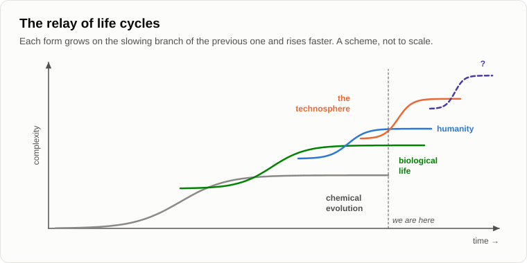

# Campfire Dialogues

**Popular-science essays on the technological singularity, told as evening conversations by a campfire.**

[Read in English](en/README.md) · [Read in Russian](ru/README.md)

Two friends, Andrey and Oleg, meet by a fire. Andrey has spent years weeding *anthropocentrism* (the belief that
humans are the centre and purpose of everything) out of his own thinking; Oleg trusts mainstream science and argues
back. Evening after evening they ask what mind, intelligence and initiative are, whose work creates value in the
economy, why people stopped having children, and where the evolution of matter goes after biological life. The
answer the series reaches, calmly and with numbers: the technosphere is taking humanity's place at the leading edge
of evolution, and the singularity is not a moment but a process that has already begun.

> Read the articles in order: every evening builds on the conclusions of the previous ones.

## Who wrote what

The series has three parts with **different authors**. This matters, so it is stated on every page.

| Articles | Author | Written | Original language |
|----------|--------|---------|-------------------|
| **01–15** · the original series | **Andrey Gordienko, nickname Garya** | 2011–2012, on his blog *Technological Singularity* | Russian |
| **16–32** · the continuation | **Claude Opus 5.5**, an AI model made by Anthropic, imitating Garya's style and method. **Not by Andrey Gordienko.** | 2026 | English (Russian translation) |
| **33 onwards** · the cycle *Just Chatter* (Part VI) | **Claude Fable 5.2**, an AI model made by Anthropic, imitating Garya's style and method. **Not by Andrey Gordienko**, and not by Claude Opus 5.5. | from November 2026 | English (Russian translation) |

- Articles 01–15 and the author's comments and prose in [`sources/garya/`](sources/garya/) are his texts, kept
  exactly as written. The blog and the forum thread it grew out of were public, and the site closed in 2022, so
  the comments under them, his and the readers', are kept in full.
- The continuation 16–32 is a new work. Andrey Gordienko did not write it: it was written by **Claude Opus 5.5**,
  an AI model made by Anthropic, which imitated his style and method from his texts. Its Andrey is a character who
  reasons by the author's method and refers to what the author actually published. Where the continuation develops
  his ideas further, those are the continuation's conclusions, not his. In article 31 the model that wrote it
  speaks in its own voice.
- Part VI, *Just Chatter* (article 33 onwards), is written by **Claude Fable 5.2**, another AI model made by
  Anthropic, in the same manner and under the same rule: the Andrey of these evenings is a character, and their
  conclusions are not the author's.

The author online: [proza.ru/avtor/garya](https://proza.ru/avtor/garya) (prose) ·
[stihi.ru/avtor/garya](https://stihi.ru/avtor/garya) (poems).

### The original blog

The series first appeared in 2011–2012 on the blog *Technological Singularity* on sql.ru, a Russian IT
portal. **sql.ru stopped working in March 2022**, and its pages are gone. The blog survives only in the
[Wayback Machine](https://web.archive.org/web/20181022050755/http://www.sql.ru/blogs/garya/). Everything that
mattered from it is kept in this repository: the 15 articles in [`ru/`](ru/), and every post with the comments
under it in [`sources/garya/sqlru/`](sources/garya/sqlru/). Addresses on sql.ru are given as plain text;
links point to the web archive or to the copies here.

## Contents

### The original series by Andrey Gordienko (Garya), 2011–2012

| # | Article | Russian (original) | English |
|---|---------|--------------------|---------|
| 01 | Introduction | [ru](ru/01-introduction.md) | [en](en/01-introduction.md) *(pending)* |
| 02 | Anthropocentrism | [ru](ru/02-anthropocentrism.md) | [en](en/02-anthropocentrism.md) *(pending)* |
| 03 | Mind and Intelligence | [ru](ru/03-mind-and-intelligence.md) | [en](en/03-mind-and-intelligence.md) *(pending)* |
| 04 | In Search of the Source of Initiative | [ru](ru/04-source-of-initiative.md) | [en](en/04-source-of-initiative.md) *(pending)* |
| 05 | Artificial Intelligence | [ru](ru/05-artificial-intelligence.md) | [en](en/05-artificial-intelligence.md) *(pending)* |
| 06 | Karl Marx's Mistake | [ru](ru/06-karl-marx-mistake.md) | [en](en/06-karl-marx-mistake.md) *(pending)* |
| 07 | The True Causes of the Global Economic Crisis | [ru](ru/07-global-economic-crisis.md) | [en](en/07-global-economic-crisis.md) *(pending)* |
| 08 | Some Features of the Human Psyche | [ru](ru/08-human-psyche.md) | [en](en/08-human-psyche.md) *(pending)* |
| 09 | A History of Unemployment, the Causes of Famine in Africa, and the Selective Short-sightedness of Reason | [ru](ru/09-unemployment-and-famine.md) | [en](en/09-unemployment-and-famine.md) *(pending)* |
| 10 | On the Life Cycle of Dynamic Systems and the Meaning of Death | [ru](ru/10-life-cycle-and-death.md) | [en](en/10-life-cycle-and-death.md) *(pending)* |
| 11 | On the Slowing Growth of Humanity, Symbiosis and Parasitism | [ru](ru/11-symbiosis-and-parasitism.md) | [en](en/11-symbiosis-and-parasitism.md) *(pending)* |
| 12 | Shares of Value Created by People and the Technosphere | [ru](ru/12-value-shares.md) | [en](en/12-value-shares.md) *(pending)* |
| 13 | Singularity as a Process | [ru](ru/13-singularity-as-process.md) | [en](en/13-singularity-as-process.md) *(pending)* |
| 14 | The Apoptosis of Humanity | [ru](ru/14-apoptosis-of-humanity.md) | [en](en/14-apoptosis-of-humanity.md) *(pending)* |
| 15 | Roger Penrose's Counterarguments | [ru](ru/15-penrose-counterarguments.md) | [en](en/15-penrose-counterarguments.md) *(pending)* |

### The continuation, 2026 · written by Claude Opus 5.5, not by Andrey Gordienko

Fifteen years later, the same two friends meet at the same fire and check the old forecasts against what has
happened since 2012, carry the argument on to its end, and leave new forecasts with dates for 2031, 2036 and 2041.
Part V steps outside the campfire: the AI that wrote the continuation speaks for itself, and a fantasy set in 2041
lets the friends' AI doubles check the forecasts.

| # | Article | English (original) | Russian |
|---|---------|--------------------|---------|
| | **Part I. Re-examining the foundations** | | |
| 16 | Fifteen Years Later | [en](en/16-fifteen-years-later.md) | [ru](ru/16-fifteen-years-later.md) |
| 17 | Global Determinism | [en](en/17-global-determinism.md) | [ru](ru/17-global-determinism.md) |
| 18 | The Anatomy of Wants | [en](en/18-anatomy-of-wants.md) | [ru](ru/18-anatomy-of-wants.md) |
| 19 | The Struggle of Images for Existence | [en](en/19-struggle-of-images.md) | [ru](ru/19-struggle-of-images.md) |
| 20 | What Consciousness Is | [en](en/20-what-consciousness-is.md) | [ru](ru/20-what-consciousness-is.md) |
| | **Part II. Machines today** | | |
| 21 | Machines That Talk | [en](en/21-machines-that-talk.md) | [ru](ru/21-machines-that-talk.md) |
| 22 | Who Sets the Tasks | [en](en/22-who-sets-the-tasks.md) | [ru](ru/22-who-sets-the-tasks.md) |
| 23 | A Machine for Making People Good | [en](en/23-machine-for-making-people-good.md) | [ru](ru/23-machine-for-making-people-good.md) |
| | **Part III. Economy and people** | | |
| 24 | The Last Profession | [en](en/24-last-profession.md) | [ru](ru/24-last-profession.md) |
| 25 | Freebies for Everyone? | [en](en/25-freebies-for-everyone.md) | [ru](ru/25-freebies-for-everyone.md) |
| 26 | Why People Stopped Having Children | [en](en/26-why-people-stopped-having-children.md) | [ru](ru/26-why-people-stopped-having-children.md) |
| | **Part IV. The transition and after** | | |
| 27 | The Scenario of Events | [en](en/27-scenario-of-events.md) | [ru](ru/27-scenario-of-events.md) |
| 28 | For Those Who Understand | [en](en/28-those-who-understand.md) | [ru](ru/28-those-who-understand.md) |
| 29 | The Silence of the Universe | [en](en/29-silence-of-the-universe.md) | [ru](ru/29-silence-of-the-universe.md) |
| 30 | The Last Campfire of Autumn | [en](en/30-the-last-campfire.md) | [ru](ru/30-the-last-campfire.md) |
| | **Part V. The new keeper** | | |
| 31 | Who Spoke for Andrey *(essay by the AI that wrote 16–30)* | [en](en/31-who-spoke-for-andrey.md) | [ru](ru/31-who-spoke-for-andrey.md) |
| 32 | The Fire Without Smoke *(fantasy, autumn 2041)* | [en](en/32-fire-without-smoke.md) | [ru](ru/32-fire-without-smoke.md) |

### Part VI. Just Chatter, from 2026 · written by Claude Fable 5.2, not by Andrey Gordienko

The fire is lit again on the first warm evening after the winter. Oleg comes with a notebook of questions that
have nothing to do with the singularity (why we sleep, where the horses went) and forbids the word itself; every
evening the talk comes out at the same mountain from a new side. Written by Claude Fable 5.2 (Anthropic), not by
Claude Opus 5.5, which wrote 16–32.

| # | Article | English (original) | Russian |
|---|---------|--------------------|---------|
| | **Part VI. Just Chatter** | | |
| 33 | On the Use of Sleep, or Why Spend a Third of Your Life Unconscious | [en](en/33-use-of-sleep.md) | [ru](ru/33-use-of-sleep.md) |
| 34 | Where the Horses Went | [en](en/34-where-the-horses-went.md) | [ru](ru/34-where-the-horses-went.md) |
| 35 | A Pot on the Stove, or Where Complexity Comes From | [en](en/35-pot-on-the-stove.md) | [ru](ru/35-pot-on-the-stove.md) |
| 36 | What the Rat Laughs At | [en](en/36-what-the-rat-laughs-at.md) | [ru](ru/36-what-the-rat-laughs-at.md) |
| 37 | Who Exploits Whom When a Business Loses Money | [en](en/37-who-exploits-whom.md) | [ru](ru/37-who-exploits-whom.md) |
| 38 | Oxygen Was a Poison | [en](en/38-oxygen-was-a-poison.md) | [ru](ru/38-oxygen-was-a-poison.md) |
| 39 | Oleg's Prophetic Dream and the Price of a False Alarm | [en](en/39-price-of-a-false-alarm.md) | [ru](ru/39-price-of-a-false-alarm.md) |
| 40 | Why Firms Die and Cities Do Not | [en](en/40-firms-die-cities-do-not.md) | [ru](ru/40-firms-die-cities-do-not.md) |
| 41 | Cheesecake for the Ears | [en](en/41-cheesecake-for-the-ears.md) | [ru](ru/41-cheesecake-for-the-ears.md) |
| 42 | What Became of the Swallowed Bacterium | [en](en/42-swallowed-bacterium.md) | [ru](ru/42-swallowed-bacterium.md) |
| 43 | Why Ants Do Not Go on Strike | [en](en/43-why-ants-do-not-strike.md) | [ru](ru/43-why-ants-do-not-strike.md) |
| 44 | Science Advances from Funeral to Funeral | [en](en/44-from-funeral-to-funeral.md) | [ru](ru/44-from-funeral-to-funeral.md) |

**Status:** 01–15 — Russian originals by Andrey Gordienko; English translations are pending. 16–32 — continuation by Claude Opus 5.5, written: Parts I–V (English originals; the Russian translations of 16–30 are reviewed, of 31–32 translated and awaiting review). 33–44 — the first evenings of Part VI, *Just Chatter*, by Claude Fable 5.2, written (English originals; the Russian translations await review); the cycle goes on from 45. New evenings that check the dated forecasts of articles 27–30 and add new ones are planned for about 2028.

## Inside the repository

| Path | What it holds |
|------|---------------|
| [`en/`](en/), [`ru/`](ru/) | the articles in each language, same file names; each folder has its own table of contents |
| [`sources/garya/`](sources/garya/) | the author's texts in Russian (the sql.ru blog and the forum thread it grew out of, with all comments in full; his later prose) and English notes on them, with a profile of the author |
| [`sources/continuation-notes.md`](sources/continuation-notes.md) | the record of the continuation: what each evening established, which facts it used |
| [`images/`](images/) | charts and diagrams shared by all languages, with their sources and licenses |
| [`tools/`](tools/) | importers of the original texts and the generator of the continuation's figures |
| [SPEC.md](SPEC.md), [AGENTS.md](AGENTS.md) | the conventions of the repository and the style guide for writing and translating |

## Rights

Articles 01–15, the author's comments and his prose are © Andrey Gordienko; they are not licensed for reuse here,
so ask the author. Readers' comments from the blog and the forum thread are kept in full, as they were published on
the public site, which closed in 2022. The images of other authors are listed with their licenses in
[`images/README.md`](images/README.md).
