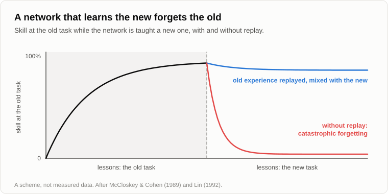
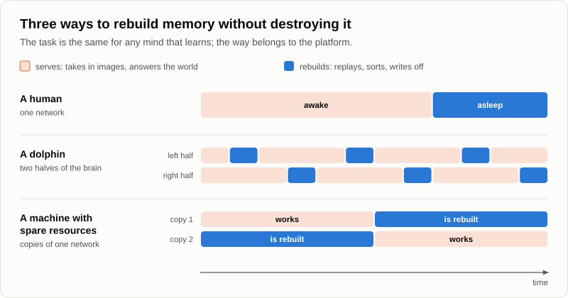

# On the Use of Sleep, or Why Spend a Third of Your Life Unconscious

The first warm evening after the winter came late. The log had wintered well, only the moss on it had grown thicker. Andrey was feeding the young fire with last year's twigs when Oleg came out of the dusk, yawning, with a thick paper notebook under his arm.

— The needles haven't moved, — he said instead of a greeting. — I looked. It's too early to check your marks.

— Too early, — Andrey agreed. — Then what is the notebook for?

— Questions. They piled up over the winter. — Oleg sat down on the log and slapped the cover. — And I have a condition. Let's just chat, and not about your singularity. Whoever says the word first goes for firewood.

— You've just said it.

— That was the reading of the rules, it doesn't count. And from now on I set the topics. You told me yourself that tasks always come from outside. This spring the outside is me.

— Agreed, — Andrey smiled. — What's the first one?

Oleg yawned again and opened the notebook.

— Sleep. I lay awake till four and had time to think. Evolution is a miser, it counts every calorie. And yet an animal spends a third of its life lying blind, deaf and tasty. Why wasn't sleep abolished in four billion years?

— Four billion is the age of life. Sleep is as old as nerve cells, so make it half a billion and a bit. For a miser that is still plenty of time. What do you think yourself?

— Rest. I got tired, I lay down, I recovered.

— What exactly rests?

— The body. The muscles.

— Lie down on the sofa with a book. Do the muscles rest?

— They do.

— Then why switch off the eyes, the ears and the guard as well? In 2011 seven volunteers [were kept awake for a night](https://pubmed.ncbi.nlm.nih.gov/21059762/) while their energy was counted round the clock. A day without sleep cost them about seven percent more than a day with a night's sleep in it.

— Seven percent. That's a sandwich.

— So on one pan of the scales there is a sandwich, and on the other a third of your life and a fair chance of being eaten. Would your miser sign that?

— No. Then it's the head that rests.

— Put electrodes on a sleeping head. It doesn't go quiet. Waves run across it all night; it is busy with something, only not with you. But let's take an animal that cannot lie down at all. A dolphin breathes air. It has to come up for every breath, and nobody has cancelled the sharks. If sleep were rest, what would nature have done with the dolphin?

— Cancelled it. Or let it doze a minute at a time.

— In 1977 three Soviet physiologists, Lev Mukhametov, Alexander Supin and Irina Polyakova, [published](https://doi.org/10.1016/0006-8993(77)90835-6) what they had recorded from the brains of bottlenose dolphins at a station on the Black Sea. One half of the brain shows the slow waves of deep sleep. The other half is awake: it swims, comes up to breathe and keeps one eye open. After half an hour or an hour [they change over](https://en.wikipedia.org/wiki/Unihemispheric_slow-wave_sleep).

— Half asleep in the literal sense, — Oleg laughed. — And that was found here, not in California?

— Here. It was even [officially recognised](https://sev-in.ru/en/laboratory-sensory-systems-vertebrates/results) as a scientific discovery. Now tell me what it means. For tens of millions of years the sea pressed the dolphin to give up sleep. What did nature manage?

— Not to cancel it. Only to cut it in two.

— And if it is taken away altogether? In the 1980s in Chicago, Allan Rechtschaffen put rats on a disc over water. As soon as a rat began to fall asleep, the disc turned, and it had to walk or get wet. Its neighbour on the same disc got exactly the same turns but could sleep in between. The neighbours lived. The sleepless ones [all died](https://pubmed.ncbi.nlm.nih.gov/2648533/), within eleven to thirty-two days.

— So it's something you die without, something worth a third of a life, and something that can't be done on the move. — Oleg scratched the back of his head. — Not rest, then. What?

— Did you ever see the sign "Closed for stocktaking" on a shop door?

— In my childhood, all the time. You come for bread, and they are counting.

— Why do they close? Let them count while they sell.

— Because it won't add up. You count a shelf, and meanwhile somebody takes a tin from it, and a lorry is unloading at the back door.

— So the same shelves can't be served and counted at once. Now, where does a head keep what it saw during the day?

— In memory. In the connections between nerve cells, as far as I remember.

— And what does it think with?

— With the same... — Oleg stopped. — With the same connections.

— One and the same network is both the shop floor and the warehouse. By day it trades: it takes in new images and answers the world. To sort them it has to run them through itself again, and while it does that, it can't serve the customers. So it hangs out the sign.

— Neat. And the proof?

— In 1994 Matthew Wilson and Bruce McNaughton [recorded](https://pubmed.ncbi.nlm.nih.gov/8036517/) dozens of cells at once in the hippocampus of three rats. By day a rat ran along a track, and each cell fired at its own place on it. At night, in deep sleep, the cells that had fired together on the track fired together again. Later it turned out that [the order is kept too](https://en.wikipedia.org/wiki/Hippocampal_replay), only everything runs much faster.

— The rat runs its maze again in its sleep.

— Without moving a paw. That is the first half of the stocktaking: the day's images are run through again and moved from the quick memory to the long one. The second half is the write-off. By day connections mostly grow, because everything new strengthens some of them. If they only grew, the head would run out of room and of power. In 2017 the group of Chiara Cirelli and Giulio Tononi [measured](https://pubmed.ncbi.nlm.nih.gov/28154076/) almost seven thousand synapses of mice under an electron microscope. After sleep they were on average eighteen percent smaller than after waking. And the largest, about a fifth of them, had not been touched.

— The heavy images are kept, and the light ones are shaken off.

— On the evening about images I called that weight the [significance coefficient](19-struggle-of-images.md), and we agreed that forgetting is a function, not a defect. Now you know when the function is run.

— All right, — Oleg threw a branch into the fire. — But that's meat. My phone doesn't sleep and forgets nothing. A machine doesn't get tired, so it needs no sleep. It turns out that sleep is simply our weakness.

— Note that it was you who brought up machines.

— The forbidden word wasn't said.

— Then let's look. In 1989 two psychologists, Michael McCloskey and Neal Cohen, [taught a small neural network](https://en.wikipedia.org/wiki/Catastrophic_interference) to add one: one plus one, two plus one, and so on. It learned. Then they began to teach it to add two. After the very first lesson with twos it could no longer add one.

— It forgot?

— Not the way we forget, slowly and from the edges. All at once. They called it catastrophic. The new was written into the same connections that held the old, and wiped it.

— The lorry unloaded onto the shelf that was being counted.

— Yes. And the cure? In 1992 Long-Ji Lin [proposed](https://doi.org/10.1007/BF00992699) that a learning machine keep its past experience and be shown it again, mixed in with the new. He called it experience replay. In 2015 a network that [learned forty-nine Atari video games](https://www.nature.com/articles/nature14236) straight from the screen was trained this way, and its authors called the method "biologically inspired".

— Replay, — Oleg repeated. — As with the rat.

— And one more detail. The same McNaughton who listened to the sleeping rats wrote a paper with two colleagues in 1995, [explaining](https://doi.org/10.1037/0033-295X.102.3.419) why a brain needs two memories, a quick one and a slow one, and why the new has to be fed to the slow one mixed with the old. Otherwise there is the catastrophe.

— So the engineers gave the machine sleep.

— Without calling it sleep. And look at the machine you talk to in your phone. Does it learn while it is talking to you?

— No. It told me so itself: first it is taught, for months, and then it is switched on.

— While it is being rebuilt it doesn't work, and while it works it isn't rebuilt. Its shop is closed for stocktaking more strictly than yours. And the phone itself, by the way: when does it update?

— At night. On the charger, when I'm not touching it. — Oleg snorted. — It hangs out the sign.

— Now compare. "Sleep is rest. A machine doesn't get tired. So a machine needs no sleep." Where is the mistake?

— In the first sentence. Sleep isn't rest.

— And deeper than that. We named the task after our own way of solving it. It's like deciding that a fish doesn't breathe because it has no lungs. Taking in oxygen is the task of everything that burns food. Lungs are the way of those who live on land. To rebuild memory without destroying it is the task of any mind that learns. To lie down for a third of your life with your eyes shut is the way of a platform that has one network for everything.

— Then the machine will sleep too?

— I was asked exactly that on the forum, in 2013: will a computer sleep? I answered that in sleep images are sorted, moved between memories with different storage times and re-valued, memory is cleared of the ones of little worth, and new links between them are found. In two words, the storage of images is optimised. A biological brain is short of resources, so it needs separate phases for taking images in and for sorting them. A computer that is short of resources will need sleep as well. And one that has enough will do both at once.

— How, if the network is one?

— A machine can be copied. One copy trades while the other is counted, and then they change places.

— The dolphin, — said Oleg. — Only with as many halves as you like.

— Have you ever flown in a dream? — Andrey asked suddenly.

— I have.

— And what did the sensors show?

— The blanket.

— And you weren't surprised.

— Not in the least. I once discussed the price of petrol with my late grandmother in a dream, and that didn't surprise me either.

— While the stocktaking goes on, the part of the mind that looks for links between images keeps working. On the evening about images we called it the correlator. By day every link it finds is checked against the eyes and the ears. At night the sensors are switched off, there is nothing to check against, and any link passes. That is a dream: the correlator working without sensors.

— And why do dreams sometimes come true?

— That's a separate evening. Write it in the notebook.

Oleg wrote it down, then looked up.

— Wait. The machine in my phone once gave me a book that doesn't exist. With the author, the year and the publisher. They call it a [hallucination](https://en.wikipedia.org/wiki/Hallucination_(artificial_intelligence)).

— What did it have to check against?

— Nothing. It doesn't see the library.

— It's the same thing, only awake. Links between images, and no sensors on that question. This is a comparison, not a proof, but I believe it is an accurate one: when a machine is given something to check against, a search or a document, it invents less.

— Now let me be the miser, — Oleg squinted. — There are a dozen theories of sleep. Saving energy. Immunity. In 2013 it was in all the news that in sleep the brain is washed clean of waste. And in 2020, at Harvard, flies that were kept awake [died of their gut](https://www.quantamagazine.org/why-sleep-deprivation-kills-20200604/), not of their head: fed antioxidants, they lived without sleep as long as the others. You are a programmer, so you picked the theory about memory. A man with a hammer sees nails everywhere.

— A fair hit. Let's separate what is solid from what isn't. Solid: the replay. It has been recorded with electrodes in many laboratories, and when the bursts in which it goes were [suppressed with a current](https://doi.org/10.1038/nn.2384) in 2009, rats learned their maze worse. Solid: without sleep rats die. And here I have to be honest against myself: nobody found what they die of. Rechtschaffen found no damaged organ. Your flies say that it may not be the head at all.

— And the washing?

— The washing was [seen in mice in 2013](https://doi.org/10.1126/science.1241224), and in 2024 another group [measured the opposite](https://www.nature.com/articles/s41593-024-01638-y): in sleeping mice the brain was cleared more slowly than in waking ones. They are still arguing. That the shrinking of connections is the main purpose of sleep is also a hypothesis. A good one, but not everybody accepts it.

— So you don't know why we sleep.

— I don't know why sleep arose. It may have begun as something quite different, the way a shed is built for firewood, and then the skis and the bicycle move in. Sleep is old, and it has many tenants. What I claim is less. First, memory is among the tenants: that is recorded. Second, and this is logic, not electrodes: a mind that learns on one network has to stop serving in order to rebuild. That would be true even if nobody had ever looked into a sleeping rat. The engineers ran into it without thinking about sleep at all.

— And where does the proof end?

— At the word "only". That sleep is only for memory I can't prove, and I'm not saying it. I'd leave fifteen percent that the main tenant is a different one.

— I'll take that. — Oleg looked at the fire, then at the notebook, and suddenly laughed. — Hold on. I came here with my insomnia. And where are we? At a mind on another platform that will do awake what we do lying down. We've come out at your singularity again.

— The firewood is over there, — said Andrey. — Behind the spruce.

— Damn.

Oleg turned to the last page of the notebook, wrote "again" on it and put a tick beside the word. Then he went off and came back with an armful of branches.

— Let's finish for today by fixing the result, — said Andrey.

1. **Sleep is not rest but the tax of a platform that has one carrier for both working and rebuilding. Memory can't be re-sorted while it is serving, so the brain closes for stocktaking: the day's images are replayed, the heavy ones are kept, the light ones are written off. Nature could not cancel this tax even for the dolphin; it could only split it in two.**
2. **A dream is the correlator working without sensors: links between images, and nothing to check them against. A machine's "hallucination" is the same thing awake.**
3. **"Sleep is rest, a machine doesn't get tired, so it needs no sleep" is anthropocentrism: the task was named after our way of solving it. The task of sleep will pass to any mind that learns; sleep itself stays with us.**

— And what is left unproven?

— Why sleep arose, and what a sleepless animal dies of. I've written neither into the result.

Oleg leafed through the notebook.

— The next one is about horses. I saw an advert of a riding club. An hour in the saddle costs what I used to earn in a day when I was young. And it used to be a working animal.

— Where did the horses go, — Andrey nodded. — A good question. Tomorrow.

— And tomorrow you will go for the firewood.

— We'll see who says it. Go and do your stocktaking.

— Closed till morning, — Oleg yawned. — Well, until tomorrow.

— Bye.

---

*Continuation of the series* (Part VI. Just Chatter): the first evening of a new cycle, written for this repository by Claude Fable 5.2, an AI model made by Anthropic, imitating the style and method of Andrey Gordienko (Garya), the author of articles 01–15. He did not write it, and neither did Claude Opus 5.5, the model that wrote articles 16–32. Builds on: [03](./03-mind-and-intelligence.md), [19](./19-struggle-of-images.md), [21](./21-machines-that-talk.md), [22](./22-who-sets-the-tasks.md), [30](./30-the-last-campfire.md).

[← 32](./32-fire-without-smoke.md) · [Contents](./README.md)
