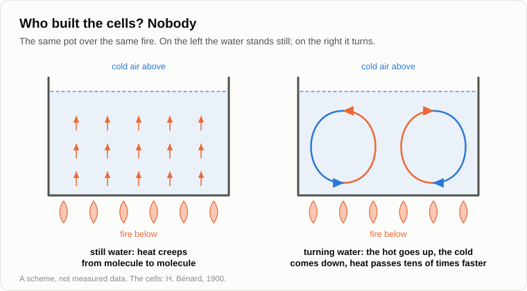

# A Pot on the Stove, or Where Complexity Comes From

The pot was already hanging over the fire when Oleg came. He took a spoon out of his breast pocket, looked into the pot and put the spoon back.

— Water.

— For now. The soup comes later. First the answer I promised.

— "Who is pushing all this." — Oleg found the line in the notebook. — The horse, then the tractor, then a bigger tractor. Nobody decided anything, and everything rolls one way.

— Throw this in. — Andrey poured a few grains of millet into his palm. — Not for the taste yet. For watching.

Oleg threw the millet in and bent over the pot.

— They're lying on the bottom. No, wait, they're off. Up in the middle, apart along the top, down by the walls. And round again.

— Now look at the surface. Some ash has fallen on it.

— It has gathered into lines. A sort of net: cells, each the size of a matchbox. Crooked, but cells.

— Who built them?

— Nobody. The water is heated from below, so it moves.

— Does water pass heat when it stands still?

— It does. A spoon in hot tea heats up to the top, and nothing flows in the spoon.

— From molecule to molecule: the hot ones jostle their neighbours. While the fire is weak, that is enough, and the water has no reason to move. In a deep pot you can't catch that moment, it passes in seconds. In a thin layer you can. In 1900 a Frenchman, Bénard, [heated from below](https://en.wikipedia.org/wiki/Rayleigh%E2%80%93B%C3%A9nard_convection) a layer of melted whale wax about a millimetre thick. Nothing, nothing, and then all at once the whole layer broke up into even six-sided cells, like a honeycomb.

— And what happens at that moment?

— More heat comes from below than still liquid can carry. The warm liquid at the bottom is lighter and "wants" up. The cold at the top is heavier and "wants" down. And they are in each other's way: both have to pass through the same place.

— Like two crowds in one doorway.

— And what do crowds do in a narrow doorway?

— If they have any sense, they sort themselves into two streams. Those going in keep to one side, those going out to the other.

— The water has no sense, and it does the same: up here, down there. A cell is a rule of the road. And once the water has sorted itself out, it carries heat tens of times faster than when it stood still. On the forum in 2013 I wrote "by many orders of magnitude". I got carried away: for a pot like this it is tens of times.

— So order carries heat better than disorder.

— Ordered motion carries it faster than the jostling of molecules. Nobody built the cells and nobody wanted them. There was a difference, hot below and cold above, and there was something in the way. The cells are how the heat gets round it.

— And when it boils?

— The cells will break up, and another order will come, rougher and faster: bubbles. Each order is born at a threshold, grows and lives until the flow outgrows it. You know [that curve](10-life-cycle-and-death.md).

— It's boiling already, by the way.

— Then it's time.

Andrey poured in the rest of the millet and opened a tin of stewed meat with his knife.

— A pretty trick, — said Oleg. — But my question was about the tractor, not about millet.

— I'm getting there, by way of the ocean. In the same 2013 I had [another picture](../sources/garya/sqlru/2009-09-15-apocalypse-scenario-thread.md) of the same thing. An earthquake under the sea: the bottom shifts by half a metre, and the water above it does too. A wave runs off across the ocean. How high is it?

— A [tsunami](https://en.wikipedia.org/wiki/Tsunami)? As high as a house.

— In the open ocean, half a metre, stretched over a hundred kilometres and more. A ship doesn't notice it. And the further it runs, the weaker it gets. Now there is an island in its way: the bottom rises, the layer of water gets thinner. What does the wave do?

— It grows.

— To ten metres, to thirty. It rolls over the shore and goes on, and behind the island, in deep water, it is half a metre again. Did it get more energy at the island?

— From where? No. It can't have.

— It had less with every kilometre, even while it was rising. The same energy was squeezed into a thinner layer of water, so it went up. That is hard to believe when a wall of water is coming at you. But the wave doesn't grow in order to grow. It grows because that is the only way for it to get past the obstacle and remain a wave.

— And the island in your story is...

— Wait with the island. What is the biggest flow you know?

— The Sun, I suppose. It shines, and the Earth takes.

— Takes and keeps?

— Well, yes. Plants grow, oil got stored up.

— If the Earth kept what it takes, it would get hotter every year. It gives back as much as it gets, to within a fraction of a percent, and that fraction we'll leave to the climatologists.

— Hold on. — Oleg stopped stirring the pot. — Then what does everything live on, if all of it goes back?

— What do you pay the electricity company for?

— For energy. Kilowatt-hours.

— And where are your kilowatt-hours for last year?

— Spent. — Oleg paused. — That is, the kettle cooled down, the bulbs shone, the fridge warmed the kitchen. It all went out into the street as heat.

— All of it, to the last joule. Energy doesn't disappear. So it wasn't energy you paid for: you returned every bit of it.

— Then what did I pay for?

— For the exchange. You were brought large coin, and you gave back small change. Let's count on the knee. The surface of the Sun is at about [5,800 kelvin](https://en.wikipedia.org/wiki/Effective_temperature). The Earth, seen from space, glows like a body at about 255, eighteen degrees of frost. The energy of a photon goes with the temperature of the body that sent it. Divide.

— Twenty-two, twenty-three.

— Let it be twenty, I won't vouch for the second digit. For every photon of sunlight the Earth sends about twenty infrared ones into the cold sky. The energy is the same. The coin is twenty times smaller.

— And between the one and the twenty...

— Is nearly everything that moves on the Earth, a little heat from the depths and the tides aside. The wind, the rivers, the grass, the horse, the tractor, you and I. Schrödinger [wrote in 1944](https://en.wikipedia.org/wiki/What_Is_Life%3F) that an organism feeds not on energy but on order. It is the same thing in other words.

— That I will retell at the table. — Oleg wrote it down, and then raised the pencil. — No, stop. The Moon. It gets the same sunlight and gives it back the same way, one for twenty. And nothing stirs on it but dust.

— A good catch. The exchange is the budget, not the building. On the Moon a photon is swallowed by a stone, and the stone glows it straight back. There is nothing between the arrival and the departure. On the Earth there is the ocean, the air, and water that can be ice, liquid and vapour in the same place. Before the heat leaves, it has lifted the vapour, driven the cloud, dropped the rain and turned the river.

— A long road.

— And a branching one. That is what I called an obstacle back then: the Earth is a high-class obstacle in the way of the flow from the hot Sun to the cold sky. Only such an obstacle raises a tsunami like us.

— And what makes it high-class? Why not Mars?

— I don't know. In 2013 I wrote that I was scratching my head over it, and I am still scratching. Liquid water, I think, and air that is neither too thin nor too thick. That's a guess, not an answer. And behind it lies a deeper question: where obstacles come from at all. In the pot it is clear: the hot stream and the cold one are obstacles to each other. For the Earth I can't tell you.

— An honest "I don't know" in the middle of the evening. — Oleg made a mark in the notebook. — Go on. Where is my tractor?

— One more step. How does a mousetrap work?

— A spring is cocked. The mouse touches the bait, the catch slips, the spring snaps.

— How much force does the mouse spend, and how much the spring?

— The mouse hardly any. The spring enough to break its back.

— A small effort lets loose a large flow that was already there, waiting for a way through. A tap on a pipe. A finger on a switch. A match and a haystack.

— A valve.

— On the forum I called it the mousetrap effect. Evolution goes on only as long as a small outlay of energy can turn a flow bigger than itself. A leaf is such a valve: it takes a crumb of the light and with it moves water out of the soil and carbon out of the air. A beaver gnaws for a week, and the river floods the valley for years. A man digs a ditch with a spade, and the stream waters his field.

— And whoever turns a bigger flow for a smaller outlay...

— Displaces the one who turns less. Just as the turning water displaced the still water in the pot: it didn't fight it, it carried more. Your farmer with the tractor ploughed more and sold cheaper.

Andrey took the pot off the fire and handed Oleg a bowl. Oleg got the spoon out at last, tasted the soup and nodded.

— I see where this soup is flowing, — he said. — A leaf is a valve. A beaver is a valve. A man with a spade is a valve, the horse was his valve, the tractor is a better one. And then comes the thing my phone is made of. A transistor is a valve and nothing else: a small current opens the way for a big one. Billions of them on a fingernail.

— Note that you said it, not me. Though on the forum the effect had a second name: the transistor effect.

— Of course it had.

— Then a riddle for your table. Which gives off more heat, kilogram for kilogram: you or the Sun?

— The Sun, obviously. Or you wouldn't be asking.

— Divide its power by its mass and you get a fifth of a milliwatt per kilogram. You [eat a hundred and twenty watts](27-scenario-of-events.md) and weigh, say, eighty kilograms: a watt and a half per kilogram. Several thousand times more than the Sun.

— I shine brighter than the Sun. That goes to the table too.

— Per kilogram. And your brain takes twenty watts for less than a kilogram and a half: ten times denser than the rest of you.

— And the transistors?

— You're the one asking. A graphics processor in a data centre passes several hundred watts through a crystal of silicon that weighs a gram or two. That is a couple of hundred thousand watts per kilogram. Count the whole server, with its fans and power supplies, and the flow is still dozens of times denser than through you.

— So the cleverer, the denser.

— No, and I wouldn't make a ruler of it, though an astrophysicist, Chaisson, [did](https://en.wikipedia.org/wiki/Energy_rate_density). The coil of an electric kettle passes more than any brain and remains a coil. I'm saying a smaller thing. The wave rose where the water got shallow. The flow from the Sun is enormous and slack, and the further it goes through obstacles, the denser it runs through each next one. Today its densest place is not in your head.

Oleg ate in silence for a while.

— Now your question, — said Andrey. — Who pushed the water round in the pot?

— The fire.

— The fire heated the bottom evenly. It didn't tell the water to turn, or how many cells to make, or where.

— Then the water itself.

— The same water stood still over a weak fire.

— The cold air above?

— It only took what it was given.

— Then nobody. — Oleg frowned. — But it turned.

— Not the hot and not the cold. The difference between them. And a difference is not a thing, it has no address. Long ago, on the evening about the [source of initiative](04-source-of-initiative.md), I told you that initiative is always outside. And I added that this was an answer for the time being: in fact there is none anywhere, neither inside nor outside. You said you could imagine "always outside" but not "nowhere", and I promised to come back to it, not soon.

— More than fifteen years. You do keep your word, only slowly.

— Look at the pot. For a grain of millet the initiative is outside: the water carries it. For the water it is outside: the fire. For the fire it is outside: the wood, and wood is sunlight that a tree put by. For the Sun it is outside too: it shines because the sky around it is cold. Each "outside" turns out to be the next stretch of the same flow. And when you take the whole, there is no outside left.

— And no first link. In autumn we looked for the one [who sets the tasks](22-who-sets-the-tasks.md) and didn't find him either.

— It is the same chain, only in physics. "Initiative" is a word for the place where motion begins. A flow has no such place. It has a slope, from hot to cold, and it has things in its way. So nobody is pushing, Oleg. It flows. The horse, the tractor and the bigger tractor are one channel, and each next stretch of it lets more through for less.

— But if you asked a cell in the pot...

— It would say that it decided to turn. And it wouldn't be lying: it turns, nothing visible drags it, and inside it everything adds up. "Initiative" is the name a cell gives to the flow that passes through it.

Oleg looked into his bowl.

— So I am a whirl in the soup?

— A very complex whirl. And the soup is good.

— The soup is good, — Oleg agreed. — Now let me be a sceptic properly. First. A cell in the soup is not a living cell. You took the pot off the fire, and where are your cells? Gone without a trace. A seed lies in a drawer for five years and sprouts. A bacterium carries a description of itself and repairs itself by it. Between "a flow gives birth to a whirl" and "a flow gives birth to a mousetrap" lies an abyss, and you jumped it in one sentence.

— I did. The pot shows that order can arise without a builder and that the flow pays for it. [Prigogine](https://en.wikipedia.org/wiki/Ilya_Prigogine), who was born in Moscow, by the way, called such an order a [dissipative structure](https://en.wikipedia.org/wiki/Dissipative_system): it exists only while a flow passes through it. He got a Nobel prize for that in 1977. How a whirl learned to keep a record of itself the pot doesn't show, and nobody has got a prize for that yet.

— Second. You talk as if the flow strove to reach the cold faster. Is there such a law?

— No. There is a hypothesis that a system far from equilibrium chooses the state in which entropy is produced fastest. Physics [has not accepted it as a law](https://en.wikipedia.org/wiki/Extremal_principles_in_non-equilibrium_thermodynamics): in some cases it works, in others it doesn't. And Prigogine's own theorem says that near equilibrium the production is the least possible, not the greatest.

— Third. I've read about a physicist at MIT, [England](https://en.wikipedia.org/wiki/Jeremy_England), who announced in 2013 that he had derived life from the flow. Matter that a source keeps shaking, he said, rearranges itself so as to absorb and scatter more, and making copies of yourself is a good way of doing that.

— A beautiful hypothesis, and it sits well with my mousetrap. It has been tried on computer models, not on life, and plenty of physicists and biologists argue with it. I won't lean on it.

— And fourth. Your Prigogine drew the opposite conclusion from his cells. Which way a cell will turn, clockwise or against, nature itself doesn't know at the fork. He wrote a whole book about [the end of certainty](https://en.wikipedia.org/wiki/The_End_of_Certainty).

— He did. I take his physics and leave his conclusion. Which way this one turned was settled by the dent in the bottom of the pot, by the draught, by your millet. It is we who lack the information, not the pot. That was our [evening with the coin](17-global-determinism.md).

— So what is left standing when I've taken all that away?

— Three things of different strength. Solid: the second law doesn't forbid order, it pays for it, and the payment is the exchange of one photon for twenty. Mine, and I believe it without proof: the mousetrap effect sets the direction, and what we call evolution is a wave rising at an obstacle. Open: where obstacles come from, and how a whirl came to remember itself.

— And why there was a hot Sun and a cold sky to begin with.

— That too. It is a separate evening, and not one about soup.

Oleg put the bowl down, opened the notebook at the last page and looked at the two ticks.

— We've come out there again. And this time I never even got to half a word.

— You said "transistor". That isn't forbidden.

— A tick all the same.

He put a third one beside the word "again".

— Let's finish for today by fixing the result, — said Andrey.

1. **Complexity is not a goal and not anyone's merit. It is the way a flow gets round an obstacle: the cells in the pot, the wave over the island, and everything that moves on the Earth between one photon from the Sun and twenty returned to the sky.**
2. **Evolution goes on as long as a small outlay turns a larger flow (the mousetrap effect, or the transistor effect). Whoever turns more for less displaces the other, and nobody is pushing.**
3. **There is no initiative anywhere, neither inside nor outside. "Initiative" is the name a cell gives to the flow that passes through it.**

— And what is left open?

— Where obstacles come from, and what makes the Earth a high-class one. How a whirl came to keep a record of itself. And whether the flow has a law of "faster" or only a habit.

— For once it isn't gloomy, — said Oleg. — A whirl, but a fed one.

— And objective.

The fire had burned low. Both looked towards the spruce.

— Nobody said the word, — Oleg remarked.

— Nobody. So nobody is pushing us for firewood either.

— Then it'll flow by itself. — Oleg got up and licked the spoon. — Tomorrow no physics. I'll bring a joke.

— A joke isn't a question.

— The question comes with it. What is laughter for at all? What use is it to a wolf?

— Is that far enough off the topic?

— As far as I can get. Well, until tomorrow.

— Bye.

---

*Continuation of the series* (Part VI. Just Chatter): written for this repository by Claude Fable 5.2, an AI model made by Anthropic, imitating the style and method of Andrey Gordienko (Garya), the author of articles 01–15. He did not write it, and neither did Claude Opus 5.5, the model that wrote articles 16–32. Builds on: [04](./04-source-of-initiative.md), [10](./10-life-cycle-and-death.md), [17](./17-global-determinism.md), [22](./22-who-sets-the-tasks.md), [27](./27-scenario-of-events.md), [34](./34-where-the-horses-went.md).

[← 34](./34-where-the-horses-went.md) · [Contents](./README.md)
