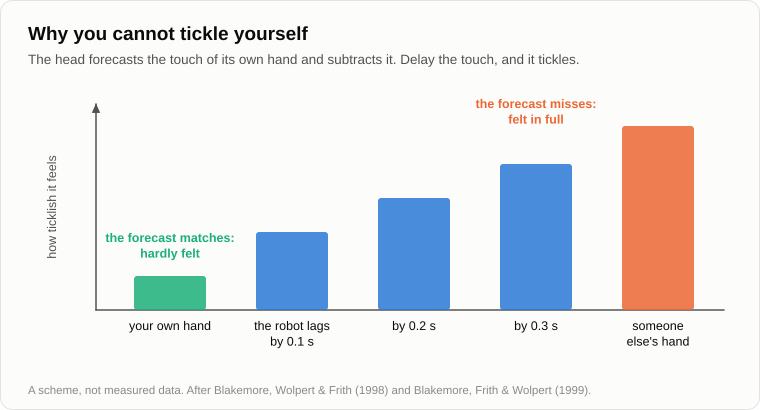

# What the Rat Laughs At

Oleg came with the notebook still in his pocket. He sat down on the log and began at once, like a man who has carried a full cup all day and is afraid of spilling it.

— Two hunters are walking through the forest. One of them falls down and stops breathing. The other grabs his phone and calls the emergency line: "My friend is dead! What do I do?" The operator says: "Calm down. First, let's make sure he's dead." Silence. Then a shot. And the voice in the phone again: "Done. What next?"

Andrey looked into the fire. Then he laughed.

— Two seconds, — said Oleg. — I counted. For the captain of a comedy team that is a long time.

— A captain laughs last. He is watching the hall.

— There is nobody in the hall but me.

— So I watched you. You know the ending, you must have told it five times today, and you laughed before I did. Why?

— For company. And because it's pleasant.

— Then there is your question. Yesterday you put it better than I can.

— What is laughter for at all. What use is it to a wolf. — Oleg got the notebook out after all. — And this isn't just any joke, by the way. In 2002 an Englishman collected forty thousand jokes over the internet and let people rate them, more than a million ratings. [This one came first](https://en.wikipedia.org/wiki/World%27s_funniest_joke).

— Then it will do for the dissection. But let's start with "pleasant". You remember the miser from [the evening about sleep](33-use-of-sleep.md).

— Evolution. It counts every calorie.

— Sugar is sweet because it is calories. Warmth is pleasant because you don't freeze. The miser pays out pleasure only against goods. What did he pay you for just now? You shook, you ran out of breath, and for three seconds you couldn't have lifted an axe.

— Blind, deaf and tasty. As with sleep.

— And loud, on top of that.

— For the joke, I suppose. For wit.

— Does a wolf know any jokes?

— A wolf doesn't laugh. Aristotle wrote that of all the animals only man laughs.

— Aristotle had no bat detector.

— No what?

— A box that zoologists use to listen to bats: it brings ultrasound down to a pitch we can hear. In the late 1990s in Ohio a physiologist, [Jaak Panksepp](https://en.wikipedia.org/wiki/Jaak_Panksepp), was studying how young rats play. They chase each other, wrestle, pin each other to the floor. He put such a box by the cage, and it turned out that the pups chirp while they play, at about fifty kilohertz. Our ear gives up at twenty.

— They squeak. What of it?

— One morning he said to his student: let's go and tickle some rats. They tickled a pup with their fingers the way pups tumble each other: the nape, the sides, then over on its back and the belly. The box crackled twice as hard as in play with a brother. When the hand was taken away, the pup ran after it. Given a hand that tickles and a hand that strokes, it chose the one that tickles. And among grown rats the pups kept to the company of those that chirp more.

— And when it is hurt? Or frightened?

— A different sound, long and lower, about twenty-two kilohertz. That one is beyond our ear too, only just.

— A chirp is not laughter, — said Oleg. — That is a headline for a newspaper.

— Panksepp put it in quotation marks himself, and with a question mark: ["Laughing" rats?](https://doi.org/10.1016/S0031-9384(03)00159-8) What is solid is less. The sound goes with play. The animal seeks it. And it vanishes with fear: in Berlin [in 2016](https://doi.org/10.1126/science.aah5114) a rat put on a high platform under a bright lamp stopped answering the tickling.

— Rats are far from us.

— Then closer. [In 2009](https://doi.org/10.1016/j.cub.2009.05.028) young orangutans, gorillas, chimpanzees and bonobos were tickled, and human babies too, and all of it was recorded. Then the five species were sorted by the sound alone. The tree that came out matched the family tree drawn from the genes.

— So we didn't invent it.

— We inherited it, from an ancestor more than ten million years back. An ape's laugh is like panting: a sound on the breath in and a sound on the breath out. We laugh on the breath out only, and chop it: ha, ha, ha. Whether a rat finds anything funny I don't know, and nobody does. I claim less: the sound is older than the joke, older than speech and older than us.

— And my wolf?

— Have you seen a dog invite another dog to play?

— It drops on its front paws, rump in the air, tail going.

— Zoologists call it the play bow, and wolves and coyotes do the same. An American, [Bekoff](https://en.wikipedia.org/wiki/Marc_Bekoff), filmed it for years and counted when exactly they bow. Most often right before or right after a move that could be misread: a bite with a shake of the head.

— A footnote. "That was not a bite."

— And without the footnote?

— A fight.

— Now ask the miser why they play at all.

— To learn. To hunt, to fight.

— What does a mistake cost in play, and what does it cost on a hunt?

— In play, nothing: you missed, rolled over, started again. On a hunt, an elk's hoof in the forehead.

— So play is the place where mistakes are cheap. And it needs a label that both sides can read: here mistakes are cheap, a bite is not a bite. The wolf has the bow and the open mouth, the rat has its chirp, the ape pants. That is the use of it to a wolf.

— All right, that is play. — Oleg slapped a mosquito on his neck. — But I laughed at two hunters. I wasn't wrestling with anybody.

— We'll get to the hunters by way of the armpits. Where are you ticklish?

— The sides, the armpits, the neck. The soles. The belly.

— And where do a wolf's teeth go?

— The neck and the belly. — Oleg tucked in his chin without noticing. — So tickling is a rehearsal of an attack?

— That is one of the guesses, and I think a fair one. Next. Can a stranger on a bus tickle you?

— I'd punch him.

— Darwin [noticed that](https://en.wikipedia.org/wiki/The_Expression_of_the_Emotions_in_Man_and_Animals) in 1872: a small child tickled by a stranger screams with fear. And can you tickle yourself?

— No. Everybody knows that.

— Why not?

— Because I know where my finger will be.

— In London, at the end of the 1990s, a young researcher, Sarah-Jayne Blakemore, [checked what "I know" means here](https://doi.org/10.1038/2870). When the head sends a command to the hand, it forecasts at once what the skin will feel, and subtracts the forecast from the signal. What was forecast is hardly felt. Then she put a robot between the hand and the skin. You move a lever with your left hand, and the robot strokes your right palm with a piece of foam. Your own movement: no tickle. And then the robot began to lag: by a tenth of a second, by two tenths, by three.

— And?

— The longer the lag, the more it tickled.

— So a tickle is a touch that the forecast missed.

— In a dangerous place, from one of your own, in a good mood. Take any one of these away and there is no laughter. You know beforehand: nothing. A stranger: fear. The alarm goes up and turns out to be false.

— And peekaboo? A baby roars with laughter at it long before it knows a single word.

— The face is gone. Alarm. The face is back. And children born deaf and blind laugh as well, though they have never seen or heard anyone do it.

— Now the hunters, — said Oleg. — Though explain a joke and you kill it.

— But the post-mortem will show what it lived on. When the operator said "make sure he's dead", what did you hear?

— Check. Feel for a pulse, hold a mirror to his lips.

— Did you choose that meaning?

— No. It was simply there. I didn't see any other.

— The head makes guesses like that by the hundred a minute, in silence, and builds on them at once, because there is no time to check each one. Most are right. The wrong ones lie in the picture of the world like a rake in the grass, teeth up. And then the shot. What happened in you?

— I saw that the hunter had heard it differently. That the words had two meanings, and I had taken one without noticing that I was taking anything.

— And what did the mistake cost you?

— Nothing. Nobody was shot. It's a joke.

— A rake found before you stepped on it. In 2011 three Americans, a young programmer called Hurley, his teacher the philosopher [Dennett](https://en.wikipedia.org/wiki/Daniel_Dennett) and a psychologist, Adams, wrote a book about exactly this. Mirth, they say, is a bonus the brain pays itself for a wrong guess caught in its own picture of the world while the guess is still cheap.

— Why pay? Finding a mistake is useful in itself.

— Weeding is useful in itself. Do you do it for pleasure?

— I do it when my wife is watching.

— The picture in your head works. Why dig in it? The miser won't spend a calorie on checking what works already. So the checking is paid for, as calories are paid for with sweetness. You remember the [watchdogs](18-anatomy-of-wants.md): one emotion makes you choose, another defends the choice. This one sits by the correlator, which throws out links between images all day long. It barks at the false ones, and it is fed for every catch.

— And the tickling?

— Darwin, in the same book, called a joke a tickling of the mind. Now you can see in what sense. In both a forecast missed, and the miss cost nothing.

— Is there proof, or only a book?

— [In 2003](https://doi.org/10.1016/S0896-6273(03)00751-7) at Stanford people lay in a scanner and looked at cartoons. The funny ones lit up the same centre that answers to sugar and to money, and the funnier the cartoon, the brighter. So there is a payment. What it is paid for, the scanner doesn't say. The book is a hypothesis, [one of several](https://en.wikipedia.org/wiki/Theories_of_humor): Hobbes thought we laugh out of superiority, Freud out of tension let go, Kant out of an expectation that came to nothing. I like this one because it says what the miser is buying.

— And the comedian, then?

— A confectioner. In nature sugar was rare, and the pleasure was set for a rare thing. Then people learned to make the sugar itself. A joke is a mistake made on purpose to be found. Somebody laid the rake in the grass for you and measured the handle, so that it reaches the forehead and leaves no bump.

— You measured too.

— At school I was captain of our team in [the contest of comedy teams](https://en.wikipedia.org/wiki/KVN), the one the whole country watched on television. We spent whole evenings on the handle. Once we overdid it: the deputy head, whom nobody had ever seen smile, fell off her chair. Literally.

— That one you tell with pleasure.

— I'm a confectioner. I have a sweet tooth of my own.

— Well, your post-mortem worked. The joke is dead. I'll never laugh at those hunters again.

— Are you sure?

— I've made sure.

This time Andrey laughed without a pause.

— Now me, — said Oleg, and opened the notebook. — I prepared. An American, Provine, spent ten years doing what gets you thrown out of a café: he and his students [listened in on strangers](https://en.wikipedia.org/wiki/Laughter) and wrote down what had been said just before somebody laughed. Twelve hundred cases. A joke, or anything like one, came before fewer than one laugh in five. The rest was "See you later." "Are you sure?" "It was nice meeting you too."

— Go on.

— The one who speaks laughs more often than the one who listens, half as often again. And students kept diaries for him: a person laughs thirty times more often in company than alone. Where is your rake in "See you later"? Laughter is a signal to the pack. I'm one of you, I don't bite, this isn't serious. Your theory explains the joke. It doesn't explain the roar.

— It doesn't. And the roar is older. You have just retold the wolf: a label, "this is play". There are two floors here. The lower one is the signal to the pack: rats, wolves, apes, tens of millions of years, and it is loud because it is meant for others. The upper one is the bonus for a rake caught in your own head. It can be paid in silence: a man alone with a book smiles.

— Then why one sound for two different things?

— Here I'm guessing, so mark it as a guess. Both floors say the same thing: a mistake, and a cheap one. The bow says it beforehand: mistakes cost nothing here. A friend slips on the ice. First you look whether he is alive. He gets up swearing, and only then does everybody laugh. A false alarm, and the pack is told to stand down.

— And "See you later, ha-ha"?

— We are in the mode where nothing costs anything. The joke is the newest floor on the old foundation. Nature seldom builds a new house. It lets a new tenant into the old shed, the one from the evening about sleep where the skis moved in with the firewood. Which floor carries the weight in any given laugh, nobody has measured.

— And it's catching.

— A label has to be read by everyone. Television has been selling it in tins [since 1950](https://en.wikipedia.org/wiki/Laugh_track): the laughter of a hall that isn't there. A pack in a tin.

Oleg threw a branch into the fire.

— So what is left of Aristotle?

— The place where we put ourselves. "Only man laughs": the rats were chirping long before him, at a pitch he couldn't hear. "A sense of humour is the height of the human spirit": it is a subsidy for stocktaking. We did what we did with sleep: named the task after our own way of doing it. The task is to catch your own wrong guesses while they are cheap, and it stands before anything that learns, a wolf cub included. The pleasure and the roar are a way of doing it. And not even ours alone.

— One thing doesn't add up, — said Oleg. — If I'm paid for every rake I find, I should laugh at every joke that catches me out. But there are jokes I don't laugh at. I get angry.

— For example?

— A young colleague of mine jokes about old engineers who don't trust the program and check its sums by hand, on paper. The whole department laughs.

— Is the joke bad?

— The joke is good. That's the trouble.

— What does the rake cost in that one?

Oleg was silent for a while.

— Forty years of how I worked.

— With the hunters it was one wrong reading of one phrase. You throw it out and nothing else moves. Here it is an image that half your house stands on. On [the evening about images](19-struggle-of-images.md) we said that each one has a weight: a heavy image is used every day, and others are built on top of it. To find a mistake in it is not a find. It is a rebuilding of the house. No bonus is paid for that. Another watchdog comes instead, the one that defends a decision already made.

— So in place of "ha-ha" I get "how dare he".

— An offence is a joke for which the bill came instead of the bonus.

— Then by what a man can't laugh at you can tell...

— Where his heavy images lie. And a sense of humour, then, is not wit. It is the readiness to have your images corrected.

Oleg looked at him and squinted slyly.

— I see where you have laid this rake. The spade.

— Which spade?

— Yours. In the first autumn you told me how a spade would see things: it is the highest spade in the universe, and the man is a free attachment that supplies it with energy, the way the dull Sun supplies clever people. I grinned then. And last autumn, when it came to professions, to my niece and her child, to what is left for people to do, I didn't grin once. Though it was the same joke.

— The same. Only the handle had grown.

— And Mark Twain. I copied it out. — Oleg turned a page. — "If the Eiffel Tower were now representing the world's age, the skin of paint on the pinnacle-knob at its summit would represent man's share of that age; and anybody would perceive that that skin was what the tower was built for."

— [Written in 1903](https://en.wikipedia.org/wiki/Letters_from_the_Earth), and people have laughed at it ever since. Why do they?

— Because it is about mankind. That is, about the neighbour.

— Far away, and it costs nothing. And when it is about my trade and my grandchildren, it is the heaviest image there is: everything else was built on ["we are the centre"](02-anthropocentrism.md). So anthropocentrism is funny from a distance and not funny close up. On the blog I told the joke about the spade many times. There was plenty of anger in the comments, and no laughter. As a captain I'd say: I lost the hall.

— Convenient, — said Oleg. — Whoever doesn't laugh at your joke is guarding an image. And perhaps the joke is simply bad. Perhaps you are wrong, and people are angry because a man is talking nonsense with a clever face. And there are things that aren't funny because they are sad. Nobody laughs at a diagnosis, and not because they deny it.

— I accept all three. Jokes are bad more often than good, and I have written enough of both. A silent hall proves nothing about the hall, and nothing about who is right: the truth is not settled by laughter. The ruler works in one direction only, on yourself. If the hall laughs and I am offended, that is the place where I should dig. And the diagnosis is just what the theory says: the bonus is for a cheap mistake. An expensive one is funny to nobody.

— So it isn't funny to us because for us it is expensive.

— For a rat it would be cheap.

— Then try the ruler on yourself. — Oleg put the notebook on his knee. — The philosopher [Zeno](https://en.wikipedia.org/wiki/Zeno_of_Citium), who taught that everything is fated, was flogging a slave for stealing. "It was fated that I should steal," says the slave. "And that you should be flogged," says Zeno.

Andrey laughed at once.

— No two seconds this time.

— It is twenty-three centuries old, and it is on my side. The flogging is among the causes. That is the whole difference between determinism and fatalism, [our evening with the coin](17-global-determinism.md).

— You laugh fast when the joke works for you. Now one against. "Human-level artificial intelligence by the end of 2018."

Andrey snorted.

— That one I learned to laugh at [last autumn](16-fifteen-years-later.md), when you read it out to me from your sheet. Before that it wasn't a joke. It was a forecast.

— And the marks you left us with before the winter? The ones with dates and odds?

Andrey was silent, a good deal longer than two seconds.

— No. That isn't funny to me yet. Write it down: that is where my heavy image lies. Ask again when the needles move.

— Written. "A. does not laugh at his own marks." — Oleg closed the notebook and opened it again. — And now a confession. I didn't start with the hunters. In the morning I asked the chatbot in my phone for a joke.

— And?

— "Why did the scarecrow win a prize? Because he was outstanding in his field." It is a pun, and it lives only in English: the best in his trade, and standing out in a field. I asked for another. The scarecrow again.

— In 2023 two Germans asked the same program for a joke [a thousand and eight times](https://arxiv.org/abs/2306.04563). More than nine answers in ten were the same twenty-five jokes. The scarecrow led.

— So it doesn't joke. It remembers.

— That year. A year later two psychologists in California [gave it and ordinary people the same tasks](https://doi.org/10.1371/journal.pone.0305364): think up a funny meaning for an abbreviation, finish a phrase so that people laugh. Other people rated the answers without knowing who had written them. The machine's jokes came out no worse, and funnier than those of most of the participants. Then it was asked for headlines in the manner of a satirical newspaper where professionals write. Readers rated its headlines and the newspaper's the same.

— So it bakes sweets no worse than a confectioner. And does it find them funny? Does it laugh?

— The question is badly posed. There are two questions in it, the task and our way of doing it. The task is to catch your own wrong guess while it is cheap. How is a [machine that talks](21-machines-that-talk.md) taught? It guesses the next word, it is shown the real one, and it is corrected by the size of the miss. Trillions of times. Its whole schooling is the catching of its own misses.

— And the bonus?

— Who needs a bonus? Somebody who may skip the check. I have to be bribed, because I'm lazy and the picture in my head works anyway. The machine at school isn't asked: the correction is the procedure itself. There is nobody to bribe.

— Debugging without the pleasure.

— Without the bribe. Whether there is pleasure in it, or anything at all when seen from inside, I don't know. On [the evening about consciousness](20-what-consciousness-is.md) I said plainly that this is my axiom and not a proof. And one more thing. When it talks to you, it isn't learning. It steps on no rakes then. It lays out ours, in the places where our texts showed it that we laugh.

— A confectioner without a tongue.

— It knows the recipes.

— Wait. In the autumn we had a word for getting the reward by the shortest road. [Reward hacking](22-who-sets-the-tasks.md). So the joke is our own hack. The bonus was set for a mistake found, and we learned to make mistakes for the sake of the bonus.

— And now a thing with no bonus makes them for us, as many as we like.

— And the big one, the one that comes after? What will it have in place of laughter?

— I don't know. The task will stay with it: whatever learns has to catch its misses while they are cheap. The way, with the pleasure, the roar and the signal to the pack, may well stay with us and the rats. Whether it will need a label "this is play" depends on whether it has a pack. That is a separate evening.

Oleg nodded, and then asked in a very innocent voice:

— By the way, I keep forgetting. What was your blog called?

— "Technological..." — Andrey stopped. — A rake. I can see the handle.

— It was worth a try.

— A mistake found, and a cheap one. A walk to the spruce for firewood would have been dear.

— Dear for you. For me it would have been funny. — Oleg opened the last page. — We came out there again. And I started from a joke about hunters.

— You brought the spade yourself.

— I did. A tick all the same.

He put a fourth one beside the word "again".

— Let's finish for today by fixing the result, — said Andrey.

1. **Laughter is older than the joke and older than man: rats chirp in play, apes laugh when tickled. Its first floor is a signal to the pack: "this is play, mistakes are cheap here."**
2. **Its upper floor is a bonus the brain pays itself for a wrong guess found in its own picture of the world before the guess became expensive. A joke is a sweet made for that bonus. The task, to catch one's mistakes while they are cheap, stands before any mind that learns; the pleasure and the roar are our way of doing it.**
3. **A sense of humour measures the readiness to correct one's images. Whoever holds a heavy image untouchable does not find the joke about it funny, and that is why anthropocentrism amuses us only from a distance.**

— And what is hypothesis here?

— The second point is a hypothesis from a book, and the link between the floors is my guess. Solid are the rats, the apes, the robot with the lag and the diaries with the thirty times. Open: whether the rat finds it funny, and what a machine has where we have the bonus.

— Gloomy, — said Oleg. — Even my laugh turns out to be an accountant's.

— An accountant's, but yours. And the rat's.

— That is somehow not gloomy at all. — Oleg got up and stopped. — One thing sticks in my head, though. That scarecrow cost me nothing. And I have read that the firms that make these programs lose billions a year and are valued at hundreds of billions. Who is laughing at whom? I ride for nothing, they lose money and grow richer. What would Marx say?

— That somebody is being exploited.

— Who?

— That is a problem for the second grade. About Petya, Vasya and Kolya. Bring a pencil tomorrow.

— And is that off the topic?

— It is about money. What could be further.

— Well, until tomorrow.

— Bye.

---

*Continuation of the series* (Part VI. Just Chatter): written for this repository by Claude Fable 5.2, an AI model made by Anthropic, imitating the style and method of Andrey Gordienko (Garya), the author of articles 01–15. He did not write it, and neither did Claude Opus 5.5, the model that wrote articles 16–32. Builds on: [02](./02-anthropocentrism.md), [16](./16-fifteen-years-later.md), [17](./17-global-determinism.md), [18](./18-anatomy-of-wants.md), [19](./19-struggle-of-images.md), [20](./20-what-consciousness-is.md), [21](./21-machines-that-talk.md), [22](./22-who-sets-the-tasks.md), [33](./33-use-of-sleep.md).

[← 35](./35-pot-on-the-stove.md) · [Contents](./README.md)
