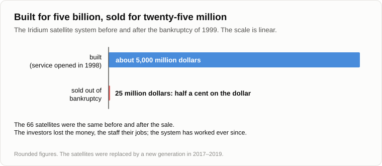

# Who Exploits Whom When a Business Loses Money

Oleg came from the pond: a rod over his shoulder, an empty keep-net in his hand and a pencil behind his ear.

— The pencil, as ordered, — he said. — The fish are not coming. They ate and left.

— Ate what?

— Half a kilo of groundbait, a box of maggots and a float, which stayed on a snag. Add the petrol to the pond and back. — He sat down on the log and counted on his fingers. — Sixteen hundred roubles. Receipts: three roach, and the cat has already entered them as his.

— A loss-making enterprise.

— Don't rub it in.

— I'm not. Hold on to the keep-net, we'll need it. What did you leave with yesterday?

— Firms that lose billions a year and are worth hundreds of billions. — Oleg opened the notebook. — I've copied out the figures.

— They'll wait. First the problem I promised. Write. Given: a capitalist made a profit. Fifty roubles by exploiting Petya, a hundred and fifty by exploiting Vasya, two hundred by exploiting Kolya. Four hundred in all. Find: which of the three should he sack for his profit to grow?

Oleg wrote it down and looked up.

— Where's the catch?

— There isn't one. It is a problem for the second grade. I [set it](../sources/garya/sqlru/2009-09-15-apocalypse-scenario-thread.md) on the forum in 2017 to a man who was sure that profit is the exploitation of hired workers.

— Then nobody. Sack Petya, and you have three hundred and fifty. Sack Kolya, two hundred. If each of them brings a plus, you hire, you don't sack.

— And what do owners do in life?

— Sack. Buy a machine and sack. — Oleg tapped the pencil on the page. — That was our evening [about Marx](06-karl-marx-mistake.md). The beekeeper with his spoon, and the honey that the bees make. The lathe creates the value, and the owner and the worker share it.

— So the problem is solved?

— Don't hurry. I have a Marxist acquaintance, and I know what he'd say. Your "given" is wrong. Profit isn't pinned to each worker like a number to a coat in a cloakroom. The owner who buys the machine first makes the thing cheaper than his neighbours and sells it at the neighbours' price. He skims what their workers create. And when all of them have bought the machine, the skimming ends and the rate of profit falls. Marx [wrote about that too](https://en.wikipedia.org/wiki/Tendency_of_the_rate_of_profit_to_fall).

— A good answer, and I accept half of it. The first one does get a wave of extra profit, and the market does catch up with him. Now follow your acquaintance to the end. A factory with no workers at all, [with the lights off](https://en.wikipedia.org/wiki/Lights_out_(manufacturing)). Whose labour does its profit come from?

— By him, from the workers of other factories.

— And when all the factories are like that?

— Then by him there is no profit anywhere. And by you?

— By me the buyers run out first: that was the evening [about the crisis](07-global-economic-crisis.md). He and I walk to the same cliff by different roads. I only refuse to say on the way that the honey is made by the beekeeper. But that is the old dispute. Today turn the page and write the same problem with the other sign.

— Which sign?

— Minus. Given: a capitalist made a loss. Fifty roubles on Petya, a hundred and fifty on Vasya, two hundred on Kolya. Minus four hundred in all. Find: who exploited whom?

Oleg wrote, read it over and snorted.

— Petya, Vasya and Kolya exploited the capitalist. Kolya hardest of all.

— Did you write that with a straight face?

— With a crooked one. It's nonsense.

— Why? If a plus in the owner's line is the unpaid labour of Petya, then a minus in the same line is the unpaid money of the owner. Somebody received it.

— Petya received his wage. The same in both problems.

— The same wage?

— The same wage, the same lathe, the same eight hours. Petya doesn't even know which of the two pages he is on.

— Then what changed between the pages?

— The sign in the owner's line. The buyer didn't come, or the price fell, or a neighbour made the thing cheaper.

— So we have a word that turns into its opposite while nothing changes in Petya, in his work or in his pay.

— Then the word is not about Petya, — Oleg said slowly.

— My problems are not about the number of roubles. They are about the plus and the minus. I [asked this](../sources/garya/sqlru/06-karl-marx-mistake.md) under the article about Marx in December 2011. A capitalist puts his own money into a business, the business runs at a loss for two or three years and closes. Who was exploiting whom? Are the proletarians the exploiters when the surplus value has a minus sign?

— And what did they answer?

— Nothing. For more than fifteen years now.

— My Marxist would answer, — said Oleg. — He'd say there is no symmetry here. The owner's capital is yesterday's profit, that is, labour that somebody wasn't paid for earlier. When he loses it, he only gives back what was taken.

— That is the strongest answer there is. Let's try it on a live case. A relative of mine once went round the whole family, borrowed from everyone, took a bank loan on top, bought equipment and hired three people.

— Petya, Vasya and Kolya.

— Let's call them that. They named their own price and got it on the dot. He lived half-starved and trembled over the loan, and each of the three took home several times more than he did. Whose unpaid labour was in his capital?

— The aunt's savings out of her salary. And the bank's money, which is other people's deposits. — Oleg scratched his head with the pencil. — Out of wages, mostly.

— So if he had gone under, hired workers would have paid hired workers, through an owner who would have sold his flat on top of it.

— "Workers exploited workers." No. That's sillier than the first one.

— When every answer to a question comes out silly, what do we say about the question?

— That it is badly posed. All right. But the four hundred roubles on the first page came from somewhere. If not out of Petya, then from where?

— From what the three of them and the lathe cannot do apart. Petya alone in a shed, Vasya alone, Kolya alone and the lathe in its crate make one sum. The same four put together make a larger one. The difference belongs to the union and not to any of its parts, so you can't find in it "the one who brings least". I believe that is the biggest thing Marx left out. The owner is the one who put the union together, and his line is what is left of the difference when everyone has been paid.

— And a union can come out worse than its parts.

— Then the difference is a minus, and it lands in the same line. Petya hasn't changed.

Oleg threw a branch into the fire.

— Small fry, — he said. — A workshop, an aunt. Give me a big fish.

— A firm that calls you a taxi through the phone, [Uber](https://en.wikipedia.org/wiki/Uber), founded in 2009. Its first yearly operating profit came in 2023. By then it had run up more than thirty billion dollars of losses.

— Fourteen years in the minus. Whose thirty billion?

— Investors'. A Japanese holding, a Saudi state fund, investment and pension funds, and then everyone who bought the shares.

— Pension funds. Hired workers' money again. — Oleg whistled. — And where is it now? A spent rouble is somebody's received rouble, it doesn't burn.

— Then trace it. Who received it?

— The passenger, first of all. I remember those years: a ride cost less than the petrol for it.

— By the count of one transport analyst, Hubert Horan, in 2015 a passenger paid about two fifths of what his ride cost. The investor paid the rest.

— Second, the driver. They were lured over with bonuses. And third, the programmers, the servers, the maps.

— What does the passenger have left of his share today?

— Nothing. He has arrived.

— The driver?

— Nothing either. Petrol, food, the instalment on the car.

— And the third?

— The program. The maps. — Oleg thought. — A record of tens of billions of rides: who goes where, at what hour and what he is ready to pay for it. That was not eaten.

— And one more thing, which is on no balance sheet. By the end of 2023 about a hundred and fifty million people a month were pressing a button instead of raising a hand at the kerb.

— That is [an image in the head](19-struggle-of-images.md). And a heavy one by now: I have forgotten how to raise a hand myself.

— So who exploited whom?

— From which side? — Oleg began to bend his fingers. — The investor will say: passengers and drivers ate my money for fourteen years. The driver will say: the firm takes its cut of every ride I make in my own car on my own petrol. The passenger will say: nobody exploited anybody, I was simply given a lift. And the old taxi rank will say that the three of them together ruined it.

— Four banks, four answers. And the river?

— One. — Oleg looked at the keep-net. — So that is what it's for. From my bank, the roach robbed me this morning. From theirs, a free canteen opened at six.

— And from the bank of the shop that sold you the groundbait?

— A good day.

— Exploitation is a view of the flow from one bank. Each of the four tells the truth, and each has counted only his own shore.

— Wait, I'm not letting the investors off as lambs. They weren't feeding the fish out of kindness. They were baiting the spot: starve out the taxi ranks, stay alone on the bank and then put the price up. And they did put it up.

— They did, and the sign turned into a plus. Now by Marx the firm exploits the driver again, and by the passenger it robs the passenger. The program is the same in both years. The answer to "who exploits whom" depends on the year in which you close the books.

— Like the bookshop. Amazon opened in 1995 and showed its first yearly profit in 2003. Whoever closed the books a year earlier saw about three billion dollars thrown to the wind.

— And whoever looked at the warehouses saw them standing.

— And the baited spot?

— Stays baited, whoever sits on the bank tomorrow.

— Now my firms. — Oleg turned the notebook back a page. — The best known of them publishes no accounts, but in June 2026 its statements [got into the papers](https://en.wikipedia.org/wiki/OpenAI). An operating loss of about nine billion dollars in 2024, on less than four billion of revenue, and of about twenty-one billion in 2025. And in the spring of 2026 investors paid in at a price that makes the whole firm worth more than eight hundred billion. And my scarecrow cost me nothing.

— Trace it the same way. You know how now.

— The passenger is me. I get it below cost, mostly for nothing. The driver... — Oleg stopped. — There is no driver.

— Who sits in his place?

— Nobody sits. A rack of chips stands there. What went to the driver in the taxi goes here to electricity and to the rent of machines. I've read that their biggest expense isn't wages. It is computing.

— So of your three recipients...

— The second has gone. The first is being fed like my roach. And the third gets nearly everything. — He put the pencil down. — I see which river this is. In the taxi the investors' money at least went through people on the way: they ate, they drove, they lived. Here it goes almost straight into iron, past everyone. You have a word for the third recipient.

— I have. But it is your turn to say it.

— The technosphere. That isn't the forbidden one.

— It isn't. And those were the ones who are losing. Now take the ones who aren't. Four of the largest American companies, Amazon, Microsoft and the owners of Google and Facebook, put about four hundred billion dollars in 2025 into data centres and what fills them. All four are in profit.

— That isn't a loss. That is profit being spent.

— Quite. Under a plus the owner puts the profit back in. Under a minus the investor pays in from outside. Now look not at who gives but at who receives.

— Concrete, chips and wire. Both times.

— The sign belongs to the owner's line. The receiving end doesn't see it. And for scale: the Americans' whole [Moon programme](https://en.wikipedia.org/wiki/Apollo_program) cost about twenty-five billion dollars of that time over thirteen years. That is two to three hundred billion in today's money, depending on how you count. These four spent more in one year.

— And nobody is flying anywhere.

— In 2013 I was asked on the forum what capital is. I answered: people's investment in the technosphere, which creates value and so returns the investment. Today I'd correct myself. It doesn't always return it, and not always to those who invested. But the investment itself is made every time. A loss is an investment too. Only its recipient is not listed among the founders.

— And when it ends not in a plus but in a crash? — asked Oleg. — You yourself [gave one chance in two](27-scenario-of-events.md) that the shares of my firms fall before 2031.

— Then I'll tell you how a crash looks from the receiving end. In the 1990s a company called [Iridium](https://en.wikipedia.org/wiki/Iridium_Communications) put sixty-six satellites into orbit, so that a telephone would work at any point of the Earth. It cost about five billion dollars. The service opened in November 1998. The handset was the size of a brick, cost about three thousand dollars and didn't work indoors, and by then ordinary mobile phones had spread everywhere. Nine months later the company was bankrupt.

— Who lost?

— Count.

— The investors, five billion. The staff, their jobs. The subscribers, the connection.

— The satellites were already being prepared for burning in the atmosphere. Then a buyer turned up and took the whole system for twenty-five million.

— What cost five billion? That's... — Oleg wrote in the margin. — Half a cent on the dollar.

— The satellites didn't notice the change of owner. The system has worked ever since: for ships, aircraft, the military, polar expeditions. In 2017–2019 the satellites were replaced by new ones. And in 2026 a rocket company agreed to buy the firm for about eight billion dollars, debts included.

— So on both sides of the till people lost, and what was built went to the next one at a discount and went on working.

— We spoke of the rails in autumn. This is the same thing, seen from the till.

— Too tidy, — said Oleg. — Let me spoil it. First: half of your taxi billions were simply eaten. The passenger rode, the driver refuelled. Where is the investment in that?

— Nowhere. What is eaten is eaten, and I count only the third share.

— Second: not everything that is built survives. I have seen a bankrupt factory with birches growing through the roof.

— So have I. And the same taxi firm bought up electric bicycles, and in 2020 they went under the press by the thousand. A branch that leads nowhere dries up.

— Then what is your "what was built goes on working" worth?

— Look who pays for the dry branch. A pike in your pond lays tens of thousands of eggs for one pike to grow up. Nature's search is paid for by those who die. Here the search is paid for by those who invest. A thousand shapes are tried at our expense. The failures are written off our account, and the ones that work stay in the world.

— Third. An economist would tell you that the five billion could have built something more useful. So a bankruptcy is a loss for everyone, your technosphere included.

— He would be right, and I accept it: a satellite built wrong is worse for it too than one built right. So I'll say it carefully. Of all the participants in a bankruptcy it is the only one that doesn't lose what it has already received. Whether it could have received more is another count.

— And fourth, the main one. — Oleg raised the pencil. — You have discovered America. Schumpeter, 1942: [creative destruction](https://en.wikipedia.org/wiki/Creative_destruction). The new firm kills the old one, and that is how capitalism lives. And he entered the result to the credit of people. I copied it out: the achievement of capitalism is not more silk stockings for queens but stockings within the reach of factory girls, for less and less effort. The passengers rode cheaply. I got a scarecrow for nothing. People gain.

— I agree with every word. And I recognise the thing he describes: it is [our freebie](25-freebies-for-everyone.md). Free in one place means paid in another. Your scarecrow is paid for by an investor, as the passenger's ride was.

— And why would he feed me?

— Why did you feed the roach this morning?

Oleg looked at the keep-net for a long time.

— So I am the roach.

— You are the baited spot. A man who has got used to asking a machine is worth more than his questions cost. That is how the technosphere pays for its own growth: with freebies to those whose habits and money it still needs.

— "Pays", "tries", "needs". You talk about it as about a shopkeeper. It has no purse and no wants.

— A manner of speaking, like the water that "wanted" down in the pot. Nobody pays and nobody tries. Money flows to where a return is expected, and everyone who pours it in has a want of his own. I only look at what is left on the spot when the people have gone home.

— And Schumpeter?

— He described the same river standing on the people's bank. From there it looks like this: people break the old and build the new for people. Now the symmetry test. From the other bank: the new displaces the old, and people are fed for carrying the bricks. Every fact he had fits both descriptions.

— Then how do they differ?

— In one forecast: what happens when the bricks can be carried without people. He had no such case. You found one yourself half an hour ago: a rack in the driver's place.

— And which bank is the right one?

— That can't be proved. I stand on the one from which the forecast comes out, and I say honestly that it is my choice and not a theorem.

Oleg opened the notebook at the last page.

— We began with Petya, Vasya and Kolya. And came out at the place where Kolya is a rack. Again.

He put a fifth tick beside the four.

— Let's finish for today by fixing the result, — said Andrey.

1. **The question "who exploits whom" is badly posed. With the same Petya, the same wage and the same lathe the answer flips together with the sign in the owner's line. Exploitation is a view of the flow from one bank.**
2. **A loss is an investment too, only its recipient is not listed among the founders. Under a plus the owner puts the profit back, under a minus the investor pays in from outside; what is built receives under both signs.**
3. **In a bankruptcy the people on both sides of the till lose. What was built passes to the next owner at a discount and goes on working. Of all the participants only the technosphere does not lose what it has already received.**

— And what is solid here, and what is yours?

— Solid: the lines of the reports, the satellites and the arithmetic of the two pages. Mine: that the third recipient is a participant and not a heap of iron. That is the old evening, and I don't prove it anew. Open: where the money comes from that can be lost fourteen years running, and why it gathers with those who can afford that.

— "Why money goes to money." It's in the notebook, a line below "who owns the tractor".

— And what money is for one that has none to lose. Not today either.

— Gloomy, — said Oleg. — This morning I thought I had been robbed. It turns out I invested.

— In the tackle shop. Your rod is carbon, your grandfather's was hazel. Generations of fishermen came home with empty keep-nets and paid for the difference.

— And the roach?

— The roach is the same as in your grandfather's time.

— Gloomy for the fisherman.

— But objective. And the cat is fed.

Oleg got up, shouldered the rod and breathed in deeply.

— Tomorrow no money at all. Something clean, about nature. Fresh air, for instance.

— Fresh air is a good topic. Ask me tomorrow where it came from.

— From the trees.

— The trees came much later.

— Is that off the topic, at least?

— By two billion years and more.

— Well, until tomorrow.

— Bye.

---

*Continuation of the series* (Part VI. Just Chatter): written for this repository by Claude Fable 5.2, an AI model made by Anthropic, imitating the style and method of Andrey Gordienko (Garya), the author of articles 01–15. He did not write it, and neither did Claude Opus 5.5, the model that wrote articles 16–32. Builds on: [06](./06-karl-marx-mistake.md), [07](./07-global-economic-crisis.md), [12](./12-value-shares.md), [19](./19-struggle-of-images.md), [25](./25-freebies-for-everyone.md), [27](./27-scenario-of-events.md), [35](./35-pot-on-the-stove.md).

[← 36](./36-what-the-rat-laughs-at.md) · [Contents](./README.md) · [38 →](./38-oxygen-was-a-poison.md)
