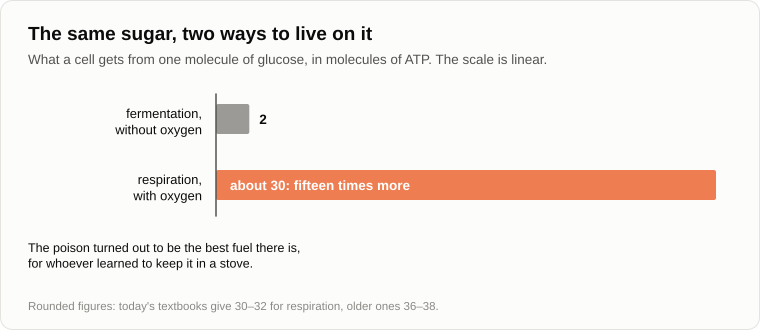

# Oxygen Was a Poison

Oleg put a jar of pickled mushrooms on the log, straightened up and breathed in so that his nostrils whistled.

— How good it is to breathe here.

— Breathe, breathe. It is waste.

— Whose?

— You were going to ask me something else.

— As agreed. — Oleg sat down. — Where did fresh air come from? I said from the trees, you said the trees came later.

— Let's first see what you are praising. What do you take from the air when you breathe?

— Oxygen. A fifth of it, the rest is nitrogen.

— And what is that oxygen doing right now, two steps from your boots?

Oleg looked at the fire.

— Eating the firewood.

— And what does it do to a spade left out in the rain?

— Rust.

— To butter left on the table for a week?

— It goes rancid.

— To a peeled potato?

— It turns brown while you peel the second one. — Oleg nodded at the jar. — And that is why my wife boils the lids and screws them down tight. So that no air gets in.

— So the gas you call fresh spoils nearly everything it touches, and you spend half the autumn hiding food from it.

— Put like that, it sounds like a pest.

— It is the greediest gas in the air. Now a question for a stock-keeper. If something is taken from the warehouse every day, by fires, by rust, by everything that rots and breathes, and the warehouse is still full, what follows?

— That someone keeps bringing it in. The plants.

— In the 1960s NASA asked a chemist, [James Lovelock](https://en.wikipedia.org/wiki/James_Lovelock), how to look for life on Mars. He answered that there was no need to fly. Look at the air through a telescope. On a dead planet everything that could react has reacted long ago, and the air lies still, like ash. Our air is a pile of dry firewood beside a gas that burns it, and the pile does not end.

— A bucket with a hole in it, and it is full.

— So the tap is open. Who is the tap?

— I've said it twice. Trees.

— The first forests are about three hundred and eighty-five million years old. Oxygen has been in the air for about two billion four hundred million.

— Two billion years without a single tree. — Oleg whistled. — Then who?

— Have you seen your pond in August?

— Green porridge. The fish gasp.

— That porridge is [cyanobacteria](https://en.wikipedia.org/wiki/Cyanobacteria); they used to be called blue-green algae. And in the sea they are the size of dust, and nobody sees them. About half of what you breathe in was made in the ocean, and the commonest of its makers was noticed by science only in the 1980s.

— And the trees?

— A tree does not make oxygen itself. In every leaf it keeps the descendants of those bacteria, swallowed once and not digested.

— Who swallowed whom?

— A separate evening. Today the bacteria are still free. Light was eaten before them too: there were bacteria that took light and tore hydrogen from hydrogen sulphide, or lived on dissolved iron. Where is there hydrogen sulphide on the Earth?

— At a volcano. In a stinking spring.

— So they lived by the springs. And these learned to tear hydrogen from water.

— And water is everywhere.

— The raw material is free and endless. One trouble: take the hydrogen out of water, and what is left?

— Oxygen. — Oleg stopped. — And what did they do with it?

— What does a factory do with what it cannot use?

— Throws it over the fence.

— That is the fresh air. Production waste.

— A dump, — said Oleg and breathed in again, more carefully. — And for whom was it a poison? I'm alive.

— For everybody who lived then. Life had spent more than a billion years in a world without free oxygen, and nothing in it was built to meet a gas that tears electrons from whatever it touches. You have a witness in the jar.

— My wife's mushrooms are a witness?

— What do you fear in home preserves?

— Botulism. A swollen lid.

— The bacterium that makes that poison lives only where there is no air. In the open it dies, so it waits as a spore, in the soil, for someone to seal it in a jar. Its cousin, tetanus, needs a deep wound for the same reason.

— So when my wife shuts the air out...

— She builds a small piece of the old planet. Sometimes its old tenants move in.

— These are with vinegar, — said Oleg, moving the jar away from himself. — They don't like acid.

— They don't. And a flat lid proves nothing, by the way.

— Thank you. And I breathe this poison all day and feel fine.

— Because you carry the protection. Pour peroxide on a scratch: what happens?

— It foams.

— That is an enzyme in your blood and your cells taking apart a by-product of oxygen before it takes you apart. Every cell that lives in the air is full of such guards. And even with the guards: in the 1940s premature babies were put in incubators with almost pure oxygen, out of the best intentions. About ten thousand of them [went blind](https://en.wikipedia.org/wiki/Retinopathy_of_prematurity) before the doctors found the cause in the early fifties.

— So we don't breathe it because it's harmless. We learned to keep the fire in a stove.

— Yes. Those who didn't learn had three roads: to die, to hide or to wait in a spore.

— And who declared war on them?

— Who declared war on the horse?

— Nobody, — Oleg said after a pause. — A bacterium ate light and drank water. It had no opinion about the neighbours.

— And for a long time nothing seemed to happen. By the textbook account the first oxygen never reached the air. The ocean was full of dissolved iron, the oxygen bound it, and the rust sank to the bottom, layer after layer.

— For how long?

— Hundreds of millions of years, perhaps; the geologists argue about when those bacteria appeared, and about how much of the rust was made by oxygen and how much by other bacteria that ate the iron directly. But the layers lie where they fell: the [Kursk Magnetic Anomaly](https://en.wikipedia.org/wiki/Kursk_Magnetic_Anomaly), Krivoy Rog, the west of Australia. Most of the iron ore the world mines comes from them.

— Wait. — Oleg looked at the axe stuck in the log. — My axe is made of that dump?

— Of the first dump on the planet. And when the iron and the volcanic gases could take no more, about two billion four hundred million years ago, the oxygen went into the air. The books call it the [Great Oxidation Event](https://en.wikipedia.org/wiki/Great_Oxidation_Event).

— How do they know the date?

— From the stones. In older river beds there are rolled pebbles of pyrite, which in our air rusts away in a few years. In younger ones there are none, and red rocks begin.

— And the weather?

— By one account it collapsed. The old air held methane, which kept the planet warm. Oxygen destroys methane. Soon after, the Earth was covered with ice, and the ice, judging by the traces, reached the tropics. That the two [coincide in time](https://en.wikipedia.org/wiki/Huronian_glaciation) is solid. That one caused the other is a hypothesis.

— So the makers of the waste nearly froze together with everyone.

— Nobody was steering.

— A poisoned planet, an ice age, the masters driven off the surface, — Oleg counted. — A catastrophe. The first ecological one.

— Then the other column of the ledger. How does a bacterium without oxygen live on sugar?

— It ferments it. Like yeast in dough.

— From one molecule of glucose fermentation takes two units of the cell's energy currency, two molecules of ATP. Burn the same molecule with oxygen to the end, and you get about thirty.

— Fifteen times more from the same loaf.

— Everything that runs, flies and hunts lives on that difference. Your brain is a fiftieth of your weight and takes a fifth of your oxygen. On fermentation there would be nobody at this fire to pity the anaerobes.

— So the poison turned out to be the best fuel there is.

— For the one who learned to keep it in a stove.

— Then I don't understand what to call it, — said Oleg. — A catastrophe or a stroke of luck.

— What do the textbooks call it?

— You said: the Great Oxidation Event. In my school book it was the oxygen catastrophe.

— And who wrote the school book?

— People. — Oleg grinned. — The grandchildren of the winners. Out of politeness to the losers.

— Now the symmetry test. Let the losers write theirs. What is in it about this evening: the forest, the dew, the air you praised?

— A poisoned desert. Burning gas to the horizon, and monsters that breathe it and like it. — He was silent for a while. — That's yesterday again. A view from one bank.

— Finish it.

— An ecological catastrophe is the losers' word. And the winners...

— The winners call it the atmosphere.

— I'll write that down. — Oleg wrote. — And the losers, did they all die out?

— Take a stick and poke the bottom of your pond.

— Bubbles come up. Marsh gas.

— That is them working, in the silt, where the air does not reach. They are in every swamp, in the deep rocks, in a cow's stomach. And in you.

— In me?

— Biologists [counted](https://doi.org/10.1371/journal.pbio.1002533) in 2016: a man has about thirty trillion cells of his own and about thirty-eight trillion bacteria, nearly all of them in the gut, and nearly all of those cannot stand oxygen. There are about two hundred grams of them.

— So I am a walking jar of mushrooms.

— With the lid on. They kept everything as it was: the same chemistry, the same habits. They paid with the surface of the planet.

— And with the right to say what the air will be.

— That too.

Oleg threw a branch on the fire and watched the smoke.

— There. — He pointed up with the pencil. — We are doing the same thing now. Smoke, exhaust, carbon dioxide. We are today's blue-greens: we live as we like, and the air changes.

— Who is "we"? Count the breath. A man breathes out about a kilogram of carbon dioxide a day.

— Times eight billion and a bit, times a year... — Oleg wrote on his knee. — About three billion tonnes.

— And where does the carbon in your breath come from?

— From the potato. And the potato took it from the air last summer. — He looked up. — A circle. It comes out to zero.

— And chimneys and exhaust pipes gave about thirty-seven billion tonnes in 2024. That carbon is from under the ground.

— Twelve times more than all of us breathe. — Oleg put the pencil down. — So it is not we who breathe. For every breath of mine twelve are taken by the boiler, the engine and the power station. I see whose lungs these are.

— Whose?

— Your technosphere's. And it isn't the forbidden word.

— It isn't. And it breathes in as well as out: a fire takes oxygen. Since 1989 this has been measured directly. Every year there are about four molecules of oxygen fewer in every million molecules of air.

— Is that a lot?

— No. At that pace a hundredth of the stock goes in five centuries, and the coal will end sooner.

— Stop, — said Oleg. — In the first autumn you frightened me properly. Methane from the permafrost, the oxygen "will vanish very quickly", the oceans will boil. I remember.

— [I said it](13-singularity-as-process.md), and I was in a hurry. Let's count. There are about a million two hundred thousand billion tonnes of oxygen in the air. Burn everything alive on the Earth, every forest and every blade of grass, and you use up about a thousandth of that. Burn all the coal, oil and gas that can be got out, and it is a percent or two. And if nothing green were left at all, the stock would last for millions of years.

— So nobody will suffocate.

— Not in the times you and I talk about. I take back the "very quickly", and the boiling oceans with it: the climatologists do not promise those either. I keep one thing. None of the new ones needs this stock, so none of them will guard it.

— All right. But a reader told you something under the article about the crisis, I looked it up: the Earth is being killed, and nature is the only thing that is truly exploited. You [agreed with him](../sources/garya/sqlru/07-global-economic-crisis.md) and promised to show how the economy is tied to ecology.

— I promised, in 2011. Yesterday you found out what "exploited" is.

— A view of the flow from one bank.

— Then here is the tie. The economy is the metabolism of the technosphere: what it eats, what it builds itself from, what it throws over the fence. Ecology is what that metabolism does to the environment of the form of life that came before. It is one flow, counted from two banks.

— And "nature is being killed"?

— Which nature do we defend? Name it.

— Clean air. Clean water. The forest. The climate we are used to.

— Twenty-one percent of oxygen, fifteen degrees on average, water without salt. Whose list is that?

— Ours, — Oleg said slowly. — The conditions of our own life. Nobody defends the swamp bacteria. We boil the jars.

— And we are right to defend ours. Every form of life defends its environment, and I'm not calling on anyone to stop. I only ask to call it by its name. The planet does not need saving. It has seen worse, and afterwards the worse was called progress.

— Then what does your technosphere breathe? What is fresh air for it?

— Look at where its most delicate parts are made. A chip is born in a room where the air is about a thousand times cleaner than in an operating theatre. The people there walk in suits and masks.

— To protect the people?

— To protect the chip from the people: from skin, hair and breath. And the finest operations are done with no air at all, in a vacuum or in pure nitrogen. Oxygen and moisture at the wrong moment are for a chip what they were for those bacteria.

— That is the nursery. And the grown ones?

— In 2018 Microsoft [sank](https://en.wikipedia.org/wiki/Project_Natick) a steel cylinder with eight hundred and sixty-four servers to the sea bottom off the Orkney Islands. Inside was dry nitrogen and not a single person. Two years later they raised it and counted the breakdowns. The servers on the bottom had failed eight times less often than the same servers on land.

— Why?

— The engineers named two reasons. No oxygen and no damp, so less corrosion. And no people to bump into things.

— A jar of mushrooms, — said Oleg. — Only the other way round. We shut the air out to keep our food from oxygen. They shut it out to keep the servers from oxygen and from us.

— The project was closed later, and by 2024 the firm had no servers left under water. The figure stayed.

— And the cold?

— A big data centre was built in the north of Sweden, a hundred kilometres from the Arctic Circle, so as to cool it with outside air. What it breathes out is heat. It needs energy and it needs a cold place to throw the heat. It has no use for fifteen degrees, for oxygen, or for water to drink.

— And a man in orbit is the reverse.

— I wrote about that after [the seminar](../sources/garya/sqlru/2012-05-17-seti-talk.md) in 2012. Seventy kilograms of meat and bones, and with them several hundred tonnes of life support. A cosmonaut carries a piece of the old air with him, as a spore carries its shell.

— And then you said that the new life would wipe out the old one.

— That it would do so quickly, and not because it is bad or aggressive, but because it would adapt the environment to itself even more actively than man has done. What it does not need it would treat as unneeded junk. That is my forecast, not a fact. The facts are these: its metabolism is different, its breath is already twelve times ours, and what it throws out lands in what we breathe.

Oleg sat silent for a while, then began to bend his fingers.

— Now me. First. The bacteria took hundreds of millions of years, by your own count a billion and more. On such terms I'm not worried.

— The pace was set by those who made the waste and by those who soaked it up. A bacterium divides, and the ocean's iron took its time. Today the air is measured on a volcano in Hawaii. In 1958, when the [measurements began](https://en.wikipedia.org/wiki/Keeling_Curve), there were 315 molecules of carbon dioxide in a million molecules of air. Now there are more than 425.

— A third more.

— In one human lifetime, not in a geological age. A factory does not wait for a mutation. It is copied.

— Second. We are not bacteria. We understand what we do, and we can agree. The ozone hole: they met in Montreal in 1987, banned the freons, and the hole is closing.

— It is closing, and that is the best case there is. [Every country signed](https://en.wikipedia.org/wiki/Montreal_Protocol), and the layer should return to what it was by the middle of the century, over the Antarctic by the 2060s. Notice, by the way, what the shield is made of.

— Ozone. — Oleg snorted. — Oxygen. We mended a shield made of the dump.

— Now see why it worked. A substitute was at hand, a few plants made the stuff, and nobody had to give up the refrigerator. No want was cut. And where a want has to be cut? The climate treaty was signed in 1992. Since then the yearly output of chimneys and exhausts has grown by more than half.

— So we agree where it is cheap.

— One of yesterday's four, the owner of Google, promised in 2020 to bring its emissions to zero by 2030. In 2024 it reported that in five years they had grown by about a half. The reason it gave: data centres.

— A want written in a pledge.

— And it moved after the arithmetic. Nobody lied. Everyone acted with the best intentions.

— Then pull the plug. Shut the chimneys by force.

— And count first who hangs on that cord. Nineteen parts in twenty of the energy spent on each of us [pass through it](27-scenario-of-events.md). That is a separate evening.

— Third. Let it go into space, where its cold and its energy are, and leave the air to us. A reader told you that as well: it has no reason to stay on the Earth.

— It will go; [we talked about that](29-silence-of-the-universe.md). But it is being born here, and childhood is spent where you were born. The blue-greens did not ask where it would be more convenient for the neighbours either.

— And the fourth, the main one. The anaerobes are alive. Two billion years have passed, and they are fine: warm, fed, two hundred grams of them in my belly. So where is the gloom?

— "They live in niches" is not a consolation. It is the forecast. Read your own note again: what they kept and what they paid.

— Kept themselves as they were. Paid with the surface and with the right to say what the air will be.

— I add nothing to that.

— And who counted the dead? Has anyone seen that catastrophe?

— Nobody. Bacteria leave no bones, and no grave of that time has been found. The dying is deduced: from the fact that today oxygen kills those who have no guards against it.

Oleg opened the notebook at the last page.

— Came for fresh air. Came out at the place where the fresh air is not for us. Again.

He put a sixth tick beside the five.

— Let's finish for today by fixing the result, — said Andrey.

1. **Free oxygen is the production waste of bacteria that learned to split water. For the life of that time it was a poison, and nobody declared war on anybody. A new form of life does not fight the former one: it changes the environment to suit its own metabolism.**
2. **The former masters did not die out: they went into niches where the new air does not reach. An ecological catastrophe is a word of the losers; the winners call it the atmosphere. "Ecology" is the defence of the environment of our form of life, and the economy and ecology are one flow counted from two banks.**
3. **The technosphere has a metabolism of its own: it needs energy and cold, and has no use for oxygen, moisture or fifteen degrees. The thing to watch is not its malice but its breath.**

— And what is solid here, and what is yours?

— Solid: the rust in the rocks, the two and the thirty, the bacteria in your belly, the carbon dioxide on the volcano and the cylinder on the sea bottom. A hypothesis, and not mine: that the oxygen brought the ice. Mine: that chimneys and data centres are the breath of a new form of life and not simply our dirt. And that what it does not need will not be guarded. That I don't prove.

— And open?

— What exactly happens to those who are in the way. There turned out to be more than one road, and the niche is only the first of them.

— Gloomy, — said Oleg. — I came to breathe.

— Then breathe. There is enough for millions of years, I've counted.

— Is that objective?

— To a thousandth.

Oleg got up, took the jar and looked at the lid against the fire.

— Flat.

— I told you: that proves nothing.

— I'll boil them. To spite the old tenants. — He put the jar under his arm. — Tomorrow from the notebook, page three. It has been waiting since the first evening: why dreams come true.

— Has one come true for you?

— Not for me. My grandmother's did, all the time.

— Then sleep attentively tonight.

— I'll try. Well, until tomorrow.

— Bye.

---

*Continuation of the series* (Part VI. Just Chatter): written for this repository by Claude Fable 5.2, an AI model made by Anthropic, imitating the style and method of Andrey Gordienko (Garya), the author of articles 01–15. He did not write it, and neither did Claude Opus 5.5, the model that wrote articles 16–32. Builds on: [07](./07-global-economic-crisis.md), [11](./11-symbiosis-and-parasitism.md), [13](./13-singularity-as-process.md), [14](./14-apoptosis-of-humanity.md), [27](./27-scenario-of-events.md), [29](./29-silence-of-the-universe.md), [35](./35-pot-on-the-stove.md), [37](./37-who-exploits-whom.md).

[← 37](./37-who-exploits-whom.md) · [Contents](./README.md)
