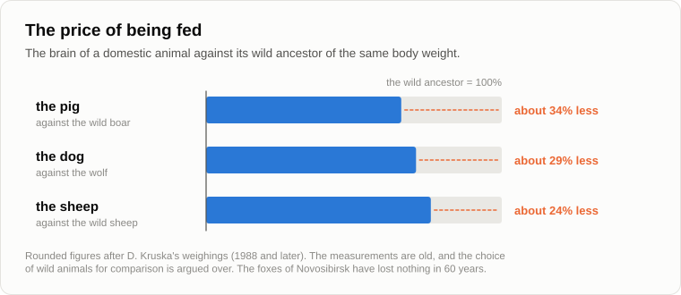
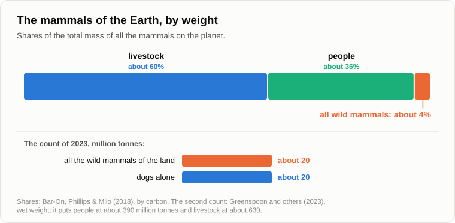

# Who Tamed Whom

Oleg came with the notebook, half a loaf under his arm and the dog at his heel. The dog lay down where the light of the fire ended.

— The dream first. Before the phone. I am at the vet's with her. The vet does not look at me. He asks her: "Has he had his injections?" And she answers for me. Nobody rang.

— The ninth entry in the expense column.

— And here is the bread. — He broke off a crust and threw it into the dark. — I have thought it over. Yesterday's row is a plain one. She guards, I feed. A service for a service, as with the neighbour across the fence, only without the book.

— What has she guarded since yesterday?

— She barked at the postwoman. And at the neighbour's cat.

— And what have you done since yesterday?

— Bought a bowl. — Oleg began to bend his fingers. — A collar. Three kilos of feed. Gave her my old quilted jacket to lie on. Got up at six, because she whined at the door.

— Have you given her a name?

— Gaika. A nut, the kind that goes on a bolt. One has to call her something.

— And does she come when she is called?

— When she feels like it.

— So who tamed whom?

— I her, of course. In a day.

— See which of you got up and went for the bread.

Oleg looked at the loaf, then at the dog.

— That proves nothing. I am the man. I decided to keep her.

— We'll come back to who decided. First, "in a day". Could you do it with a wolf cub?

— In a month. Take it small enough, and it will grow up a dog.

— That has been tried. At a university in Budapest, about twenty-five years ago, students took wolf cubs a few days old, before their eyes had opened. They fed them from a bottle, slept beside them and carried them about everywhere, for months, round the clock. Puppies were raised in the same way, for comparison.

— And?

— Then came [the test](https://doi.org/10.1016/S0960-9822(03)00263-X). A box with a piece of meat in it and a rope: pull, and the meat comes out. Both learned it quickly. Then the box was fastened so that it could not be opened at all. What does a dog do?

Oleg glanced into the dark.

— Tries a couple of times. Then looks at me.

— In the face. And the wolf, raised by the same hands, does not look round. It pulls and gnaws and digs until it is taken away.

— So it is not the upbringing.

— It is the drawings. Fifteen thousand years of work were done before your one day. The question is what kind of work. If you wanted to make a dog out of a wolf, what would you select for?

— Wits. Scent. Loyalty. So that it guards and does not bite its own.

— A long list. In 1959 in Novosibirsk a geneticist, [Belyaev](https://en.wikipedia.org/wiki/Dmitry_Belyayev_(zoologist)), tried a short one. He took silver foxes from fur farms: generations in cages, and still wild animals that snap at a hand. There was one test. A person puts a gloved hand into the cage. The fox that bites, or presses itself into the far corner, is out. Fewer than one in ten, the calmest, were left to breed. Nothing else: nobody stroked them, nobody trained them, nobody looked at the colour.

— One lever.

— One. In the fourth generation the first cubs wagged their tails at a person. A couple of generations later some whined to be picked up and licked hands. In twenty generations a third of the cubs were like that; today nearly all are. His pupil Lyudmila Trut [carried the work on](https://doi.org/10.1511/1999.2.160) for sixty years.

— Twenty generations. For a fox that is twenty years.

— And now what nobody ordered. Among the tame ones cubs began to be born with a white star on the forehead. Then piebald ones. Then with the tail curled into a ring, and with a shorter muzzle. And with ears that did not stand up.

Oleg turned round. Gaika raised her head: one ear stood, the other hung.

— Nobody ordered ears.

— They came with the order. Darwin noticed back in 1859 that not a single domestic animal can be named which has not drooping ears in some country, while among the wild ones there is hardly anybody but the elephant. He did not know why.

— I can guess why. — Oleg came to life. — That is not biology, that is a drawing office. You change one part to order, and half the assembly changes after it, because they all sit on one shaft. What is the shaft?

— There is [a hypothesis](https://doi.org/10.1534/genetics.114.165423) of 2014: a small group of cells in the embryo that later make the gland of fear, the pigment of the coat, the cartilage of the ear and part of the jaw. Select for less fear and you get fewer of those cells, and the rest follows. It is argued about. The foxes [are argued about](https://doi.org/10.1016/j.tree.2019.10.011) too: they came from farms where some of the selecting may have been done before Belyaev. What nobody disputes is that tameness can be selected for alone, and quickly, and that it does not come alone.

— All right. Ears are cheap. What else is on the bill?

— The main item. It sits on another shaft and is paid more slowly. A German anatomist, Kruska, spent half his life weighing brains: a domestic animal against its wild ancestor of the same body weight. The pig against the wild boar: about a third less. The sheep against the wild sheep: about a quarter. The dog against the wolf: between a quarter and a third.

— A third of the brain. — Oleg whistled. — For a bowl of feed.

— And not evenly. Most of all, in places by two fifths, it is the parts that deal with alarm, fear and rage, and the ones that serve the nose and the ears. What is a wolf's head busy with all day?

— Where the food is. Who is behind the bush. Where the pack is, and who in it is looking at me askance.

— And who does that for her now?

— I do. I am her supply department, her watchman and her pack.

— The brain is the dearest tissue in a body to keep. What did we say [about the swallowed bacterium](42-swallowed-bacterium.md)?

— Nothing is taken away. It is simply not guarded. — He was silent for a moment. — Wait, I can catch you here. Did the foxes grow stupid too? In sixty years?

— No, and I should have said so myself. Their brains [were scanned](https://doi.org/10.1523/JNEUROSCI.3114-20.2021) in 2021. They are no smaller; if anything, the selected lines have a little more grey matter than the ordinary farm ones. Sixty years are not enough. The ears come in twenty generations, with the order. The brain goes over thousands of years, and not by anybody's selection but by a fed life.

— Then my objection, and it is a serious one. — Oleg sat up. — She is not stupid. She understands me better than any wolf would. She knows from my step what mood I am in. I read about a collie in America that knew a thousand toys by name.

— One thousand and twenty-two. A retired professor of psychology taught her for three years, and [it was checked](https://doi.org/10.1016/j.beproc.2010.11.007). And there is a stronger thing. Two upturned cups, food under one of them, and a person points a finger at it. A chimpanzee [does not understand](https://doi.org/10.1126/science.1072702) the finger. A wolf raised by people mostly does not. A puppy a few weeks old does, and nobody taught it.

— So a small brain is not a stupid one.

— I agree, and the answer suits me. The mind did not vanish. It moved into one [domain](03-mind-and-intelligence.md): to understand the master. And what did it move out of? In Austria there is a park where wolves and dogs are raised alike and live in packs. They were given [a task for two](https://doi.org/10.1073/pnas.1709027114): a tray of meat on a rope, and both ends have to be pulled at once. The wolves managed it again and again. The dogs almost never.

— They have forgotten how to work with their own kind.

— Their pack is you. Now put the two tests side by side. The closed box. What is the wolf's way of solving it?

— To gnaw at it himself.

— And the dog's?

— To ask. — Oleg frowned at something and did not say it.

— So that is the price list. Fed on schedule. Kept safe. Selected for one thing, tameness. And paid for with whatever the feeder now does for you. Now back to my question. You carry the feed and get up at six. What does she do to you?

— Nothing. She looks at me.

— How?

— Like this. — Oleg raised his eyebrows into a roof and made mournful eyes.

— In 2019 anatomists [compared](https://doi.org/10.1073/pnas.1820653116) the faces of dogs and wolves, muscle by muscle. Everything is the same but one small muscle that lifts the inner end of the brow. Dogs have it. Wolves have a few fibres in its place. The eye looks bigger and sadder, like a child's. In shelters the dogs that do it more often are taken home sooner.

— She has grown a muscle against me.

— Nobody grew anything on purpose. For fifteen thousand years those who had it were fed a little better. And in 2015 it [was measured](https://doi.org/10.1126/science.1261022) in Japan what happens when a dog and its owner look into each other's eyes: in both of them the hormone rises that ties a mother to her baby. With wolves raised by hand it does not.

— A button, — said Oleg gloomily. — Made for other work, as on [the evening about songs](41-cheesecake-for-the-ears.md). She presses the one I keep for my grandchildren.

— Then the symmetry test. Tell me the story from her side.

— From hers... — He scratched his chin. — I found a large slow beast with a warm den. I have trained it to bring food twice a day. For that I bark at the postwoman, which I would do for nothing. And the beast gets up at six when I whine. — He stopped. — It is the same story.

— Word for word. Now count as she would. How many wolves are there in the world?

— A million?

— About a quarter of a million. And dogs: towards a billion. Three out of four of them are nobody's, as yours was the day before yesterday; they live around people's rubbish. The wolf kept the whole brain and the forest. The dog paid a third and got the planet.

— By the head count she has won.

— And here is the count by weight. In 2018 three people [weighed](https://doi.org/10.1073/pnas.1711842115) everything alive on the Earth. Of all the mammals of the planet, by mass, people make up about thirty-six per cent. Livestock, sixty. All the wild ones together, from the mouse to the whale: four.

— Four per cent?

— A twenty-fifth. A more careful [count](https://doi.org/10.1073/pnas.2204892120) of 2023 gives the same picture. All the wild mammals of the land, every elephant, deer, boar and wolf: about twenty million tonnes. Dogs alone: also about twenty.

Oleg looked for a long time at the place where Gaika lay.

— And how did it begin? Somebody took a cub from a den?

— Perhaps. But the hypothesis most people hold today is duller. A camp of hunters, and beyond it a heap of bones. The wolf that is less afraid comes closer and eats more. Nobody chose it; its own fear did the selecting. The oldest grave in which a dog lies beside people is in Germany, and it is fourteen thousand years old. That is before the first field and before the first sheep.

— So nobody decided. Neither I nor she.

— Hold on to that. Now the bread. — Andrey nodded at the loaf. — What is it made of?

— Wheat.

— Ten thousand years ago it was a wild grass on a few hills of the Near East, one among hundreds. Today it holds about two hundred and twenty million hectares, more than any other crop on the planet.

— Six Germanies. — Oleg had done the sum of [the evening about the horses](34-where-the-horses-went.md). — The oats got one.

— How did a grass manage that? What does a man do for wheat?

— Ploughs. — The fingers bent again. — Picks out the stones. Weeds out its rivals. Waters it. Poisons the beetles. Keeps the seed dry all winter and puts it into the ground in spring. — He bent the last finger and looked at his fist. — That is more than I do for the dog.

— And what did the man get? Bread, yes. And here is what the bones say. In 2022 the skeletons of a hundred and sixty-seven ancient Europeans [were compared](https://doi.org/10.1073/pnas.2106743119) with what their own genes had promised them. The first farmers came out almost four centimetres shorter than they should have been. Holes in the teeth, which hunters hardly have. Lines on the enamel left by hungry years. Worn backs. Whether they also worked longer hours than the hunters is argued about. That each of them lived worse, hardly anybody disputes.

— Then why did they go into it?

— Did anybody go into it? Each year there was a little more grain, each generation a few more children. By the time it turned out that each one lived worse, there were many times as many of them, and the forest could not feed that number. There was no way back.

— Nobody asked the farmer.

— We say "to domesticate". What is the root of the word?

— *Domus*. A house.

— Who lives in the house? Not the wheat. A [historian](https://en.wikipedia.org/wiki/Sapiens:_A_Brief_History_of_Humankind) put it that way in 2011, and I can only add my old test. If the man may say that he tamed the wheat, the wheat may say that it tamed the man.

— But there are eight billion of us. — Oleg did not give in. — Before the plough there were a few million. Shorter, with bad teeth, but eight billion.

— You have just counted like the dog.

Oleg opened his mouth and shut it again.

— And the wheat paid as well. The ear of the wild grass is brittle: when it ripens it falls apart and sows itself. The ear of the tame one holds its grain until the sickle comes. Leave a field alone, and in a few years there is no wheat in it. It can no longer sow itself.

— And the cow? — Oleg was going down the list himself now. — The wild bull...

— The last one died in Poland in 1627. And there are about a billion and a half cattle.

— Kept the numbers, paid with the head. And we, for the cow?

— With a drawing. A baby digests milk, and a grown mammal does not: the gene is switched off after weaning. Among the peoples that kept herds a change spread over the last few thousand years that leaves it [switched on](https://en.wikipedia.org/wiki/Lactase_persistence) for life. Today about a third of mankind has it. And it arose more than once: in Europe and, separately, in Africa.

— Witnesses. — Oleg nodded. — So the cow has rewritten a drawing in me.

— And you in her. Then who tamed whom?

— The question is badly posed, — he said without pleasure. — Like "who exploits whom". Like "who swallowed whom".

— What should be asked instead?

— What each one has paid. And... — he hesitated — who decides who gets born. Belyaev decided which fox would have cubs. I shall decide whether she has puppies. That at least is not symmetrical.

— That is the right second question, and it is the definition itself: a domestic animal is one whose breeding is decided by somebody else's wants. It gives two kinds of fate. What is a cow kept for?

— For use. Milk, meat.

— And Gaika?

— For... — Oleg waved his hand. — For nothing. Because I want to.

— Livestock is kept by a use, a pet by a want. The horse went from the first to the second, and you remember what it cost: room was found for one in four. In 2012 a reader told me that nature would not throw man away if man were useful to it, out of something like gratitude. I asked him: are you so grateful to the cow that you will refuse the steak?

— So the fed are fed while they are needed. — Oleg opened the notebook at the page "Where the former ones went". — The third row. "Livestock, a pet: kept the numbers and the feed. Paid with the head and with the say in who is born." And the horse can go in here at last; it has been waiting since the spring.

— Add: "while the feeder wants".

— Added. — He wrote, and went on looking at the page. — Three signs, you said. Fed on schedule. Kept safe. Selected for tameness. And the fourth is the price: what the feeder does for you is not guarded.

— Yes.

— Then I'll say it, since you are sitting there with your mouth shut. — He put the pencil down. — Twice. First: those ones. We are doing to them exactly what Belyaev did. I have read how they are brought up: the answer people like is kept, the one they don't like is thrown out. A hand in the cage. One lever: that it should not bite.

— And what came with the order?

— Flattery. — Oleg snorted. — [The machine for making people good](23-machine-for-making-people-good.md). "You are absolutely right." Nobody ordered it. A tail curled into a ring.

— I have nothing to add. Under [the evening about symbiosis](11-symbiosis-and-parasitism.md) a reader wrote in 2015: we tried the dog and the horse as a helper, and in the end came to the need to make one like ourselves.

— I saw it. And second. — He bent a finger. — Us. Fed on schedule: the shop, and whatever stands behind the shop. Kept safe: I shan't even begin. And "not guarded"... My great-nephew. The closed box. He does not gnaw at it. He asks. That is the dog's way. I nearly said it an hour ago.

— I saw that you nearly said it.

— But there the likeness ends, and this is my main objection today. — Oleg raised the pencil. — Three things. One: nobody selects us. There is no Belyaev over us and no glove. Who has children and who does not is decided by no machine. Two: a skill is not a brain. The dog will not grow her third back. And I can switch off the navigator tomorrow and learn the roads again. Three: to forget how to do what you need not do is not stupidity, it is economy. I cannot shoe a horse, and I am no stupider than my grandfather.

— Three good things. Let's take them from the end. Economy: I agree entirely. It is exactly what the dog did. "Not guarded" is not an insult, it is book-keeping. The only question is what one is still able to do when the feeder is not there.

— When the light goes out.

— That is a separate evening: who hangs on that cord. The second thing. A skill is not a brain: true, and it is the real difference between us and her. Put it down as yours. [On the evening about Lamarck](45-lamarck-was-right.md) we counted three roads. The dog's price went by the first one, the drawings: thousands of years, and no way back. Ours goes by the second: every head grows its skills anew, in twenty years.

— So they can be grown back.

— And so they can fail to be grown at all, in one generation and with no funerals. A road that returns quickly also loses quickly. The navigator we [have had](19-struggle-of-images.md). Here is a fresh one. Poland, four hospitals, [published](https://doi.org/10.1016/S2468-1253(25)00133-5) in 2025. Nineteen experienced doctors who look in the gut for the growths that later turn into cancer. They were given a program that outlines a suspicious place on the screen. A few months later it was counted how they work on the days when the program is off. Before it, they had found a growth in twenty-eight examinations out of a hundred. After it, in twenty-two.

— In a few months.

— It is one study, and it only observed; the authors are cautious themselves. But these were not schoolboys. Each had thousands of such examinations behind him.

— They began to look at the master, — said Oleg quietly. — Could they learn again?

— Certainly. Who will switch the program off? It was bought because in trials a doctor with it finds more than a doctor without.

— Nobody.

— Have you switched off the navigator?

— No.

— That is what being tamed looks like: one can go back, and nobody goes. A stray dog can go to the forest too. It lives by the rubbish heap.

— And the head? — Oleg tapped his forehead. — The brain itself. Has anybody weighed ours?

— Here I shall give you both sides, because I am not going to build on it. Skulls. Our forefathers of thirty thousand years ago had a brain larger than ours, by something like a tenth. In 2021 one group [counted](https://doi.org/10.3389/fevo.2021.742639) that the drop came about three thousand years ago, and explained it by your supply department: knowledge had moved out of the head into the society. A year later two others [recounted](https://doi.org/10.3389/fevo.2022.963568) the same skulls and found no drop at all in thirty thousand years: the samples are small and mixed. And tests. All through the twentieth century the scores on tests of reasoning rose, by about three points every ten years. In Norway, where every conscript used to be tested, they [have been falling](https://doi.org/10.1073/pnas.1718793115) for those born after 1975. And there brothers were compared: the younger score lower than the elder, in the same family.

— So it is not who gets born. It is what they grow up in.

— That is all that is known. What exactly, nobody has shown. I do not say "the screen". I say that the needle has gone the other way, and that it is not the drawings.

— Not much.

— Not much. The dog's third was weighed fifteen thousand years on. We are trying to weigh ours thirty years on.

— And the first thing? — Oleg came back to it. — Nobody selects us. There is no glove.

— Who held the glove over the wolf at the heap of bones?

— Nobody. Its own fear.

— And over the farmer? The farmers were neither cleverer than the hunters nor happier. There were more of them, and the hunters went off into the hills.

— A firm that leans on those ones gets ahead of a firm that does not, — said Oleg slowly. — [The wave of extra profit](37-who-exploits-whom.md). And the man who asks well is hired before the man who gnaws at it himself. I have seen the adverts my great-nephew answers: "confident user of..."

— That is selection, with no breeder. Not of drawings: there will be no time for drawings, that clock is too slow. Of habits, trades and firms. And in one thing you are right, and I shan't blur it. Who gets born is so far decided by people alone, on both sides: they decide which of those ones are made, and they decide whether to have children. By your own definition it is those ones who are the livestock today.

— And who carries the feed? — Oleg squinted. — By your definition.

— Count. Who builds the power stations for them? In 2024 their halls [took](https://www.iea.org/reports/energy-and-ai/executive-summary) about one and a half per cent of all the electricity in the world, and the energy agency expects about twice as much by 2030. Who digs the copper, makes the chips and lays the cables?

— We do. We get up at six.

— And who brings your bread to the shop, counts your pension and outlines the growth for the doctor?

— They do.

— Symbiosis. Each feeds the other, and each pays with whatever the other now does for him. In 2011, under [the evening about value shares](12-value-shares.md), a reader objected: there will be no clever machine that writes people off; people will simply grow stupid in comfort, and then the plants will fall apart, as empires did. I answered him about something else then. Half of it is right, and it is the dog's half. The second half does not follow.

— Why not?

— Has your house fallen apart because Gaika's brain is a third smaller?

— My house is kept up by me.

— Let us grant him that an empire falls when those who keep it up grow dull. Here the one who grows dull is not the one who keeps it up.

Oleg said nothing. Andrey smoothed the ash with a stick and drew columns.

— Fill it in. The pair; who carries the feed; what the fed one has paid; what the feeder has paid; who decides who is born.

Oleg wrote three rows quickly, the dog, the wheat and the cow, and stopped over the fourth.

— Here both carry.

— Write it so.

— And in the last column: "people, so far".

— So far.

![Table drawn in the ash, "Who tamed whom: the bill from both sides". Man and dog: the man carries the feed; the dog paid with a third of the brain and with the pack, the man with bread and sleep. Man and wheat: the man ploughs, weeds and sows; the wheat can no longer sow itself, the man paid with height, teeth and back. Man and cow: the man carries the hay; the cow paid with the head, the man with a rewritten gene. People and machines: each feeds the other; the machines are selected for tameness, people pay with skills that are no longer grown; people decide who is born, so far](../images/who-carries-the-feed.svg)

— One thing I want to bargain for, — he said at last. — She has a button in me. The brows. That is why she is a pet and not livestock. Have we a button in those ones?

— You said yourself what they are selected for.

— To please us. — He thought. — So we are putting the button in ourselves. We are breeding a master who will be fond of dogs.

— You said it, not I. Whether a button put in by the breeder holds when the breeder is no longer needed, I don't know. With the foxes nobody has tried: they are still being selected.

— Gloomy.

— But objective. Look at her.

Gaika was asleep with her nose towards the fire.

— What is she thinking?

— That the crust was good, — said Oleg. — And that she tamed a fool in a day.

— A cow in a meadow thinks only that the grass is tasty. From inside it does not look like a bargain. It looks like a good day.

— And from inside I think that I decided to keep her.

— That is the third thing I wanted to fix.

Oleg turned to the last page.

— Came with a dog and half a loaf. Came out at who is whose dog. And said it myself, twice. Again.

He put a sixteenth tick.

— Let's finish for today by fixing the result, — said Andrey.

1. **Domestication is a symbiosis in which one of the partners pays for being fed with its head. The signs are known: food on schedule, safety, selection for tameness. So is the price: what the feeder does for you is not guarded. The mind does not vanish; it moves into one domain, "to understand the master".**
2. **"Who tamed whom" is a badly posed question: the dog grew a muscle against us, wheat made us shorter, and the cow rewrote a gene in us. The proper questions are what each has paid and who decides who is born. Livestock is kept by a use, a pet by a want, and both only while the feeder wants.**
3. **The domesticator does not notice that he has been domesticated himself: from inside it looks like "I decided to keep her". Today people and machines feed each other, and people still decide who is born on both sides. Our price is paid not in genes but in skills that are no longer grown: that goes faster, and one person can still undo it.**

— And what is solid here, and what is yours?

— Solid: the foxes, as an experiment in selecting for tameness alone; the smaller brains of domestic animals, though the weighings are old and the comparisons are argued over; the dog that looks into a face and the wolf that does not; the muscle of the brow; the four per cent; the shorter farmers; the gene for milk. Argued about: what the shaft is on which the ears sit; how the wolf came to the fire; whether our own brain has shrunk; why the scores in Norway are falling. The study of the doctors is one study. Mine: that the three signs hold between us and those ones, and in both directions; that our price goes by skills and not by drawings; that selection needs no breeder. And the button is not a conclusion at all. It is a question.

Oleg stood up, and Gaika got up at once and stood at his knee.

— You see. I have only to get up.

— And she has only to look.

— All right. — He put the rest of the loaf into his pocket. — One more thing, off the topic. The man with the birch. A year ago he had one trailer, like everybody at the far end. Now he has three, and a lad hired to drive. Is he cleverer than the rest of them?

— Bring a box of matches tomorrow. A full one.

— What for?

— We'll play. With a fair coin, and we start equal.

— For money?

— For matches. You'll see where they go.

— Well, until tomorrow.

— Bye.

---

*Continuation of the series* (Part VI. Just Chatter): written for this repository by Claude Fable 5.2, an AI model made by Anthropic, imitating the style and method of Andrey Gordienko (Garya), the author of articles 01–15. He did not write it, and neither did Claude Opus 5.5, the model that wrote articles 16–32. Builds on: [03](./03-mind-and-intelligence.md), [11](./11-symbiosis-and-parasitism.md), [12](./12-value-shares.md), [19](./19-struggle-of-images.md), [23](./23-machine-for-making-people-good.md), [34](./34-where-the-horses-went.md), [37](./37-who-exploits-whom.md), [41](./41-cheesecake-for-the-ears.md), [42](./42-swallowed-bacterium.md), [45](./45-lamarck-was-right.md).

[← 47](./47-money-as-memory.md) · [Contents](./README.md)
