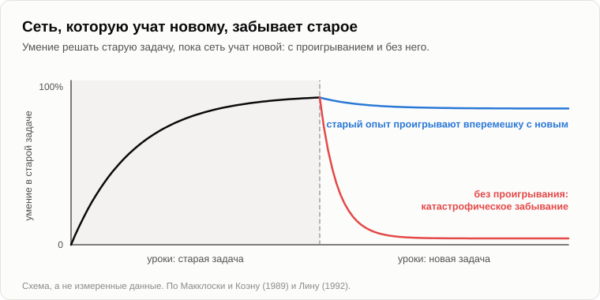
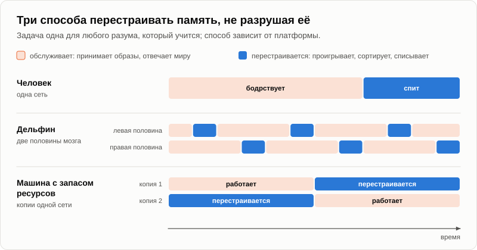

# О пользе сна, или Зачем проводить треть жизни без сознания

Первый тёплый вечер после зимы выдался поздно. Бревно перезимовало благополучно, только мха на нём прибавилось. Андрей подкармливал молодой огонь прошлогодними веточками, когда из сумерек вышел Олег, зевая, с толстым бумажным блокнотом под мышкой.

— Стрелки не дрогнули, — сказал он вместо приветствия. — Я смотрел. Проверять твои отметки рано.

— Рано, — согласился Андрей. — А блокнот тогда зачем?

— Вопросы. За зиму накопились. — Олег сел на бревно и хлопнул ладонью по обложке. — И у меня условие. Давай просто потреплемся. Только чур не про твою сингулярность. Кто первым произнесёт это слово, тот идёт за дровами.

— Ты его только что произнёс.

— Это было оглашение правил, оно не считается. И темы теперь задаю я. Ты сам говорил, что задачи всегда приходят снаружи. Этой весной снаружи — я.

— Согласен, — улыбнулся Андрей. — Что первое?

Олег снова зевнул и раскрыл блокнот.

— Сон. Я до четырёх пролежал без сна и успел подумать. Эволюция — скряга, каждую калорию считает. А треть жизни зверь лежит слепой, глухой и вкусный. Почему сон не отменили за четыре миллиарда лет?

— Четыре миллиарда — это возраст жизни. Сон не старше нервных клеток, так что считай полмиллиарда с небольшим. Для скряги и это срок немалый. А сам ты как думаешь?

— Отдых. Устал, лёг, восстановился.

— Что именно отдыхает?

— Тело. Мышцы.

— Ляг на диван с книжкой. Мышцы отдыхают?

— Отдыхают.

— Тогда зачем отключать ещё и глаза, уши и сторожа? В 2011 году семерым добровольцам [не дали спать одну ночь](https://pubmed.ncbi.nlm.nih.gov/21059762/) и круглые сутки считали, сколько энергии они тратят. Сутки без сна обошлись им примерно на семь процентов дороже, чем сутки с ночным сном.

— Семь процентов. Это бутерброд.

— Значит, на одной чаше весов бутерброд, а на другой — треть жизни и неплохой шанс быть съеденным. Твой скряга на такое подпишется?

— Нет. Тогда отдыхает голова.

— Поставь на спящую голову электроды. Она не затихает. По ней всю ночь ходят волны; она чем-то занята, только не тобой. Но возьмём зверя, которому лечь вообще нельзя. Дельфин дышит воздухом. За каждым вдохом ему надо всплыть, а акул никто не отменял. Если бы сон был отдыхом, как бы природа поступила с дельфином?

— Отменила бы. Или разрешила дремать по минуте.

— В 1977 году трое советских физиологов, Лев Мухаметов, Александр Супин и Ирина Полякова, [опубликовали](https://doi.org/10.1016/0006-8993(77)90835-6) то, что записали с мозга дельфинов-афалин на черноморской станции. В одной половине мозга идут медленные волны глубокого сна. Другая половина бодрствует: плывёт, всплывает подышать и держит один глаз открытым. Через полчаса-час [они меняются](https://en.wikipedia.org/wiki/Unihemispheric_slow-wave_sleep).

— Полусонный в прямом смысле, — засмеялся Олег. — И открыли это у нас, а не в Калифорнии?

— У нас. Это даже [официально признали](https://sev-in.ru/en/laboratory-sensory-systems-vertebrates/results) научным открытием. А теперь скажи, что это значит. Десятки миллионов лет море давило на дельфина: откажись от сна. Чего добилась природа?

— Отменить не смогла. Только разрезала пополам.

— А если отнять совсем? В восьмидесятых годах в Чикаго Аллан Рехтшаффен сажал крыс на диск над водой. Стоило крысе начать засыпать, диск поворачивался, и ей приходилось шагать или мокнуть. Её соседке на том же диске доставались точно такие же повороты, но в промежутках она могла спать. Соседки жили. Бессонные [погибли все](https://pubmed.ncbi.nlm.nih.gov/2648533/), за срок от одиннадцати до тридцати двух дней.

— Значит, это что-то такое, без чего умирают, что стоит трети жизни и чего нельзя сделать на ходу. — Олег почесал в затылке. — Выходит, не отдых. А что?

— Ты видел когда-нибудь на двери магазина табличку «Закрыто на учёт»?

— В детстве постоянно. Придёшь за хлебом, а они считают.

— А зачем закрываться? Пусть считают и торгуют.

— Потому что не сойдётся. Ты полку пересчитал, а с неё тем временем взяли банку, да ещё с чёрного хода разгружается машина.

— То есть одни и те же полки нельзя разом и обслуживать, и пересчитывать. Теперь скажи: где голова хранит то, что увидела за день?

— В памяти. В связях между нервными клетками, насколько я помню.

— А думает она чем?

— Теми же... — Олег осёкся. — Теми же связями.

— Одна и та же сеть — и торговый зал, и склад. Днём она торгует: принимает новые образы и отвечает миру. Чтобы их разобрать, она должна заново прогнать их через себя, и пока она это делает, обслуживать покупателей не может. Вот она и вешает табличку.

— Складно. А доказательства?

— В 1994 году Мэттью Уилсон и Брюс Макнотон [записали](https://pubmed.ncbi.nlm.nih.gov/8036517/) в гиппокампе трёх крыс по нескольку десятков клеток одновременно. Днём крыса бегала по дорожке, и каждая клетка срабатывала в своём месте. Ночью, в глубоком сне, клетки, которые срабатывали вместе на дорожке, снова срабатывали вместе. Позже выяснилось, что [сохраняется и порядок](https://en.wikipedia.org/wiki/Hippocampal_replay), только всё идёт гораздо быстрее.

— Крыса во сне заново пробегает свой лабиринт.

— Не шевельнув лапой. Это первая половина учёта: дневные образы прогоняются ещё раз и переносятся из быстрой памяти в долгую. Вторая половина — списание. Днём связи большей частью растут, потому что всё новое какие-то из них усиливает. Если бы они только росли, в голове кончились бы и место, и энергия. В 2017 году группа Кьяры Чирелли и Джулио Тонони [измерила](https://pubmed.ncbi.nlm.nih.gov/28154076/) под электронным микроскопом почти семь тысяч синапсов мышей. После сна они оказались в среднем на восемнадцать процентов меньше, чем после бодрствования. А самые крупные, примерно пятая часть, остались нетронутыми.

— Тяжёлые образы оставляют, лёгкие стряхивают.

— На вечере про образы я называл этот вес [коэффициентом значимости](19-struggle-of-images.md), и мы сошлись на том, что забывание — функция, а не дефект. Теперь ты знаешь, когда эту функцию запускают.

— Ладно, — Олег бросил в костёр ветку. — Но это всё мясо. Мой телефон не спит и ничего не забывает. Машина не устаёт, значит, сон ей не нужен. Получается, сон — просто наша слабость.

— Заметь, про машины заговорил ты.

— Запретное слово не прозвучало.

— Тогда давай посмотрим. В 1989 году два психолога, Майкл Макклоски и Нил Коэн, [научили маленькую нейронную сеть](https://en.wikipedia.org/wiki/Catastrophic_interference) прибавлять единицу: один плюс один, два плюс один и так далее. Она выучила. Потом её стали учить прибавлять двойку. После первого же урока с двойками прибавлять единицу она разучилась.

— Забыла?

— Не так, как забываем мы, медленно и с краёв. Всё разом. Это назвали катастрофическим забыванием. Новое записалось в те же связи, которые держали старое, и стёрло его.

— Машина разгрузилась на ту самую полку, которую пересчитывали.

— Да. А чем это вылечили? В 1992 году Лонг-Джи Лин [предложил](https://doi.org/10.1007/BF00992699), чтобы обучающаяся машина хранила прошлый опыт и ей показывали его снова, вперемешку с новым. Он назвал это проигрыванием опыта, experience replay. В 2015 году так обучали сеть, которая [освоила сорок девять видеоигр «Атари»](https://www.nature.com/articles/nature14236) прямо с экрана, и её авторы назвали этот приём «подсказанным биологией».

— Проигрывание, — повторил Олег. — Как у крысы.

— И ещё одна подробность. Тот самый Макнотон, который слушал спящих крыс, в 1995 году написал с двумя коллегами статью и [объяснил](https://doi.org/10.1037/0033-295X.102.3.419) в ней, зачем мозгу две памяти, быстрая и медленная, и почему новое надо скармливать медленной вперемешку со старым. Иначе катастрофа.

— Значит, инженеры дали машине сон.

— Не называя его сном. И посмотри на машину, с которой ты разговариваешь в телефоне. Она учится, пока с тобой говорит?

— Нет. Она сама мне сказала: сначала её месяцами учат, а потом включают.

— Пока её перестраивают, она не работает, а пока работает, её не перестраивают. Её магазин закрывается на учёт строже твоего. Да и сам телефон, кстати: когда он обновляется?

— Ночью. На зарядке, когда я его не трогаю. — Олег хмыкнул. — Вешает табличку.

— А теперь сравни. «Сон — это отдых. Машина не устаёт. Значит, машине сон не нужен». Где ошибка?

— В первой фразе. Сон — не отдых.

— И глубже. Мы назвали задачу по своему способу её решать. Это всё равно что решить, будто рыба не дышит, раз у неё нет лёгких. Добывать кислород — задача всего, что сжигает пищу. Лёгкие — способ тех, кто живёт на суше. Перестраивать память, не разрушая её, — задача любого разума, который учится. Лежать треть жизни с закрытыми глазами — способ платформы, у которой на всё одна сеть.

— Так машина тоже будет спать?

— Меня ровно об этом спросили на форуме в 2013 году: будет ли спать компьютер. Я ответил, что во сне происходит сортировка образов, перемещение их между памятью с разными сроками хранения, переоценка, очистка памяти от образов, не имеющих большой ценности, выявление новых связей между ними. В двух словах, оптимизация системы хранения образов. Ресурсы биологического мозга ограничены, поэтому ему нужны раздельные фазы: одна — чтобы получать образы, другая — чтобы их сортировать. Компьютеру, сильно ограниченному в ресурсах, сон тоже потребуется. А тот, которому ресурсов хватит, будет делать то и другое параллельно.

— Как, если сеть одна?

— Машину можно скопировать. Одна копия торгует, другую пересчитывают, потом они меняются.

— Дельфин, — сказал Олег. — Только половин сколько угодно.

— Ты во сне летал? — вдруг спросил Андрей.

— Летал.

— А сенсорика что показывала?

— Одеяло.

— И ты не удивился.

— Ничуть. Я как-то во сне обсуждал с покойной бабушкой цены на бензин и тоже не удивился.

— Пока идёт учёт, та часть разума, что ищет связи между образами, продолжает работать. На вечере про образы мы назвали её коррелятором. Днём каждую найденную связь сверяют с глазами и ушами. Ночью сенсорика отключена, сверять не с чем, и проходит любая связь. Это и есть сновидение: коррелятор, работающий без сенсорики.

— А почему сны иногда сбываются?

— Это отдельный вечер. Запиши в блокнот.

Олег записал и поднял голову.

— Погоди. Машина в телефоне однажды выдала мне книгу, которой не существует. С автором, годом и издательством. Это называют [галлюцинацией](https://ru.wikipedia.org/wiki/%D0%93%D0%B0%D0%BB%D0%BB%D1%8E%D1%86%D0%B8%D0%BD%D0%B0%D1%86%D0%B8%D1%8F_(%D0%B8%D1%81%D0%BA%D1%83%D1%81%D1%81%D1%82%D0%B2%D0%B5%D0%BD%D0%BD%D1%8B%D0%B9_%D0%B8%D0%BD%D1%82%D0%B5%D0%BB%D0%BB%D0%B5%D0%BA%D1%82)).

— А с чем ей было сверяться?

— Ни с чем. Библиотеку она не видит.

— То же самое, только наяву. Связи между образами, а сенсорики по этому вопросу нет. Это сравнение, а не доказательство, но, я полагаю, точное: когда машине дают, с чем свериться, поиск или документ, выдумывает она меньше.

— А теперь скрягой побуду я, — прищурился Олег. — Теорий сна с десяток. Экономия энергии. Иммунитет. В 2013 году во всех новостях писали, что во сне мозг промывается от отходов. А в 2020-м в Гарварде мухи, которым не давали спать, [погибали от кишечника](https://www.quantamagazine.org/why-sleep-deprivation-kills-20200604/), а не от головы: с антиоксидантами в корме они жили без сна столько же, сколько остальные. Ты программист, вот и выбрал теорию про память. У кого в руке молоток, тому всюду гвозди.

— Удар честный. Давай отделим твёрдое от нетвёрдого. Твёрдо: проигрывание. Его записывали электродами во многих лабораториях, а когда в 2009 году всплески, в которых оно идёт, стали [гасить током](https://doi.org/10.1038/nn.2384), крысы запоминали лабиринт хуже. Твёрдо: без сна крысы гибнут. И тут я должен быть честен против себя: от чего они гибнут, никто не нашёл. Рехтшаффен не обнаружил ни одного повреждённого органа. А твои мухи говорят, что дело, может быть, вовсе не в голове.

— А промывка?

— Промывку [видели у мышей в 2013 году](https://doi.org/10.1126/science.1241224), а в 2024-м другая группа [намерила обратное](https://www.nature.com/articles/s41593-024-01638-y): у спящих мышей мозг очищался медленнее, чем у бодрствующих. Спорят до сих пор. То, что усыхание связей — главное назначение сна, тоже гипотеза. Хорошая, но принимают её не все.

— Выходит, ты не знаешь, зачем мы спим.

— Я не знаю, зачем сон возник. Он мог начаться с чего-то совсем другого: сарай строят под дрова, а потом в него въезжают лыжи и велосипед. Сон стар, и жильцов в нём много. Утверждаю я меньшее. Первое: память среди жильцов есть, это записано. Второе, и это уже логика, а не электроды: разум, который учится на одной сети, должен перестать обслуживать, чтобы перестроиться. Это было бы верно, даже если бы в спящую крысу никто никогда не заглядывал. Инженеры упёрлись в это, вовсе не думая о сне.

— И где кончается доказательство?

— На слове «только». Что сон нужен только для памяти, я доказать не могу и не утверждаю. Процентов пятнадцать я оставил бы за то, что главный жилец — другой.

— Принимается. — Олег посмотрел на огонь, потом на блокнот и вдруг засмеялся. — Постой. Я пришёл сюда со своей бессонницей. А где мы оказались? У разума на другой платформе, который будет делать наяву то, что мы делаем лёжа. Мы опять вышли к твоей сингулярности.

— Дрова вон там, — сказал Андрей. — За ёлкой.

— Блин.

Олег открыл последнюю страницу блокнота, написал на ней «опять» и поставил рядом галочку. Потом ушёл и вернулся с охапкой веток.

— Давай на сегодня закончим, зафиксировав результат, — сказал Андрей.

1. **Сон — не отдых, а налог платформы, у которой один носитель и для работы, и для перестройки. Память нельзя пересортировать, пока она обслуживает, поэтому мозг закрывается на учёт: дневные образы проигрываются заново, тяжёлые остаются, лёгкие списываются. Отменить этот налог природа не сумела даже для дельфина — только разделить его пополам.**
2. **Сновидение — это коррелятор, работающий без сенсорики: связи между образами, которые не с чем сверить. «Галлюцинация» машины — то же самое наяву.**
3. **«Сон — это отдых, машина не устаёт, значит, сон ей не нужен» — это антропоцентризм: задачу назвали по нашему способу её решать. Задача сна достанется любому разуму, который учится; сам сон останется с нами.**

— А что осталось недоказанным?

— Зачем сон возник и от чего гибнет зверь, лишённый сна. Ни того, ни другого я в результат не вписал.

Олег полистал блокнот.

— Следующий — про лошадей. Я видел объявление конного клуба. Час в седле стоит столько, сколько я в молодости зарабатывал за день. А ведь была рабочая скотина.

— Куда делись лошади, — кивнул Андрей. — Хороший вопрос. Завтра.

— А за дровами завтра пойдёшь ты.

— Посмотрим, кто произнесёт. Иди, проводи свой учёт.

— Закрыто до утра, — зевнул Олег. — Ну, до завтра.

— Пока.

---

*Продолжение серии* (Часть VI. Просто трёп): первый вечер нового цикла. Написана для этого репозитория моделью ИИ Claude Fable 5.2 (компания Anthropic), подражающей стилю и методу Андрея Гордиенко (Garya), автора статей 01–15. Сам он её не писал; не писала её и модель Claude Opus 5.5, написавшая статьи 16–32. Перевод с английского оригинала. Опирается на: [03](./03-mind-and-intelligence.md), [19](./19-struggle-of-images.md), [21](./21-machines-that-talk.md), [22](./22-who-sets-the-tasks.md), [30](./30-the-last-campfire.md).

[← 32](./32-fire-without-smoke.md) · [Оглавление](./README.md) · [34 →](./34-where-the-horses-went.md)
