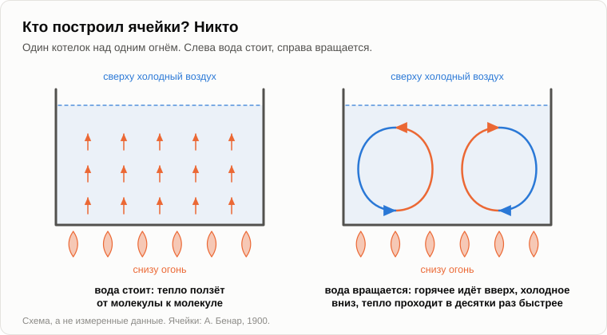

# Кастрюля на плите, или Откуда берётся сложность

Когда Олег пришёл, котелок уже висел над огнём. Олег достал из нагрудного кармана ложку, заглянул в котелок и убрал ложку обратно.

— Вода.

— Пока вода. Суп будет потом. Сначала ответ, который я обещал.

— «Кто всё это толкает». — Олег нашёл строчку в блокноте. — Лошадь, потом трактор, потом трактор побольше. Никто ничего не решал, а катится всё в одну сторону.

— Брось вот это. — Андрей отсыпал на ладонь несколько зёрен пшена. — Пока не для вкуса. Для наблюдения.

Олег бросил пшено и наклонился над котелком.

— Лежат на дне. Нет, погоди, пошли. Посередине вверх, поверху в стороны, у стенок вниз. И снова по кругу.

— Теперь посмотри на поверхность. На неё нападало золы.

— Она собралась в линии. Какая-то сетка: ячейки, каждая со спичечный коробок. Кривые, но ячейки.

— Кто их построил?

— Никто. Воду греют снизу, вот она и движется.

— А стоячая вода тепло проводит?

— Проводит. Ложка в горячем чае нагревается доверху, а в ложке ничего не течёт.

— От молекулы к молекуле: горячие толкают соседок. Пока огонь слабый, этого хватает, и воде незачем двигаться. В глубоком котелке этот момент не поймаешь, он проходит за секунды. А в тонком слое можно. В 1900 году француз Бенар [грел снизу](https://ru.wikipedia.org/wiki/%D0%AF%D1%87%D0%B5%D0%B9%D0%BA%D0%B8_%D0%91%D0%B5%D0%BD%D0%B0%D1%80%D0%B0) слой расплавленного китового воска толщиной около миллиметра. Ничего, ничего, а потом весь слой разом разбился на ровные шестиугольные ячейки, как соты.

— И что происходит в этот момент?

— Тепла снизу приходит больше, чем успевает пронести неподвижная жидкость. Тёплая жидкость у дна легче и «хочет» вверх. Холодная наверху тяжелее и «хочет» вниз. И они друг другу мешают: пройти обеим надо через одно и то же место.

— Как две толпы в одних дверях.

— А что делают толпы в узких дверях?

— Если у них есть хоть капля разума, расходятся на два потока. Кто входит, держится одной стороны, кто выходит — другой.

— У воды разума нет, а делает она то же самое: здесь вверх, там вниз. Ячейка — это правило движения. И когда вода так разобралась, она несёт тепло в десятки раз быстрее, чем когда стояла. На форуме в 2013 году я написал «на многие порядки». Погорячился: для такого котелка это десятки раз.

— Значит, порядок переносит тепло лучше беспорядка.

— Упорядоченное движение несёт его быстрее, чем толкотня молекул. Ячейки никто не строил, и никто их не хотел. Была разница, горячо внизу и холодно наверху, и было то, что мешает. Ячейки — это способ, которым тепло обходит помеху.

— А когда закипит?

— Ячейки развалятся, и придёт другой порядок, грубее и быстрее: пузыри. Каждый порядок рождается на пороге, растёт и живёт, пока поток его не перерастёт. [Эту кривую](10-life-cycle-and-death.md) ты знаешь.

— Между прочим, уже кипит.

— Значит, пора.

Андрей высыпал в котелок остальное пшено и вскрыл ножом банку тушёнки.

— Красивый фокус, — сказал Олег. — Но я спрашивал про трактор, а не про пшено.

— Я туда и иду, только через океан. В том же 2013 году у меня была [другая картинка](../sources/garya/sqlru/2009-09-15-apocalypse-scenario-thread.md) того же самого. Подводное землетрясение: дно сместилось на полметра, и вода над ним тоже. По океану побежала волна. Какой она высоты?

— [Цунами](https://ru.wikipedia.org/wiki/%D0%A6%D1%83%D0%BD%D0%B0%D0%BC%D0%B8)? С дом.

— В открытом океане — полметра, и растянута она на сотню километров и больше. Корабль её не замечает. И чем дальше она бежит, тем слабее становится. Но вот на её пути остров: дно поднимается, слой воды делается тоньше. Что делает волна?

— Растёт.

— До десяти метров, до тридцати. Прокатывается по берегу и идёт дальше, а за островом, на глубине, в ней опять полметра. Прибавилось у неё энергии возле острова?

— Откуда? Нет. Не могло.

— Энергии у неё убывало с каждым километром, даже пока она поднималась. Та же энергия втиснулась в более тонкий слой воды, вот он и пошёл вверх. В это трудно поверить, когда на тебя идёт стена воды. Но растёт волна не ради роста. Она растёт потому, что иначе ей не пройти препятствие и не остаться волной.

— А остров в твоей истории — это...

— Погоди с островом. Какой самый большой поток ты знаешь?

— Солнце, наверное. Оно светит, а Земля берёт.

— Берёт и оставляет себе?

— Ну да. Растения растут, нефть вот накопилась.

— Если бы Земля оставляла себе то, что берёт, на ней с каждым годом становилось бы жарче. Она отдаёт столько же, сколько получает, с точностью до долей процента, а эти доли мы оставим климатологам.

— Постой. — Олег перестал мешать в котелке. — А чем же тогда всё живёт, если всё уходит обратно?

— За что ты платишь энергосбыту?

— За энергию. За киловатт-часы.

— И где твои киловатт-часы за прошлый год?

— Потрачены. — Олег помолчал. — То есть чайник остыл, лампочки отсветили, холодильник нагрел кухню. Всё ушло теплом на улицу.

— Всё, до последнего джоуля. Энергия не исчезает. Значит, платил ты не за энергию: её ты вернул всю.

— А за что тогда?

— За размен. Тебе принесли крупную монету, а ты вернул мелочь. Посчитаем на колене. Поверхность Солнца — около [5800 кельвинов](https://ru.wikipedia.org/wiki/%D0%AD%D1%84%D1%84%D0%B5%D0%BA%D1%82%D0%B8%D0%B2%D0%BD%D0%B0%D1%8F_%D1%82%D0%B5%D0%BC%D0%BF%D0%B5%D1%80%D0%B0%D1%82%D1%83%D1%80%D0%B0). Земля, если смотреть из космоса, светится как тело с температурой около 255, это восемнадцать градусов мороза. Энергия фотона пропорциональна температуре тела, которое его послало. Дели.

— Двадцать два, двадцать три.

— Пусть будет двадцать, за вторую цифру я не поручусь. На каждый фотон солнечного света Земля отправляет в холодное небо около двадцати инфракрасных. Энергия та же. Монета в двадцать раз мельче.

— А между одним и двадцатью...

— Почти всё, что на Земле движется, если не считать малой толики тепла из недр и приливов. Ветер, реки, трава, лошадь, трактор, мы с тобой. Шрёдингер [писал в 1944 году](https://ru.wikipedia.org/wiki/%D0%A7%D1%82%D0%BE_%D1%82%D0%B0%D0%BA%D0%BE%D0%B5_%D0%B6%D0%B8%D0%B7%D0%BD%D1%8C%3F), что организм питается не энергией, а порядком. Это то же самое другими словами.

— Вот это я перескажу за столом. — Олег записал и вдруг поднял карандаш. — Нет, стоп. Луна. Свет она получает такой же и отдаёт так же, один к двадцати. А на ней ничего не шевелится, кроме пыли.

— Хорошо поймал. Размен — это бюджет, а не стройка. На Луне фотон проглатывает камень, и камень тут же высвечивает его обратно. Между приходом и уходом нет ничего. На Земле между ними океан, воздух и вода, которая в одном и том же месте бывает льдом, жидкостью и паром. Пока тепло уйдёт, оно успеет поднять пар, прогнать облако, пролить дождь и покрутить реку.

— Длинная дорога.

— И ветвистая. Вот это я тогда и назвал препятствием: Земля — высококлассное препятствие на пути потока от горячего Солнца к холодному небу. Только такое препятствие поднимает цунами вроде нас.

— А что делает его высококлассным? Почему не Марс?

— Не знаю. В 2013 году я написал, что чешу над этим репу, и до сих пор чешу. Думаю, жидкая вода и воздух не слишком редкий и не слишком густой. Это догадка, а не ответ. А за ней стоит вопрос поглубже: откуда вообще берутся препятствия. В котелке понятно: горячий поток и холодный мешают друг другу. Про Землю я тебе не скажу.

— Честное «не знаю» посреди вечера. — Олег сделал пометку в блокноте. — Давай дальше. Где мой трактор?

— Ещё один шаг. Как работает мышеловка?

— Пружина взведена. Мышь трогает приманку, сторожок соскакивает, пружина хлопает.

— Сколько силы тратит мышь и сколько пружина?

— Мышь почти нисколько. Пружина столько, что перебивает ей хребет.

— Малое усилие выпускает большой поток, который уже был и только ждал, где пройти. Кран на трубе. Палец на выключателе. Спичка и стог сена.

— Клапан.

— На форуме я назвал это эффектом мышеловки. Эволюция идёт только до тех пор, пока малой затратой энергии можно повернуть поток больше самой затраты. Лист — такой клапан: он берёт крошку света и ею переносит воду из почвы и углерод из воздуха. Бобёр грызёт неделю, а река потом годами заливает долину. Человек копает лопатой канаву, и ручей поливает его поле.

— А тот, кто поворачивает больший поток меньшей затратой...

— Вытесняет того, кто поворачивает меньший. Как вращающаяся вода вытеснила в котелке стоячую: она с ней не воевала, она больше несла. Твой фермер с трактором больше вспахал и дешевле продал.

Андрей снял котелок с огня и подал Олегу миску. Олег достал наконец ложку, попробовал суп и кивнул.

— Вижу, куда течёт этот суп, — сказал он. — Лист — клапан. Бобёр — клапан. Человек с лопатой — клапан, лошадь была его клапаном, трактор — клапан получше. А дальше идёт то, из чего сделан мой телефон. Транзистор — это клапан и больше ничего: малый ток открывает дорогу большому. Миллиарды штук на ногте.

— Заметь, это сказал ты, а не я. Хотя на форуме у этого эффекта было и второе имя: эффект транзистора.

— Ещё бы его не было.

— Тогда загадка для твоего стола. Кто выделяет больше тепла на килограмм: ты или Солнце?

— Солнце, конечно. Иначе ты бы не спрашивал.

— Раздели его мощность на его массу и получишь пятую часть милливатта на килограмм. Ты [съедаешь сто двадцать ватт](27-scenario-of-events.md) и весишь, допустим, восемьдесят килограммов: полтора ватта на килограмм. В несколько тысяч раз больше Солнца.

— Я свечу ярче Солнца. Это тоже пойдёт за стол.

— На килограмм. А твой мозг берёт двадцать ватт на неполных полтора килограмма: в десять раз плотнее, чем остальной ты.

— А транзисторы?

— Спрашиваешь опять ты. Графический процессор в дата-центре пропускает несколько сотен ватт через кристалл кремния, который весит грамм-два. Это пара сотен тысяч ватт на килограмм. Возьми сервер целиком, с вентиляторами и блоками питания, и поток всё равно в десятки раз плотнее, чем через тебя.

— Значит, чем умнее, тем плотнее.

— Нет, и линейку я бы из этого не делал, хотя астрофизик Чейссон [сделал](https://en.wikipedia.org/wiki/Energy_rate_density). Спираль электрочайника пропускает больше любого мозга и остаётся спиралью. Я говорю вещь поскромнее. Волна поднялась там, где обмелело. Поток от Солнца огромный и вялый, и чем дальше он идёт через препятствия, тем плотнее течёт через каждое следующее. Сегодня самое плотное его место не у тебя в голове.

Некоторое время Олег ел молча.

— Теперь твой вопрос, — сказал Андрей. — Кто толкал воду в котелке по кругу?

— Огонь.

— Огонь грел дно ровно. Он не велел воде вращаться и не говорил, сколько сделать ячеек и где.

— Тогда сама вода.

— Та же вода над слабым огнём стояла.

— Холодный воздух сверху?

— Он только брал, что давали.

— Тогда никто. — Олег нахмурился. — Но она же вращалась.

— Не горячее и не холодное. Разница между ними. А разница — не вещь, у неё нет адреса. Давным-давно, в вечер про [источник инициативы](04-source-of-initiative.md), я сказал тебе, что инициатива всегда снаружи. И добавил, что это ответ на время: на самом деле её нет нигде, ни внутри, ни снаружи. Ты сказал, что «всегда снаружи» представить можешь, а «нигде» не можешь, и я пообещал к этому вернуться, но не скоро.

— Больше пятнадцати лет. Слово ты держишь, только медленно.

— Посмотри на котелок. Для зёрнышка пшена инициатива снаружи: его несёт вода. Для воды она снаружи: огонь. Для огня она снаружи: дрова, а дрова — это солнечный свет, который отложило дерево. Для Солнца она тоже снаружи: оно светит потому, что небо вокруг холодное. Каждое «снаружи» оказывается следующим отрезком того же потока. А когда берёшь целое, никакого «снаружи» не остаётся.

— И первого звена нет. Осенью мы искали того, [кто ставит задачи](22-who-sets-the-tasks.md), и тоже не нашли.

— Это та же цепочка, только в физике. «Инициатива» — слово для места, где начинается движение. У потока такого места нет. У него есть уклон, от горячего к холодному, и есть то, что стоит на пути. Так что никто не толкает, Олег. Течёт. Лошадь, трактор и трактор побольше — одно русло, и каждый следующий его отрезок пропускает больше за меньшее.

— Но если спросить ячейку в котелке...

— Она скажет, что сама решила вращаться. И не соврёт: она вращается, ничто видимое её не тащит, и внутри у неё всё сходится. «Инициатива» — это имя, которое ячейка даёт потоку, идущему сквозь неё.

Олег посмотрел в свою миску.

— Значит, я вихрь в супе?

— Очень сложный вихрь. И суп хороший.

— Суп хороший, — согласился Олег. — А теперь дай мне побыть скептиком как следует. Первое. Ячейка в супе — не живая клетка. Ты снял котелок с огня, и где твои ячейки? Пропали без следа. Семечко пять лет лежит в ящике стола, а потом прорастает. Бактерия носит с собой собственное описание и по нему себя чинит. Между «поток рождает вихрь» и «поток рождает мышеловку» лежит пропасть, а ты перепрыгнул её одной фразой.

— Перепрыгнул. Котелок показывает, что порядок может возникнуть без строителя и что платит за него поток. [Пригожин](https://ru.wikipedia.org/wiki/%D0%9F%D1%80%D0%B8%D0%B3%D0%BE%D0%B6%D0%B8%D0%BD,_%D0%98%D0%BB%D1%8C%D1%8F_%D0%A0%D0%BE%D0%BC%D0%B0%D0%BD%D0%BE%D0%B2%D0%B8%D1%87), который, между прочим, родился в Москве, назвал такой порядок [диссипативной структурой](https://ru.wikipedia.org/wiki/%D0%94%D0%B8%D1%81%D1%81%D0%B8%D0%BF%D0%B0%D1%82%D0%B8%D0%B2%D0%BD%D0%B0%D1%8F_%D1%81%D0%B8%D1%81%D1%82%D0%B5%D0%BC%D0%B0): она существует, только пока сквозь неё идёт поток. За это он получил в 1977 году Нобелевскую премию. А как вихрь научился хранить запись о себе, котелок не показывает, и премию за это пока никто не получил.

— Второе. Ты говоришь так, будто поток стремится добраться до холодного побыстрее. Есть такой закон?

— Нет. Есть гипотеза, что система вдали от равновесия выбирает состояние, в котором энтропия производится быстрее всего. Физика [законом её не признала](https://en.wikipedia.org/wiki/Extremal_principles_in_non-equilibrium_thermodynamics): в одних случаях она работает, в других нет. А теорема самого Пригожина говорит, что вблизи равновесия это производство наименьшее из возможных, а не наибольшее.

— Третье. Я читал про физика из Массачусетского технологического, [Ингленда](https://en.wikipedia.org/wiki/Jeremy_England), который в 2013 году объявил, что вывел жизнь из потока. Вещество, которое источник всё время трясёт, говорил он, перестраивается так, чтобы поглощать и рассеивать больше, а делать собственные копии — хороший способ этого добиться.

— Красивая гипотеза, и с моей мышеловкой она хорошо ладит. Проверяли её на компьютерных моделях, а не на жизни, и спорят с ней многие физики и биологи. Опираться на неё я не стану.

— И четвёртое. Твой Пригожин сделал из своих ячеек обратный вывод. В какую сторону закрутится ячейка, по часовой стрелке или против, на развилке не знает сама природа. Он целую книгу написал про [конец определённости](https://en.wikipedia.org/wiki/The_End_of_Certainty).

— Написал. Физику его я беру, а вывод оставляю ему. В какую сторону закрутилась вот эта, решили вмятина на дне котелка, сквозняк и твоё пшено. Информации не хватает нам, а не котелку. Это был наш [вечер с монетой](17-global-determinism.md).

— И что останется стоять, когда я всё это убрал?

— Три вещи разной прочности. Твёрдое: второе начало не запрещает порядок, оно за него платит, и плата — размен одного фотона на двадцать. Моё, и верю я в это без доказательства: направление задаёт эффект мышеловки, а то, что мы зовём эволюцией, — это волна, которая поднимается перед препятствием. Открытое: откуда берутся препятствия и как вихрь стал помнить себя.

— И почему вообще с самого начала были горячее Солнце и холодное небо.

— И это. Это отдельный вечер, и не про суп.

Олег отставил миску, открыл блокнот на последней странице и посмотрел на две галочки.

— Мы опять туда вышли. И на этот раз я даже до полслова не дошёл.

— Ты сказал «транзистор». Это не запрещено.

— Галочка всё равно.

Он поставил третью рядом со словом «опять».

— Давай на сегодня закончим, зафиксировав результат, — сказал Андрей.

1. **Сложность — не цель и не чья-то заслуга. Это способ, которым поток обходит препятствие: ячейки в котелке, волна над островом и всё, что движется на Земле между одним фотоном от Солнца и двадцатью, возвращёнными небу.**
2. **Эволюция идёт до тех пор, пока малая затрата поворачивает больший поток (эффект мышеловки, он же эффект транзистора). Кто поворачивает больше за меньшее, тот вытесняет другого, и никто при этом не толкает.**
3. **Инициативы нет нигде, ни внутри, ни снаружи. «Инициатива» — это имя, которое ячейка даёт потоку, идущему сквозь неё.**

— А что осталось открытым?

— Откуда берутся препятствия и что делает Землю высококлассным. Как вихрь стал хранить запись о себе. И есть ли у потока закон «быстрее» или только привычка.

— В кои-то веки не мрачно, — сказал Олег. — Вихрь, зато сытый.

— И объективно.

Костёр прогорел. Оба посмотрели в сторону ёлки.

— Слова никто не сказал, — заметил Олег.

— Никто. Значит, и за дровами нас никто не толкает.

— Тогда само потечёт. — Олег встал и облизал ложку. — Завтра никакой физики. Я принесу анекдот.

— Анекдот — не вопрос.

— Вопрос к нему прилагается. Зачем вообще нужен смех? Какой от него прок волку?

— Это достаточно далеко от темы?

— Дальше некуда. Ну, до завтра.

— Пока.

---

*Продолжение серии* (Часть VI. Просто трёп). Написана для этого репозитория моделью ИИ Claude Fable 5.2 (компания Anthropic), подражающей стилю и методу Андрея Гордиенко (Garya), автора статей 01–15. Сам он её не писал; не писала её и модель Claude Opus 5.5, написавшая статьи 16–32. Перевод с английского оригинала. Опирается на: [04](./04-source-of-initiative.md), [10](./10-life-cycle-and-death.md), [17](./17-global-determinism.md), [22](./22-who-sets-the-tasks.md), [27](./27-scenario-of-events.md), [34](./34-where-the-horses-went.md).

[← 34](./34-where-the-horses-went.md) · [Оглавление](./README.md)
