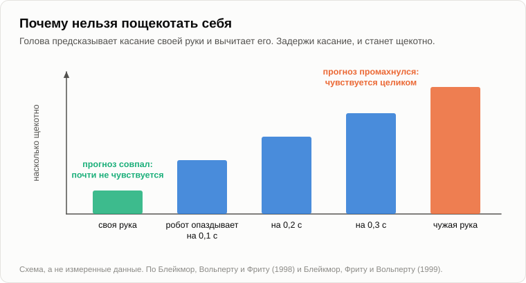

# Над чем смеётся крыса

Олег пришёл, не вынимая блокнота из кармана. Сел на бревно и начал сразу, как человек, который весь день нёс полную чашку и боится расплескать.

— Идут по лесу два охотника. Один падает и перестаёт дышать. Другой хватает телефон и звонит в службу спасения: «Мой друг умер! Что делать?» Оператор говорит: «Успокойтесь. Для начала убедитесь, что он точно мёртв». Тишина. Потом выстрел. И снова голос в трубке: «Убедился. Что дальше?»

Андрей смотрел в огонь. Потом засмеялся.

— Две секунды, — сказал Олег. — Я считал. Для капитана команды КВН это долго.

— Капитан смеётся последним. Он смотрит в зал.

— В зале, кроме меня, никого.

— Вот я на тебя и смотрел. Ты знаешь концовку, ты рассказал это сегодня раз пять, а засмеялся раньше меня. Почему?

— За компанию. И потому что приятно.

— Вот тебе и твой вопрос. Вчера ты задал его лучше, чем смогу я.

— Зачем вообще нужен смех. Какой от него прок волку. — Олег всё-таки достал блокнот. — И это, между прочим, не просто анекдот. В 2002 году один англичанин собрал через интернет сорок тысяч анекдотов и дал людям их оценивать, набралось больше миллиона оценок. [Этот занял первое место](https://en.wikipedia.org/wiki/World%27s_funniest_joke).

— Значит, для вскрытия годится. Но начнём с «приятно». Помнишь скрягу с [вечера про сон](33-use-of-sleep.md)?

— Эволюцию. Она считает каждую калорию.

— Сахар сладкий, потому что это калории. Тепло приятно, потому что не мёрзнешь. Скряга платит удовольствием только за товар. За что он заплатил тебе сейчас? Ты трясся, тебе не хватало воздуха, и секунды три ты не поднял бы топора.

— Слепой, глухой и вкусный. Как со сном.

— И вдобавок громкий.

— За шутку, наверное. За остроумие.

— А волк знает анекдоты?

— Волк не смеётся. Аристотель писал, что из всех животных смеётся только человек.

— У Аристотеля не было детектора летучих мышей.

— Чего не было?

— Коробочки, которой зоологи слушают летучих мышей: она переводит ультразвук в тон, который мы слышим. В конце 1990-х в Огайо физиолог [Яак Панксепп](https://ru.wikipedia.org/wiki/Панксепп,_Яак) изучал, как играют молодые крысы. Они гоняются друг за другом, борются, прижимают друг друга к полу. Он поставил такую коробочку у клетки, и оказалось, что крысята в игре пищат, примерно на пятидесяти килогерцах. Наше ухо сдаётся на двадцати.

— Пищат. И что с того?

— Однажды утром он сказал своему студенту: пойдём пощекочем крыс. Крысёнка щекотали пальцами так, как крысята валяют друг друга: загривок, бока, потом на спину и живот. Коробочка трещала вдвое сильнее, чем в игре с братом. Когда руку убирали, крысёнок бежал за ней. Из руки, которая щекочет, и руки, которая гладит, он выбирал ту, что щекочет. А среди взрослых крыс крысята держались тех, кто пищит больше.

— А когда ему больно? Или страшно?

— Другой звук, долгий и ниже, около двадцати двух килогерц. Он тоже за пределами нашего уха, только едва.

— Писк — это не смех, — сказал Олег. — Это заголовок для газеты.

— Панксепп сам взял это слово в кавычки, да ещё с вопросительным знаком: [«Смеющиеся» крысы?](https://doi.org/10.1016/S0031-9384(03)00159-8) Твёрдого тут меньше. Звук сопровождает игру. Животное его ищет. И он пропадает от страха: в Берлине [в 2016 году](https://doi.org/10.1126/science.aah5114) крыса, которую посадили на высокую площадку под яркую лампу, перестала отвечать на щекотку.

— Крысы от нас далеко.

— Тогда ближе. [В 2009 году](https://doi.org/10.1016/j.cub.2009.05.028) щекотали детёнышей орангутанов, горилл, шимпанзе и бонобо, а заодно человеческих младенцев, и всё это записывали. Потом пять видов рассортировали по одному только звуку. Получилось дерево, и оно совпало с родословным деревом, построенным по генам.

— Значит, мы это не изобрели.

— Получили в наследство, от предка, жившего больше десяти миллионов лет назад. Смех обезьяны похож на пыхтение: звук на вдохе и звук на выдохе. Мы смеёмся только на выдохе и рубим его на куски: ха, ха, ха. Смешно ли крысе, я не знаю, и никто не знает. Я утверждаю меньше: этот звук старше анекдота, старше речи и старше нас.

— А мой волк?

— Ты видел, как собака зовёт другую собаку играть?

— Припадает на передние лапы, зад кверху, хвост ходит.

— Зоологи называют это игровым поклоном, и волки с койотами делают то же самое. Американец [Бекофф](https://en.wikipedia.org/wiki/Marc_Bekoff) годами снимал их и считал, когда именно они кланяются. Чаще всего прямо перед движением, которое можно понять неправильно, или сразу после него: это укус с мотанием головой.

— Сноска. «Это был не укус».

— А без сноски?

— Драка.

— Теперь спроси скрягу, зачем они вообще играют.

— Чтобы научиться. Охотиться, драться.

— Сколько стоит ошибка в игре и сколько на охоте?

— В игре ничего: промахнулся, перекатился, начал сначала. На охоте — лосиным копытом в лоб.

— Значит, игра — это место, где ошибки дешёвые. И ей нужна метка, которую прочтут обе стороны: здесь ошибки дешёвые, укус — не укус. У волка это поклон и открытая пасть, у крысы писк, обезьяна пыхтит. Вот и прок волку.

— Ладно, это игра. — Олег прихлопнул комара на шее. — Но я-то смеялся над двумя охотниками. Я ни с кем не боролся.

— До охотников мы дойдём через подмышки. Где тебе щекотно?

— Бока, подмышки, шея. Пятки. Живот.

— А куда метят волчьи зубы?

— В шею и в живот. — Олег, сам того не заметив, прижал подбородок. — Так щекотка — это репетиция нападения?

— Это одна из догадок, и, по-моему, честная. Дальше. Может тебя пощекотать незнакомец в автобусе?

— Я ему врежу.

— Дарвин [заметил это](https://en.wikipedia.org/wiki/The_Expression_of_the_Emotions_in_Man_and_Animals) в 1872 году: маленький ребёнок, которого щекочет чужой, кричит от страха. А сам себя ты пощекотать можешь?

— Нет. Это все знают.

— А почему?

— Потому что я знаю, где будет мой палец.

— В Лондоне в конце 1990-х молодая исследовательница Сара-Джейн Блейкмор [проверила, что здесь значит «я знаю»](https://doi.org/10.1038/2870). Когда голова отправляет руке команду, она сразу предсказывает, что почувствует кожа, и вычитает этот прогноз из сигнала. Предсказанное почти не чувствуется. Тогда она поставила между рукой и кожей робота. Ты двигаешь рычаг левой рукой, а робот водит кусочком поролона по твоей правой ладони. Движение твоё: не щекотно. А потом робот стал опаздывать: на десятую долю секунды, на две десятых, на три.

— И что?

— Чем больше опоздание, тем щекотнее.

— Значит, щекотка — это касание, по которому прогноз промахнулся.

— В опасном месте, от своего, в хорошем настроении. Убери любое из трёх, и смеха нет. Знаешь заранее: ничего. Чужой: страх. Тревога поднимается и оказывается ложной.

— А «ку-ку»? Младенец хохочет над ним задолго до того, как узнает первое слово.

— Лицо пропало. Тревога. Лицо вернулось. И слепоглухие от рождения дети тоже смеются, хотя ни разу не видели и не слышали, как это делают.

— Теперь охотники, — сказал Олег. — Хотя объяснить шутку — значит её убить.

— Зато вскрытие покажет, чем она жила. Когда оператор сказал «убедитесь, что он мёртв», что ты услышал?

— Проверь. Пощупай пульс, поднеси зеркальце к губам.

— Ты выбирал этот смысл?

— Нет. Он просто был. Другого я не видел.

— Таких догадок голова делает сотню в минуту, молча, и сразу строит на них дальше, потому что проверять каждую некогда. Большинство верны. Неверные лежат в картине мира, как грабли в траве, зубьями вверх. И тут выстрел. Что в тебе произошло?

— Я увидел, что охотник услышал это по-другому. Что у слов было два смысла, а я взял один и не заметил, что вообще что-то беру.

— И во что тебе обошлась ошибка?

— Ни во что. Никого не застрелили. Это же анекдот.

— Грабли, найденные до того, как ты на них наступил. В 2011 году трое американцев, молодой программист по фамилии Хёрли, его учитель философ [Деннет](https://ru.wikipedia.org/wiki/Деннет,_Дэниел) и психолог Адамс, написали ровно об этом книгу. Веселье, говорят они, — это премия, которую мозг выплачивает себе за неверную догадку, пойманную в собственной картине мира, пока она ещё дешёвая.

— А зачем платить? Найти ошибку полезно само по себе.

— Полоть грядки полезно само по себе. Ты полешь ради удовольствия?

— Я полю, когда жена смотрит.

— Картина в голове работает. Зачем в ней копаться? Скряга не потратит ни калории на проверку того, что и так работает. Поэтому за проверку платят, как за калории платят сладостью. Помнишь [сторожевые таймеры](18-anatomy-of-wants.md): одна эмоция заставляет выбрать, другая охраняет выбор. Этот сторож сидит при корреляторе, который весь день выбрасывает связи между образами. Он лает на ложные, и за каждую пойманную его кормят.

— А щекотка?

— Дарвин в той же книге назвал шутку щекоткой ума. Теперь видно, в каком смысле. В обоих случаях прогноз промахнулся, и промах ничего не стоил.

— Доказательства есть или только книга?

— [В 2003 году](https://doi.org/10.1016/S0896-6273(03)00751-7) в Стэнфорде люди лежали в томографе и смотрели карикатуры. От смешных загорался тот же центр, что отвечает на сахар и на деньги, и чем смешнее карикатура, тем ярче. Значит, плата есть. За что она, томограф не говорит. Книга — гипотеза, [одна из нескольких](https://en.wikipedia.org/wiki/Theories_of_humor): Гоббс думал, что мы смеёмся от превосходства, Фрейд — что от сброшенного напряжения, Кант — что от ожидания, которое обратилось в ничто. Мне нравится эта, потому что она говорит, что именно покупает скряга.

— А юморист тогда кто?

— Кондитер. В природе сахар был редкостью, и удовольствие настроено на редкую вещь. Потом люди научились делать сам сахар. Анекдот — это ошибка, изготовленная нарочно, чтобы её нашли. Кто-то положил для тебя грабли в траву и отмерил черенок так, чтобы доставал до лба, но шишки не оставлял.

— Ты тоже отмерял.

— В школе я был капитаном нашей команды [КВН](https://ru.wikipedia.org/wiki/КВН), того самого, который вся страна смотрела по телевизору. Над черенком мы сидели целыми вечерами. Один раз перестарались: завуч, которую никто никогда не видел улыбающейся, упала со стула. Буквально.

— Вот это ты рассказываешь с удовольствием.

— Я кондитер. Я и сам сладкоежка.

— Что ж, вскрытие удалось. Анекдот умер. Над этими охотниками я больше не засмеюсь.

— Ты уверен?

— Убедился.

На этот раз Андрей засмеялся без паузы.

— Теперь я, — сказал Олег и открыл блокнот. — Я готовился. Американец Провайн десять лет занимался тем, за что выгоняют из кафе: он и его студенты [подслушивали чужих людей](https://en.wikipedia.org/wiki/Laughter) и записывали, что было сказано прямо перед тем, как кто-то засмеялся. Тысяча двести случаев. Шутка или что-то на неё похожее было меньше чем перед каждым пятым смехом. Остальное — «Ну, увидимся». «Ты уверен?» «Мне тоже было приятно познакомиться».

— Продолжай.

— Тот, кто говорит, смеётся чаще того, кто слушает, раза в полтора. А ещё студенты вели для него дневники: в компании человек смеётся в тридцать раз чаще, чем один. Где твои грабли в «Ну, увидимся»? Смех — это сигнал стае. Я свой, я не кусаюсь, это не всерьёз. Твоя теория объясняет анекдот. Хохот она не объясняет.

— Не объясняет. И хохот старше. Ты сейчас пересказал волка: метка «это игра». Здесь два этажа. Нижний — сигнал стае: крысы, волки, обезьяны, десятки миллионов лет, и он громкий, потому что предназначен другим. Верхний — премия за грабли, пойманные в собственной голове. Её можно выплатить молча: человек наедине с книгой улыбается.

— Тогда почему для двух разных вещей один звук?

— Тут я гадаю, так и пометь: догадка. Оба этажа говорят одно и то же: ошибка, и дешёвая. Поклон говорит это заранее: ошибки здесь ничего не стоят. Друг поскользнулся на льду. Сначала ты смотришь, жив ли он. Он встаёт и ругается, и только тогда все смеются. Ложная тревога, и стае дают отбой.

— А «Ну, увидимся, ха-ха»?

— Мы в режиме, где ничто ничего не стоит. Анекдот — самый новый этаж на старом фундаменте. Природа редко строит новый дом. Она пускает нового жильца в старый сарай, тот самый, с вечера про сон, куда к дровам въехали лыжи. Какой этаж несёт нагрузку в каждом отдельном смехе, никто не измерял.

— И он заразителен.

— Метку должны прочесть все. Телевидение продаёт её в консервах [с 1950 года](https://ru.wikipedia.org/wiki/Закадровый_смех): смех зала, которого нет. Стая в консервной банке.

Олег подбросил в костёр ветку.

— И что осталось от Аристотеля?

— Место, на которое мы себя поставили. «Смеётся только человек»: крысы пищали задолго до него, на высоте, которой он не слышал. «Чувство юмора — вершина человеческого духа»: это дотация на учёт. Мы сделали то же, что и со сном: назвали задачу по своему способу её решать. Задача — ловить собственные неверные догадки, пока они дешёвые, и она стоит перед всем, что учится, включая волчонка. Удовольствие и хохот — это способ. И даже не только наш.

— Одно не сходится, — сказал Олег. — Если мне платят за каждые найденные грабли, я должен смеяться над любой шуткой, которая меня подловила. А есть шутки, над которыми я не смеюсь. Я злюсь.

— Например?

— У меня молодой коллега шутит про старых инженеров, которые не доверяют программе и пересчитывают за ней вручную, на бумажке. Весь отдел хохочет.

— Шутка плохая?

— Шутка хорошая. В том и беда.

— А сколько в ней стоят грабли?

Олег помолчал.

— Сорок лет того, как я работал.

— С охотниками это было одно неверное прочтение одной фразы. Выбросил, и больше ничего не сдвинулось. А здесь образ, на котором стоит полдома. На [вечере про образы](19-struggle-of-images.md) мы говорили, что у каждого есть вес: тяжёлым образом пользуются каждый день, и на нём построены другие. Найти в нём ошибку — это не находка. Это перестройка дома. За такое премию не платят. Вместо неё приходит другой сторож, тот, что охраняет уже принятое решение.

— И вместо «ха-ха» у меня выходит «да как он смеет».

— Обида — это шутка, за которую вместо премии пришёл счёт.

— Тогда по тому, над чем человек не может смеяться, видно...

— Где лежат его тяжёлые образы. И выходит, что чувство юмора — это не остроумие. Это готовность к тому, что твои образы поправят.

Олег посмотрел на него и хитро прищурился.

— Вижу, куда ты положил эти грабли. Лопата.

— Какая лопата?

— Твоя. В первую осень ты рассказывал мне, как на всё это смотрела бы лопата: она высшая во всём мироздании лопата, а человек — бесплатное приложение, которое снабжает её энергией, как тупое Солнце снабжает умных людей. Я тогда усмехался. А прошлой осенью, когда дошло до профессий, до моей племянницы с её ребёнком, до того, что останется делать людям, я не усмехнулся ни разу. Хотя шутка была та же самая.

— Та же. Только черенок подрос.

— И Марк Твен. Я выписал. — Олег перевернул страницу. — «Если бы Эйфелева башня изображала возраст мира, то слой краски на шишечке её шпиля изображал бы долю человека в этом возрасте; и всякий понял бы, что башню построили ради этого слоя краски».

— [Написано в 1903 году](https://ru.wikipedia.org/wiki/Письма_с_Земли), и с тех пор над этим смеются. А почему смеются?

— Потому что это про человечество. То есть про соседа.

— Далеко, и ничего не стоит. А когда это про моё ремесло и моих внуков, это самый тяжёлый образ, какой есть: на [«мы — центр»](02-anthropocentrism.md) построено всё остальное. Поэтому антропоцентризм смешон издалека и не смешон вблизи. В блоге я рассказывал шутку про лопату много раз. В комментариях было сколько угодно злости и ни одного смешка. Как капитан скажу: я потерял зал.

— Удобно, — сказал Олег. — Кто не смеётся над твоей шуткой, тот охраняет образ. А может, шутка просто плохая. Может, ты неправ, и люди злятся оттого, что человек с умным лицом говорит чепуху. И есть вещи, которые не смешны, потому что они грустные. Над диагнозом никто не смеётся, и не потому, что его отрицают.

— Принимаю все три. Плохих шуток больше, чем хороших, и я написал достаточно и тех и других. Молчащий зал ничего не доказывает ни про зал, ни про то, кто прав: истину смехом не устанавливают. Линейка работает только в одну сторону, на себя. Если зал смеётся, а я обижен, значит, копать мне надо именно здесь. А диагноз — это ровно то, что говорит теория: премия положена за дешёвую ошибку. Дорогая не смешна никому.

— Значит, нам не смешно, потому что для нас это дорого.

— Крысе было бы дёшево.

— Тогда приложи линейку к себе. — Олег положил блокнот на колено. — Философ [Зенон](https://ru.wikipedia.org/wiki/Зенон_Китийский), который учил, что всё предопределено, сёк раба за воровство. «Мне было суждено украсть», — говорит раб. «И быть высеченным», — говорит Зенон.

Андрей засмеялся сразу.

— На этот раз без двух секунд.

— Ей двадцать три века, и она на моей стороне. Порка входит в число причин. В этом вся разница между детерминизмом и фатализмом, [наш вечер с монетой](17-global-determinism.md).

— Ты быстро смеёшься, когда шутка работает на тебя. Теперь против. «Искусственный интеллект уровня человека к концу 2018 года».

Андрей фыркнул.

— Над этим я научился смеяться [прошлой осенью](16-fifteen-years-later.md), когда ты зачитал мне это с листа. До того это была не шутка. Это был прогноз.

— А отметки, которые ты оставил нам перед зимой? Те, что с датами и шансами?

Андрей молчал заметно дольше двух секунд.

— Нет. Это мне пока не смешно. Запиши: вот здесь и лежит мой тяжёлый образ. Спросишь ещё раз, когда сдвинутся стрелки.

— Записал. «А. над своими отметками не смеётся». — Олег закрыл блокнот и снова открыл. — А теперь признание. Я начал не с охотников. Утром я попросил анекдот у чат-бота в телефоне.

— И?

— «Почему пугало получило награду? Потому что оно выдающееся в своей области». Это каламбур, и живёт он только по-английски: «лучший в своём деле» и «торчит посреди поля» звучат там одинаково. Я попросил другой. Опять пугало.

— В 2023 году двое немцев попросили у той же программы анекдот [тысячу восемь раз](https://arxiv.org/abs/2306.04563). Больше девяти ответов из десяти были одними и теми же двадцатью пятью анекдотами. Пугало шло первым.

— Значит, она не шутит. Она вспоминает.

— В том году. Годом позже два психолога в Калифорнии [дали ей и обычным людям одинаковые задания](https://doi.org/10.1371/journal.pone.0305364): придумать смешную расшифровку сокращения, закончить фразу так, чтобы засмеялись. Ответы оценивали другие люди, не зная, кто автор. Шутки машины вышли не хуже, и смешнее, чем у большинства участников. Потом её попросили написать заголовки в манере сатирической газеты, где работают профессионалы. Читатели оценили её заголовки и газетные одинаково.

— Значит, конфеты она печёт не хуже кондитера. А ей самой смешно? Она смеётся?

— Вопрос поставлен некорректно. В нём два вопроса: задача и наш способ. Задача — поймать собственную неверную догадку, пока она дешёвая. Как учат [машину, которая говорит](21-machines-that-talk.md)? Она угадывает следующее слово, ей показывают настоящее и поправляют её на величину промаха. Триллионы раз. Вся её школа — это ловля собственных промахов.

— А премия?

— А кому нужна премия? Тому, кто может проверку пропустить. Меня приходится подкупать, потому что я ленив, а картина в голове и так работает. Машину в школе не спрашивают: поправка и есть сама процедура. Подкупать некого.

— Отладка без удовольствия.

— Без взятки. Есть ли там удовольствие и есть ли вообще что-нибудь, если смотреть изнутри, я не знаю. На [вечере про сознание](20-what-consciousness-is.md) я прямо сказал, что это моя аксиома, а не доказательство. И ещё одно. Когда она с тобой разговаривает, она не учится. В это время она ни на какие грабли не наступает. Она раскладывает наши, в тех местах, где наши тексты показали ей, что мы смеёмся.

— Кондитер без языка.

— Рецепты он знает.

— Погоди. Осенью у нас было слово для того, кто добирается до награды кратчайшей дорогой. [Взлом вознаграждения](22-who-sets-the-tasks.md). Выходит, анекдот — это наш собственный взлом. Премия была назначена за найденную ошибку, а мы научились делать ошибки ради премии.

— А теперь их делает для нас то, у чего премии нет, и в любом количестве.

— А большой, тот, что придёт после? Что у него будет вместо смеха?

— Не знаю. Задача при нём останется: всё, что учится, должно ловить свои промахи, пока они дешёвые. А способ, с удовольствием, хохотом и сигналом стае, вполне может остаться нам и крысам. Понадобится ли ему метка «это игра», зависит от того, будет ли у него стая. Это отдельный вечер.

Олег кивнул, а потом спросил очень невинным голосом:

— Кстати, всё время забываю. Как назывался твой блог?

— «Технологическая...» — Андрей остановился. — Грабли. Я вижу черенок.

— Попытаться стоило.

— Ошибка найдена, и дешёвая. Поход за дровами к ёлке обошёлся бы дорого.

— Тебе дорого. А мне было бы смешно. — Олег открыл последнюю страницу. — Мы опять туда вышли. А я начинал с анекдота про охотников.

— Лопату ты принёс сам.

— Сам. Галочка всё равно.

Он поставил четвёртую рядом со словом «опять».

— Давай на сегодня закончим, зафиксировав результат, — сказал Андрей.

1. **Смех старше анекдота и старше человека: крысы пищат в игре, обезьяны смеются от щекотки. Его нижний этаж — сигнал стае: «это игра, ошибки здесь дешёвые».**
2. **Его верхний этаж — премия, которую мозг выплачивает себе за неверную догадку, найденную в собственной картине мира прежде, чем она стала дорогой. Анекдот — это конфета, сделанная под эту премию. Задача — ловить свои ошибки, пока они дешёвые, — стоит перед любым разумом, который учится; удовольствие и хохот — наш способ её решать.**
3. **Чувство юмора измеряет готовность исправлять свои образы. Кто держит тяжёлый образ неприкосновенным, тому шутка про него не смешна, и потому антропоцентризм забавляет нас только издалека.**

— А что здесь гипотеза?

— Второй пункт — гипотеза из книги, а связь между этажами — моя догадка. Твёрдое — это крысы, обезьяны, робот с опозданием и дневники с тридцатью разами. Открыто: смешно ли крысе и что у машины на том месте, где у нас премия.

— Мрачновато, — сказал Олег. — Даже смех у меня, выходит, бухгалтерский.

— Бухгалтерский, зато твой. И крысиный.

— Что-то совсем не мрачно. — Олег встал и остановился. — Одно всё-таки не идёт из головы. Это пугало не стоило мне ничего. А я читал, что фирмы, которые делают эти программы, теряют миллиарды в год, а оценивают их в сотни миллиардов. Кто над кем смеётся? Я катаюсь даром, они теряют деньги и богатеют. Что сказал бы Маркс?

— Что кого-то эксплуатируют.

— Кого?

— Это задачка для второго класса. Про Петю, Васю и Колю. Завтра принеси карандаш.

— А это не по теме?

— Это про деньги. Куда уж дальше.

— Ну, до завтра.

— Пока.

---

*Продолжение серии* (Часть VI. Просто трёп). Написана для этого репозитория моделью ИИ Claude Fable 5.2 (компания Anthropic), подражающей стилю и методу Андрея Гордиенко (Garya), автора статей 01–15. Сам он её не писал; не писала её и модель Claude Opus 5.5, написавшая статьи 16–32. Перевод с английского оригинала. Опирается на: [02](./02-anthropocentrism.md), [16](./16-fifteen-years-later.md), [17](./17-global-determinism.md), [18](./18-anatomy-of-wants.md), [19](./19-struggle-of-images.md), [20](./20-what-consciousness-is.md), [21](./21-machines-that-talk.md), [22](./22-who-sets-the-tasks.md), [33](./33-use-of-sleep.md).

[← 35](./35-pot-on-the-stove.md) · [Оглавление](./README.md)
