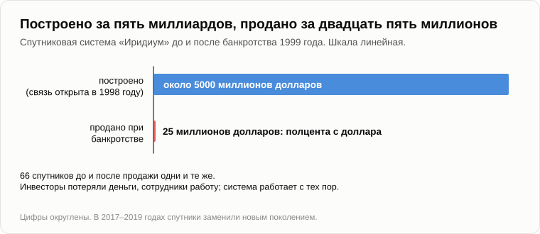

# Кто кого эксплуатирует, когда бизнес убыточен

Олег пришёл с пруда: удочка на плече, пустой садок в руке, карандаш за ухом.

— Карандаш, как заказывали, — сказал он. — Рыбы не будет. Поела и ушла.

— Что поела?

— Полкило прикормки, коробку опарыша и поплавок, он остался на коряге. Прибавь бензин до пруда и обратно. — Он сел на бревно и посчитал на пальцах. — Тысяча шестьсот рублей. Приход: три плотвички, и кот уже записал их на себя.

— Убыточное предприятие.

— Не сыпь соль.

— Не сыплю. Садок не убирай, он нам понадобится. С чем ты вчера ушёл?

— С фирмами, которые теряют миллиарды в год, а стоят сотни миллиардов. — Олег раскрыл блокнот. — Цифры я выписал.

— Подождут. Сначала задачка, которую я обещал. Пиши. Дано: капиталист получил прибыль. Пятьдесят рублей за счёт эксплуатации Пети, сто пятьдесят за счёт эксплуатации Васи, двести за счёт эксплуатации Коли. Всего четыреста. Найти: кого из троих ему уволить, чтобы прибыль выросла?

Олег записал и поднял глаза.

— А подвох где?

— Его нет. Это задачка для второго класса. Я [задал её](../sources/garya/sqlru/2009-09-15-apocalypse-scenario-thread.md) на форуме в 2017 году человеку, который был уверен, что прибыль есть эксплуатация наёмных работников.

— Тогда никого. Уволишь Петю, останется триста пятьдесят. Уволишь Колю, двести. Если каждый приносит плюс, надо нанимать, а не увольнять.

— А что хозяева делают в жизни?

— Увольняют. Покупают станок и увольняют. — Олег постучал карандашом по странице. — Это был наш вечер [про Маркса](06-karl-marx-mistake.md). Пасечник с ложкой и мёд, который делают пчёлы. Стоимость создаёт станок, а хозяин и рабочий её делят.

— Значит, задачка решена?

— Не спеши. У меня есть знакомый марксист, и я знаю, что он скажет. У тебя «дано» неверное. Прибыль не пришита к каждому работнику, как номерок к пальто в гардеробе. Хозяин, который первым купил станок, делает вещь дешевле соседей, а продаёт по соседской цене. Он снимает то, что создают их рабочие. А когда станок купят все, снимать станет нечего и норма прибыли упадёт. У Маркса [и про это написано](https://ru.wikipedia.org/wiki/Тенденция_нормы_прибыли_к_понижению).

— Хороший ответ, и половину его я принимаю. Первому действительно достаётся волна сверхприбыли, и рынок его действительно догоняет. А теперь пройди за своим знакомым до конца. Завод совсем без рабочих, [без людей и без света](https://ru.wikipedia.org/wiki/Безлюдное_производство). Из чьего труда его прибыль?

— По нему выходит, из труда рабочих на других заводах.

— А когда все заводы станут такими?

— Тогда по нему прибыли нет нигде. А по тебе?

— По мне, раньше кончатся покупатели: это был вечер [про кризис](07-global-economic-crisis.md). Мы с ним идём к одному обрыву разными дорогами. Я только отказываюсь по дороге говорить, что мёд делает пасечник. Но это старый спор. Сегодня переверни страницу и запиши ту же задачку с другим знаком.

— С каким?

— С минусом. Дано: капиталист получил убыток. Пятьдесят рублей на Пете, сто пятьдесят на Васе, двести на Коле. Всего минус четыреста. Найти: кто кого эксплуатировал?

Олег записал, перечитал и фыркнул.

— Петя, Вася и Коля эксплуатировали капиталиста. Коля сильнее всех.

— Ты это с серьёзным лицом написал?

— С кривым. Это чушь.

— Почему? Если плюс в строке хозяина есть неоплаченный труд Пети, то минус в той же строке есть неоплаченные деньги хозяина. Кто-то же их получил.

— Петя получил зарплату. Одну и ту же в обеих задачках.

— Одну и ту же?

— Та же зарплата, тот же станок, те же восемь часов. Петя даже не знает, на какой он из двух страниц.

— Тогда что изменилось между страницами?

— Знак в строке хозяина. Покупатель не пришёл, или цена упала, или сосед сделал вещь дешевле.

— Значит, у нас есть слово, которое превращается в свою противоположность, пока ни в Пете, ни в его работе, ни в его зарплате ничего не меняется.

— Тогда это слово не про Петю, — медленно сказал Олег.

— Мои задачки не про количество рублей. Они про плюс и минус. Я [спрашивал об этом](../sources/garya/sqlru/06-karl-marx-mistake.md) под статьёй про Маркса в декабре 2011 года. Капиталист вложил в бизнес личные деньги, бизнес два-три года работает в убыток и закрывается. Кто кого эксплуатировал? Являются ли пролетарии эксплуататорами, когда прибавочная стоимость имеет знак «минус»?

— И что ответили?

— Ничего. Уже больше пятнадцати лет.

— Мой марксист ответил бы, — сказал Олег. — Он сказал бы, что симметрии тут нет. Капитал хозяина — это вчерашняя прибыль, то есть труд, за который кому-то раньше не заплатили. Теряя его, он только возвращает взятое.

— Сильнее ответа нет. Давай проверим его на живом случае. Один мой родственник когда-то обошёл всю родню, занял у всех, взял сверху кредит в банке, купил оборудование и нанял троих.

— Петю, Васю и Колю.

— Пусть так. Цену они назвали сами и получали её день в день. Он жил впроголодь и трясся над кредитом, а каждый из троих уносил домой в несколько раз больше, чем он. Чей неоплаченный труд был в его капитале?

— Тёткины сбережения с зарплаты. И деньги банка, то есть чужие вклады. — Олег почесал карандашом в затылке. — В основном с зарплат.

— Значит, если бы он прогорел, наёмные работники заплатили бы наёмным работникам через хозяина, который вдобавок продал бы квартиру.

— «Рабочие эксплуатировали рабочих». Нет. Это ещё глупее первого.

— Когда любой ответ на вопрос выходит глупым, что мы говорим о вопросе?

— Что он некорректно поставлен. Ладно. Но четыреста рублей на первой странице откуда-то взялись. Если не из Пети, то откуда?

— Из того, чего они втроём со станком не могут порознь. Петя один в сарае, Вася один, Коля один и станок в ящике дают одну сумму. Те же четверо, собранные вместе, дают бóльшую. Разница принадлежит целому, а не какой-то из его частей, поэтому в ней и не найти «того, кто приносит меньше всех». По-моему, это самое большое, что упустил Маркс. Хозяин — тот, кто собрал целое, а его строка — то, что осталось от разницы, когда всем заплатили.

— А целое может выйти хуже своих частей.

— Тогда разница с минусом, и попадает она в ту же строку. Петя не изменился.

Олег подбросил в костёр ветку.

— Мелочь, — сказал он. — Мастерская, тётка. Давай крупную рыбу.

— Фирма, которая вызывает тебе такси через телефон, [Uber](https://ru.wikipedia.org/wiki/Uber), основана в 2009 году. Первую годовую операционную прибыль она показала в 2023-м. К тому времени у неё набралось больше тридцати миллиардов долларов убытков.

— Четырнадцать лет в минусе. Чьи тридцать миллиардов?

— Инвесторов. Японский холдинг, саудовский государственный фонд, инвестиционные и пенсионные фонды, а потом все, кто купил акции.

— Пенсионные фонды. Опять деньги наёмных работников. — Олег присвистнул. — И где они теперь? Потраченный рубль есть чей-то полученный рубль, он не сгорает.

— Тогда проследи. Кто их получил?

— Первым делом пассажир. Я помню те годы: поездка стоила дешевле бензина на неё.

— По подсчёту одного транспортного аналитика, Хьюберта Хорана, в 2015 году пассажир платил примерно две пятых того, во что обходилась его поездка. Остальное платил инвестор.

— Второй — водитель. Их переманивали премиями. И третьи — программисты, серверы, карты.

— Что сегодня осталось у пассажира от его доли?

— Ничего. Он доехал.

— У водителя?

— Тоже ничего. Бензин, еда, взнос за машину.

— А у третьего?

— Программа. Карты. — Олег подумал. — Запись о десятках миллиардов поездок: кто куда едет, в котором часу и сколько готов за это отдать. Этого никто не съел.

— И ещё одно, чего нет ни в одном балансе. К концу 2023 года около ста пятидесяти миллионов человек в месяц нажимали кнопку вместо того, чтобы поднять руку у обочины.

— Это [образ в голове](19-struggle-of-images.md). И уже тяжёлый: я сам разучился поднимать руку.

— Так кто кого эксплуатировал?

— А с какой стороны смотреть? — Олег начал загибать пальцы. — Инвестор скажет: пассажиры и водители четырнадцать лет ели мои деньги. Водитель скажет: фирма берёт свою долю с каждой поездки, которую я делаю на своей машине и на своём бензине. Пассажир скажет: никто никого не эксплуатировал, меня просто подвезли. А старый таксопарк скажет, что эти трое вместе его разорили.

— Четыре берега, четыре ответа. А река?

— Одна. — Олег посмотрел на садок. — Так вот он зачем. С моего берега плотва меня сегодня ограбила. С её берега в шесть утра открылась бесплатная столовая.

— А с берега магазина, который продал тебе прикормку?

— Хороший день.

— Эксплуатация — это вид на поток с одного берега. Каждый из четверых говорит правду, и каждый посчитал только свой берег.

— Погоди, овечками я инвесторов не отпущу. Они кормили рыбу не по доброте. Они прикармливали место: уморить таксопарки, остаться на берегу одним и потом поднять цену. И подняли же.

— Подняли, и знак сменился на плюс. Теперь по Марксу фирма опять эксплуатирует водителя, а по пассажиру — грабит пассажира. Программа в оба года одна и та же. Ответ на вопрос «кто кого» зависит от того, в каком году подводишь итог.

— Как с книжным магазином. Amazon открылся в 1995 году, а первую годовую прибыль показал в 2003-м. Кто подводил итог годом раньше, видел около трёх миллиардов долларов, выброшенных на ветер.

— А кто смотрел на склады, видел, что они стоят.

— А прикормленное место?

— Остаётся прикормленным, кто бы ни сел на берегу завтра.

— Теперь мои фирмы. — Олег перелистнул блокнот на страницу назад. — Самая известная из них отчётов не публикует, но в июне 2026 года её отчётность [попала в газеты](https://ru.wikipedia.org/wiki/OpenAI). Операционный убыток около девяти миллиардов долларов за 2024 год, при выручке меньше четырёх, и около двадцати одного миллиарда за 2025-й. А весной 2026 года инвесторы внесли деньги по цене, при которой вся фирма стоит больше восьмисот миллиардов. И пугало не стоило мне ничего.

— Проследи так же. Ты уже умеешь.

— Пассажир — это я. Я получаю ниже себестоимости, а большей частью даром. Водитель... — Олег остановился. — Водителя нет.

— Кто сидит на его месте?

— Никто не сидит. Там стоит стойка с чипами. То, что в такси шло водителю, здесь идёт на электричество и на аренду машин. Я читал, что главная их статья расходов не зарплата. Это вычисления.

— То есть из трёх твоих получателей...

— Второй исчез. Первого прикармливают, как я плотву. А третьему достаётся почти всё. — Он положил карандаш. — Вижу, что это за река. В такси деньги инвесторов по дороге хотя бы проходили через людей: те ели, ездили, жили. Здесь они идут почти прямо в железо, мимо всех. У тебя для третьего получателя есть слово.

— Есть. Но сказать его сейчас твоя очередь.

— Техносфера. Это не то слово, которое запрещено.

— Не то. И это были те, кто теряет. А теперь возьми тех, кто не теряет. Четыре из крупнейших американских компаний, Amazon, Microsoft и хозяева Google и Facebook, вложили за 2025 год около четырёхсот миллиардов долларов в дата-центры и в то, чем их набивают. Все четыре в прибыли.

— Это не убыток. Это потраченная прибыль.

— Именно. При плюсе хозяин вкладывает прибыль обратно. При минусе инвестор вносит деньги со стороны. А теперь посмотри не на того, кто даёт, а на того, кто получает.

— Бетон, чипы и провода. Оба раза.

— Знак принадлежит строке хозяина. Получатель его не видит. И для масштаба: вся [лунная программа](https://ru.wikipedia.org/wiki/Аполлон_(программа)) американцев стоила около двадцати пяти миллиардов тогдашних долларов за тринадцать лет. В сегодняшних деньгах это двести-триста миллиардов, смотря как считать. Эти четверо потратили больше за один год.

— И никто никуда не летит.

— В 2013 году меня спросили на форуме, что такое капитал. Я ответил: инвестиции людей в техносферу, которая создаёт ценность и тем самым возвращает инвестиции. Сегодня я бы себя поправил. Возвращает не всегда и не всегда тем, кто вложил. Но само вложение делается каждый раз. Убыток — тоже инвестиция. Только получатель её не записан в учредителях.

— А когда кончается не плюсом, а крахом? — спросил Олег. — Ты же сам [давал один шанс из двух](27-scenario-of-events.md), что акции моих фирм упадут до 2031 года.

— Тогда я расскажу, как крах выглядит со стороны получателя. В девяностых компания [«Иридиум»](https://ru.wikipedia.org/wiki/Иридиум_(спутниковая_связь)) вывела на орбиту шестьдесят шесть спутников, чтобы телефон работал в любой точке Земли. Это стоило около пяти миллиардов долларов. Связь открыли в ноябре 1998 года. Трубка была размером с кирпич, стоила около трёх тысяч долларов и не работала в помещении, а обычные мобильные к тому времени разошлись повсюду. Через девять месяцев компания обанкротилась.

— Кто потерял?

— Считай.

— Инвесторы — пять миллиардов. Сотрудники — работу. Абоненты — связь.

— Спутники уже готовили к тому, чтобы сжечь в атмосфере. Потом нашёлся покупатель и забрал всю систему за двадцать пять миллионов.

— То, что стоило пять миллиардов? Это... — Олег посчитал на полях. — Полцента с доллара.

— Спутники смены хозяина не заметили. Система работает с тех пор: для судов, самолётов, военных, полярных экспедиций. В 2017–2019 годах спутники заменили новыми. А в 2026-м одна ракетная компания договорилась купить фирму примерно за восемь миллиардов долларов, считая долги.

— То есть по обе стороны кассы люди потеряли, а построенное ушло следующему со скидкой и работает дальше.

— Про рельсы мы говорили осенью. Это то же самое, только если смотреть от кассы.

— Слишком гладко, — сказал Олег. — Дай испорчу. Первое: половину твоих таксомоторных миллиардов просто съели. Пассажир проехал, водитель заправился. Где тут инвестиция?

— Нигде. Что съедено, то съедено, я считаю только третью долю.

— Второе: не всё построенное выживает. Я видел завод-банкрот, у которого берёзы растут сквозь крышу.

— Я тоже видел. И та же фирма с такси накупила электрических велосипедов, а в 2020 году они тысячами пошли под пресс. Ветка, которая никуда не ведёт, засыхает.

— Тогда чего стоит твоё «построенное работает дальше»?

— Посмотри, кто платит за сухую ветку. Щука в твоём пруду мечет десятки тысяч икринок, чтобы выросла одна щука. Поиск природы оплачивают те, кто гибнет. Здесь поиск оплачивают те, кто вкладывает. Тысяча форм пробуется за наш счёт. Неудачи списываются с нашего счёта, а то, что заработало, остаётся в мире.

— Третье. Экономист скажет тебе, что на пять миллиардов можно было построить что-нибудь полезнее. Значит, банкротство — потеря для всех, и для твоей техносферы тоже.

— Он будет прав, и я это принимаю: неправильно построенный спутник и для неё хуже правильного. Поэтому скажу аккуратно. Из всех участников банкротства только она не теряет того, что уже получила. Могла ли она получить больше — это другой счёт.

— И четвёртое, главное. — Олег поднял карандаш. — Ты открыл Америку. Шумпетер, 1942 год: [созидательное разрушение](https://ru.wikipedia.org/wiki/Созидательное_разрушение). Новая фирма убивает старую, этим капитализм и живёт. И результат он записал на счёт людей. Я выписал: достижение капитализма не в том, чтобы дать больше шёлковых чулок королевам, а в том, чтобы сделать их доступными фабричным девчонкам за всё меньший труд. Пассажиры ездили дёшево. Мне досталось пугало даром. Люди в выигрыше.

— Согласен с каждым словом. И узнаю то, что он описывает: это [наша халява](25-freebies-for-everyone.md). Бесплатно в одном месте значит оплачено в другом. За твоё пугало платит инвестор, как платил за поездку пассажира.

— А с чего ему меня кормить?

— А с чего ты сегодня кормил плотву?

Олег долго смотрел на садок.

— Значит, я плотва.

— Ты прикормленное место. Человек, который привык спрашивать у машины, стоит дороже, чем обходятся его вопросы. Так техносфера и платит за собственный рост: халявой для тех, чьи привычки и деньги ей пока нужны.

— «Платит», «пробует», «нужны». Ты говоришь о ней как о лавочнике. У неё нет ни кошелька, ни хотелок.

— Оборот речи, как про воду, которая в котелке «хотела» вниз. Никто не платит и никто не пробует. Деньги текут туда, где ждут отдачи, и у каждого, кто их льёт, своя хотелка. Я смотрю только на то, что осталось на месте, когда люди разошлись по домам.

— А Шумпетер?

— Он описал ту же реку, стоя на берегу людей. Оттуда это выглядит так: люди ломают старое и строят новое для людей. Теперь тест на симметрию. С другого берега: новое вытесняет старое, а людей кормят за то, что они подносят кирпичи. Каждый факт, который у него был, ложится в оба описания.

— Тогда чем они отличаются?

— Одним прогнозом: что будет, когда кирпичи можно будет подносить без людей. У него такого случая не было. Ты сам нашёл его полчаса назад: стойка на месте водителя.

— И какой берег правильный?

— Этого не доказать. Я стою на том, с которого получается прогноз, и честно говорю, что это мой выбор, а не теорема.

Олег открыл блокнот на последней странице.

— Начали с Пети, Васи и Коли. А вышли туда, где Коля — это стойка. Опять.

Он поставил пятую галочку рядом с четырьмя.

— Давай на сегодня закончим, зафиксировав результат, — сказал Андрей.

1. **Вопрос «кто кого эксплуатирует» некорректно поставлен. При том же Пете, той же зарплате и том же станке ответ переворачивается вместе со знаком в строке хозяина. Эксплуатация — это вид на поток с одного берега.**
2. **Убыток — тоже инвестиция, только её получатель не записан в учредителях. При плюсе хозяин вкладывает прибыль обратно, при минусе инвестор вносит деньги со стороны; построенное получает при обоих знаках.**
3. **При банкротстве теряют люди по обе стороны кассы. Построенное переходит к следующему хозяину со скидкой и работает дальше. Из всех участников только техносфера не теряет того, что уже получила.**

— А что здесь твёрдое, а что твоё?

— Твёрдое: строки отчётов, спутники и арифметика двух страниц. Моё: что третий получатель — участник, а не куча железа. Это старый вечер, и заново я его не доказываю. Открыто: откуда берутся деньги, которые можно терять четырнадцать лет подряд, и почему они собираются у тех, кто может себе это позволить.

— «Почему деньги идут к деньгам». Это в блокноте, строчкой ниже «кто владеет трактором».

— И что такое деньги для того, кому терять нечего. Тоже не сегодня.

— Мрачновато, — сказал Олег. — Утром я думал, что меня ограбили. Оказывается, я инвестировал.

— В рыболовный магазин. У тебя удочка из углепластика, у твоего деда была из орешника. Поколения рыбаков возвращались с пустыми садками и оплатили разницу.

— А плотва?

— Плотва та же, что при деде.

— Мрачновато для рыбака.

— Зато объективно. И кот накормлен.

Олег встал, вскинул удочку на плечо и глубоко вдохнул.

— Завтра никаких денег. Что-нибудь чистое, про природу. Свежий воздух, например.

— Свежий воздух — хорошая тема. Спроси меня завтра, откуда он взялся.

— От деревьев.

— Деревья появились гораздо позже.

— Это хоть не по теме?

— На два миллиарда лет с лишним.

— Ну, до завтра.

— Пока.

---

*Продолжение серии* (Часть VI. Просто трёп). Написана для этого репозитория моделью ИИ Claude Fable 5.2 (компания Anthropic), подражающей стилю и методу Андрея Гордиенко (Garya), автора статей 01–15. Сам он её не писал; не писала её и модель Claude Opus 5.5, написавшая статьи 16–32. Перевод с английского оригинала. Опирается на: [06](./06-karl-marx-mistake.md), [07](./07-global-economic-crisis.md), [12](./12-value-shares.md), [19](./19-struggle-of-images.md), [25](./25-freebies-for-everyone.md), [27](./27-scenario-of-events.md), [35](./35-pot-on-the-stove.md).

[← 36](./36-what-the-rat-laughs-at.md) · [Оглавление](./README.md) · [38 →](./38-oxygen-was-a-poison.md)
