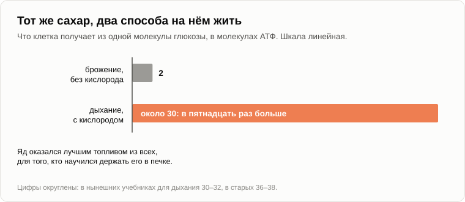

# Кислород был ядом

Олег поставил на бревно банку маринованных грибов, выпрямился и вдохнул так, что засвистело в носу.

— Хорошо-то как дышится.

— Дыши, дыши. Это отходы.

— Чьи?

— Ты собирался спросить меня о другом.

— Как договаривались. — Олег сел. — Откуда взялся свежий воздух? Я сказал, что от деревьев, а ты сказал, что деревья появились позже.

— Давай сначала посмотрим, что ты хвалишь. Что ты берёшь из воздуха, когда дышишь?

— Кислород. Его там пятая часть, остальное азот.

— А чем этот кислород занят прямо сейчас, в двух шагах от твоих сапог?

Олег посмотрел на костёр.

— Ест дрова.

— А что он делает с лопатой, забытой под дождём?

— Ржавчину.

— С маслом, которое неделю простояло на столе?

— Оно прогоркнет.

— С очищенной картошкой?

— Темнеет, пока чистишь вторую. — Олег кивнул на банку. — Поэтому жена и кипятит крышки и закатывает намертво. Чтобы воздух не попал.

— Значит, газ, который ты называешь свежим, портит почти всё, до чего дотянется, и ты пол-осени прячешь от него еду.

— Если так сказать, выходит вредитель.

— Это самый жадный газ в воздухе. Теперь вопрос для кладовщика. Если со склада каждый день что-то берут — пожары, ржавчина, всё, что гниёт и дышит, — а склад по-прежнему полон, что из этого следует?

— Что кто-то всё время подвозит. Растения.

— В шестидесятых годах НАСА спросило одного химика, [Джеймса Лавлока](https://ru.wikipedia.org/wiki/Лавлок,_Джеймс), как искать жизнь на Марсе. Он ответил, что лететь незачем. Посмотрите на воздух в телескоп. На мёртвой планете всё, что могло прореагировать, давно прореагировало, и воздух лежит спокойно, как зола. А наш воздух — это поленница сухих дров рядом с газом, который их жжёт, и поленница не кончается.

— Ведро с дыркой, а полное.

— Значит, кран открыт. Кто этот кран?

— Я дважды сказал. Деревья.

— Первым лесам около трёхсот восьмидесяти пяти миллионов лет. А кислород в воздухе уже примерно два миллиарда четыреста миллионов.

— Два миллиарда лет без единого дерева. — Олег присвистнул. — Тогда кто?

— Ты видел свой пруд в августе?

— Зелёная каша. Рыба задыхается.

— Эта каша — [цианобактерии](https://ru.wikipedia.org/wiki/Цианобактерии); раньше их называли сине-зелёными водорослями. А в море они размером с пылинку, и их никто не видит. Примерно половина того, что ты вдыхаешь, сделана в океане, и самого массового из тамошних изготовителей наука заметила только в восьмидесятых годах.

— А деревья?

— Дерево само кислород не делает. В каждом листе оно держит потомков тех бактерий, когда-то проглоченных и не переваренных.

— Кто кого проглотил?

— Это отдельный вечер. Сегодня бактерии ещё на свободе. Свет ели и до них: были бактерии, которые брали свет и отрывали водород от сероводорода или жили на растворённом железе. Где на Земле есть сероводород?

— У вулкана. В вонючем источнике.

— Вот у источников они и жили. А эти научились отрывать водород от воды.

— А вода везде.

— Сырьё бесплатное и бесконечное. Одна беда: забери из воды водород — что останется?

— Кислород. — Олег остановился. — И что они с ним делали?

— Что завод делает с тем, что ему не нужно?

— Выбрасывает за забор.

— Вот это и есть свежий воздух. Отходы производства.

— Свалка, — сказал Олег и вдохнул ещё раз, осторожнее. — А для кого он был ядом? Я вот живой.

— Для всех, кто тогда жил. Жизнь больше миллиарда лет провела в мире без свободного кислорода, и ничто в ней не было рассчитано на встречу с газом, который отрывает электроны у всего, чего коснётся. У тебя в банке свидетель.

— Грибы моей жены — свидетель?

— Чего ты боишься в домашних заготовках?

— Ботулизма. Вздутой крышки.

— Бактерия, которая делает этот яд, живёт только там, где нет воздуха. На воле она гибнет, поэтому ждёт в виде споры, в земле, пока кто-нибудь не закатает её в банку. Её родственнице, столбнячной палочке, по той же причине нужна глубокая рана.

— Выходит, когда жена закрывает грибы от воздуха...

— Она строит маленький кусочек старой планеты. Иногда в него въезжают старые жильцы.

— Эти с уксусом, — сказал Олег и отодвинул банку от себя. — Они кислоту не любят.

— Не любят. А ровная крышка, кстати, ничего не доказывает.

— Спасибо. Но я-то дышу этим ядом целый день, и ничего.

— Потому что носишь с собой защиту. Полей царапину перекисью: что будет?

— Зашипит.

— Это фермент в твоей крови и в клетках разбирает побочный продукт кислорода раньше, чем тот разберёт тебя. Каждая клетка, живущая на воздухе, набита такой охраной. И даже с охраной: в сороковых годах недоношенных детей клали в кувезы с почти чистым кислородом, из самых добрых побуждений. Около десяти тысяч из них [ослепли](https://ru.wikipedia.org/wiki/Ретинопатия_недоношенных), прежде чем в начале пятидесятых врачи нашли причину.

— То есть мы дышим им не потому, что он безвреден. Мы научились держать огонь в печке.

— Да. У тех, кто не научился, было три дороги: умереть, спрятаться или ждать в споре.

— А кто объявил им войну?

— А кто объявил войну лошади?

— Никто, — сказал Олег, помолчав. — Бактерия ела свет и пила воду. О соседях у неё мнения не было.

— И долго казалось, что ничего не происходит. По учебнику, первый кислород до воздуха не доходил. Океан был полон растворённого железа, кислород его связывал, и ржавчина оседала на дно, слой за слоем.

— Сколько это тянулось?

— Возможно, сотни миллионов лет; геологи спорят и о том, когда появились эти бактерии, и о том, сколько той ржавчины сделал кислород, а сколько другие бактерии, которые ели железо напрямую. Но слои лежат там, где легли: [Курская магнитная аномалия](https://ru.wikipedia.org/wiki/Курская_магнитная_аномалия), Кривой Рог, запад Австралии. Из них добывают большую часть железной руды в мире.

— Погоди. — Олег посмотрел на топор, воткнутый в бревно. — Мой топор сделан из этой свалки?

— Из первой свалки на планете. А когда железо и вулканические газы больше принять не могли, примерно два миллиарда четыреста миллионов лет назад, кислород пошёл в воздух. В книгах это называется [Великим кислородным событием](https://ru.wikipedia.org/wiki/Кислородная_катастрофа).

— А откуда известна дата?

— Из камней. В более старых речных руслах лежит окатанная галька пирита, который в нашем воздухе ржавеет за несколько лет. В более молодых её нет, и начинаются красные породы.

— А погода?

— По одной из версий, рухнула. В старом воздухе был метан, он держал планету в тепле. Кислород метан разрушает. Вскоре после этого Земля покрылась льдом, и лёд, судя по следам, доходил до тропиков. То, что одно и другое [совпадает по времени](https://ru.wikipedia.org/wiki/Гуронское_оледенение), твёрдо. То, что одно вызвало другое, — гипотеза.

— Выходит, изготовители отходов чуть не замёрзли вместе со всеми.

— Никто не рулил.

— Отравленная планета, ледниковый период, хозяев согнали с поверхности, — сосчитал Олег. — Катастрофа. Первая экологическая.

— Теперь вторая графа ведомости. Как бактерия без кислорода живёт на сахаре?

— Сбраживает его. Как дрожжи в тесте.

— Из одной молекулы глюкозы брожение берёт две единицы энергетической валюты клетки, две молекулы АТФ. Сожги ту же молекулу с кислородом до конца — получишь около тридцати.

— В пятнадцать раз больше с той же буханки.

— На эту разницу живёт всё, что бегает, летает и охотится. Твой мозг — это пятидесятая часть твоего веса, а забирает он пятую часть твоего кислорода. На брожении у этого костра некому было бы жалеть анаэробов.

— Значит, яд оказался лучшим топливом из всех.

— Для того, кто научился держать его в печке.

— Тогда я не понимаю, как это называть, — сказал Олег. — Катастрофой или удачей.

— А как это называют учебники?

— Ты сказал: Великое кислородное событие. А в моём школьном учебнике была кислородная катастрофа.

— А кто писал школьный учебник?

— Люди. — Олег усмехнулся. — Внуки победителей. Из вежливости к проигравшим.

— Теперь тест на симметрию. Пусть проигравшие напишут свой. Что в нём сказано про сегодняшний вечер: про лес, росу и воздух, который ты хвалил?

— Отравленная пустыня. Горючий газ до горизонта и чудовища, которые им дышат и довольны. — Он помолчал. — Это опять вчерашнее. Вид с одного берега.

— Договаривай.

— Экологическая катастрофа — это слово проигравших. А победители...

— Победители называют это атмосферой.

— Запишу. — Олег записал. — А проигравшие что, все вымерли?

— Возьми палку и ткни в дно своего пруда.

— Пойдут пузыри. Болотный газ.

— Это они работают, в иле, куда воздух не достаёт. Они в каждом болоте, в глубоких породах, в желудке коровы. И в тебе.

— Во мне?

— Биологи в 2016 году [посчитали](https://doi.org/10.1371/journal.pbio.1002533): у человека около тридцати триллионов собственных клеток и около тридцати восьми триллионов бактерий, почти все они в кишечнике, и почти все из них кислорода не переносят. Весят они граммов двести.

— Значит, я ходячая банка с грибами.

— С закрытой крышкой. Они сохранили всё как было: ту же химию, те же привычки. Заплатили поверхностью планеты.

— И правом говорить, каким будет воздух.

— И этим тоже.

Олег подбросил ветку в костёр и проследил за дымом.

— Вот. — Он показал карандашом вверх. — Мы сейчас делаем то же самое. Дым, выхлоп, углекислый газ. Мы нынешние сине-зелёные: живём как нам нравится, а воздух меняется.

— Кто это «мы»? Посчитай выдох. Человек выдыхает около килограмма углекислого газа в сутки.

— Умножить на восемь миллиардов с небольшим, умножить на год... — Олег писал на колене. — Около трёх миллиардов тонн.

— А откуда углерод в твоём выдохе?

— Из картошки. А картошка взяла его из воздуха прошлым летом. — Он поднял глаза. — Круг. В сумме ноль.

— А трубы и выхлопы дали в 2024 году около тридцати семи миллиардов тонн. Этот углерод из-под земли.

— В двенадцать раз больше, чем выдыхаем мы все. — Олег положил карандаш. — Значит, дышим не мы. На каждый мой выдох двенадцать делают котёл, мотор и электростанция. Я вижу, чьи это лёгкие.

— Чьи?

— Твоей техносферы. И это не запретное слово.

— Не запретное. И она не только выдыхает, но и вдыхает: огонь забирает кислород. С 1989 года это измеряют напрямую. Каждый год в каждом миллионе молекул воздуха становится примерно на четыре молекулы кислорода меньше.

— Это много?

— Нет. При таком темпе сотая часть запаса уйдёт за пять веков, а уголь кончится раньше.

— Стоп, — сказал Олег. — В первую осень ты меня напугал как следует. Метан из вечной мерзлоты, кислород «очень быстро исчезнет», океаны выкипят. Я помню.

— [Я это говорил](13-singularity-as-process.md), и я торопился. Давай считать. В воздухе около миллиона двухсот тысяч миллиардов тонн кислорода. Сожги всё живое на Земле, каждый лес и каждую травинку, — потратишь примерно тысячную долю. Сожги весь уголь, нефть и газ, какие можно достать, — это процент или два. А если не останется вообще ничего зелёного, запаса хватит на миллионы лет.

— То есть никто не задохнётся.

— Не в те сроки, о которых мы с тобой говорим. «Очень быстро» я беру назад, а с ним и кипящие океаны: их и климатологи не обещают. Оставляю одно. Никому из новых этот запас не нужен, поэтому никто из них не станет его охранять.

— Ладно. Но под статьёй про кризис тебе один читатель сказал, я нашёл: Землю убивают, и природа — единственное, что эксплуатируется по-настоящему. Ты [с ним согласился](../sources/garya/sqlru/07-global-economic-crisis.md) и обещал показать, как экономика связана с экологией.

— Обещал, в 2011 году. Вчера ты выяснил, что такое «эксплуатируется».

— Вид на поток с одного берега.

— Тогда вот связь. Экономика — это обмен веществ техносферы: что она ест, из чего себя строит, что выбрасывает за забор. Экология — это то, что этот обмен веществ делает со средой той формы жизни, которая была до неё. Это один поток, посчитанный с двух берегов.

— А «природу убивают»?

— Какую природу мы защищаем? Перечисли.

— Чистый воздух. Чистую воду. Лес. Климат, к которому привыкли.

— Двадцать один процент кислорода, пятнадцать градусов в среднем, вода без соли. Чей это список?

— Наш, — медленно сказал Олег. — Условия нашей собственной жизни. Болотных бактерий никто не защищает. Банки мы кипятим.

— И мы правы, что защищаем своё. Всякая форма жизни защищает свою среду, и я никого не призываю перестать. Я только прошу называть это своим именем. Планету спасать не нужно. Она видала и похуже, и потом это похуже назвали прогрессом.

— А чем тогда дышит твоя техносфера? Что для неё свежий воздух?

— Посмотри, где делают её самые нежные части. Микросхема рождается в комнате, где воздух примерно в тысячу раз чище, чем в операционной. Люди там ходят в комбинезонах и масках.

— Чтобы защитить людей?

— Чтобы защитить микросхему от людей: от кожи, волос и дыхания. А самые тонкие операции делают вообще без воздуха, в вакууме или в чистом азоте. Кислород и влага не вовремя — для микросхемы то же, чем они были для тех бактерий.

— Это ясли. А взрослые?

— В 2018 году «Майкрософт» [опустила](https://ru.wikipedia.org/wiki/Подводный_центр_обработки_данных) на морское дно у Оркнейских островов стальной цилиндр с восемьюстами шестьюдесятью четырьмя серверами. Внутри был сухой азот и ни одного человека. Через два года его подняли и посчитали поломки. Серверы на дне отказывали в восемь раз реже, чем такие же серверы на суше.

— Почему?

— Инженеры назвали две причины. Нет кислорода и сырости, поэтому меньше коррозии. И нет людей, которые всё задевают.

— Банка с грибами, — сказал Олег. — Только наоборот. Мы закрываемся от воздуха, чтобы уберечь еду от кислорода. Они закрываются, чтобы уберечь серверы от кислорода и от нас.

— Проект потом закрыли, и к 2024 году серверов под водой у фирмы не осталось. Цифра осталась.

— А холод?

— Большой дата-центр построили на севере Швеции, в сотне километров от полярного круга, чтобы охлаждать его уличным воздухом. Выдыхает он тепло. Ему нужна энергия и нужно холодное место, куда это тепло выбросить. Пятнадцать градусов, кислород и вода для питья ему ни к чему.

— А человек на орбите — это наоборот.

— Об этом я писал после [семинара](../sources/garya/sqlru/2012-05-17-seti-talk.md) в 2012 году. Семьдесят килограммов мяса и костей, а при них несколько сот тонн систем жизнеобеспечения. Космонавт носит с собой кусок старого воздуха, как спора носит свою оболочку.

— И тогда же ты сказал, что новая жизнь уничтожит старую.

— Что сделает это очень быстро, и не потому, что она плохая или агрессивная, а потому, что будет приспосабливать среду под себя ещё активнее, чем это делал человек. А с тем, что ей не нужно, поступит как с ненужным хламом. Это мой прогноз, а не факт. Факты такие: обмен веществ у неё другой, её выдох уже в двенадцать раз больше нашего, а то, что она выбрасывает, попадает в то, чем мы дышим.

Олег помолчал, потом начал загибать пальцы.

— Теперь я. Первое. У бактерий ушли сотни миллионов лет, а по твоему же счёту миллиард с лишним. На таких сроках я не волнуюсь.

— Темп задавали те, кто делал отходы, и те, кто их впитывал. Бактерия делится, а железо в океане не торопилось. Сегодня воздух измеряют на вулкане на Гавайях. В 1958 году, когда [начались измерения](https://ru.wikipedia.org/wiki/График_Килинга), в миллионе молекул воздуха было 315 молекул углекислого газа. Сейчас больше 425.

— На треть больше.

— За одну человеческую жизнь, а не за геологическую эпоху. Завод не ждёт мутации. Его копируют.

— Второе. Мы не бактерии. Мы понимаем, что делаем, и умеем договариваться. Озоновая дыра: в 1987 году собрались в Монреале, запретили фреоны, и дыра затягивается.

— Затягивается, и лучшего примера нет. [Подписали все страны](https://ru.wikipedia.org/wiki/Монреальский_протокол), и слой должен вернуться к прежнему к середине века, а над Антарктидой — к шестидесятым годам. Заметь, кстати, из чего сделан этот щит.

— Из озона. — Олег фыркнул. — Из кислорода. Мы починили щит, сделанный из свалки.

— Теперь посмотри, почему получилось. Замена была под рукой, вещество делали несколько заводов, и никому не пришлось отказываться от холодильника. Ни одну хотелку не урезали. А там, где хотелку надо урезать? Договор о климате подписали в 1992 году. С тех пор годовой выброс труб и выхлопов вырос больше чем наполовину.

— То есть договариваемся мы там, где это дёшево.

— Один из вчерашней четвёрки, владелец «Гугла», в 2020 году пообещал довести свои выбросы до нуля к 2030-му. В 2024-м он отчитался, что за пять лет они выросли примерно наполовину. Причину назвал сам: дата-центры.

— Хотелка, записанная в обещание.

— И она сдвинулась вслед за арифметикой. Никто не лгал. Все действовали из лучших побуждений.

— Тогда выдерни вилку. Закрой трубы силой.

— А сначала посчитай, кто висит на этом шнуре. Девятнадцать частей из двадцати той энергии, что тратится на каждого из нас, [идут через неё](27-scenario-of-events.md). Это отдельный вечер.

— Третье. Пусть уходит в космос, где её холод и её энергия, а воздух оставит нам. Тебе и это говорил читатель: незачем ей оставаться на Земле.

— Уйдёт; [мы об этом говорили](29-silence-of-the-universe.md). Но рождается она здесь, а детство проходит там, где родился. Сине-зелёные тоже не спрашивали, где соседям будет удобнее.

— И четвёртое, главное. Анаэробы живы. Прошло два миллиарда лет, и у них всё хорошо: тепло, сытно, двести граммов сидит у меня в животе. Так где же мрак?

— «Они живут в нишах» — это не утешение. Это и есть прогноз. Перечитай свою запись: что они сохранили и чем заплатили.

— Сохранили себя такими, какими были. Заплатили поверхностью и правом говорить, каким будет воздух.

— Мне нечего к этому добавить.

— А кто считал погибших? Кто-нибудь видел эту катастрофу?

— Никто. Бактерии не оставляют костей, и ни одной могилы того времени не нашли. Гибель выведена логически: из того, что сегодня кислород убивает тех, у кого нет охраны.

Олег открыл блокнот на последней странице.

— Пришёл за свежим воздухом. Вышел туда, где свежий воздух не для нас. Опять.

Он поставил шестую галочку рядом с пятью.

— Давай на сегодня закончим, зафиксировав результат, — сказал Андрей.

1. **Свободный кислород — это отходы производства бактерий, которые научились расщеплять воду. Для тогдашней жизни он был ядом, и никто никому войны не объявлял. Новая форма жизни не воюет с прежней: она меняет среду под свой обмен веществ.**
2. **Прежние хозяева не вымерли: они ушли в ниши, куда новый воздух не достаёт. Экологическая катастрофа — слово проигравших; победители называют это атмосферой. «Экология» — это защита среды нашей формы жизни, а экономика и экология — один поток, посчитанный с двух берегов.**
3. **У техносферы свой обмен веществ: ей нужны энергия и холод, а кислород, влага и пятнадцать градусов ей ни к чему. Следить надо не за её злобой, а за её дыханием.**

— А что здесь твёрдое, а что твоё?

— Твёрдое: ржавчина в породах, два и тридцать, бактерии у тебя в животе, углекислый газ на вулкане и цилиндр на морском дне. Гипотеза, и не моя: что лёд принёс именно кислород. Моё: что трубы и дата-центры — это дыхание новой формы жизни, а не просто наша грязь. И что ненужное ей охранять не станут. Этого я не доказываю.

— А открыто?

— Что именно будет с теми, кто оказался на дороге. Дорог оказалось больше одной, и ниша — только первая из них.

— Мрачновато, — сказал Олег. — Я пришёл подышать.

— Так дыши. Хватит на миллионы лет, я посчитал.

— Это объективно?

— До тысячной.

Олег встал, взял банку и посмотрел на крышку против огня.

— Ровная.

— Я же сказал: это ничего не доказывает.

— Прокипячу. Назло старым жильцам. — Он сунул банку под мышку. — Завтра из блокнота, страница третья. Ждёт с первого вечера: почему сны сбываются.

— У тебя сбывались?

— У меня нет. У бабушки сбывались постоянно.

— Тогда спи сегодня внимательно.

— Постараюсь. Ну, до завтра.

— Пока.

---

*Продолжение серии* (Часть VI. Просто трёп). Написана для этого репозитория моделью ИИ Claude Fable 5.2 (компания Anthropic), подражающей стилю и методу Андрея Гордиенко (Garya), автора статей 01–15. Сам он её не писал; не писала её и модель Claude Opus 5.5, написавшая статьи 16–32. Перевод с английского оригинала. Опирается на: [07](./07-global-economic-crisis.md), [11](./11-symbiosis-and-parasitism.md), [13](./13-singularity-as-process.md), [14](./14-apoptosis-of-humanity.md), [27](./27-scenario-of-events.md), [29](./29-silence-of-the-universe.md), [35](./35-pot-on-the-stove.md), [37](./37-who-exploits-whom.md).

[← 37](./37-who-exploits-whom.md) · [Оглавление](./README.md) · [39 →](./39-price-of-a-false-alarm.md)
