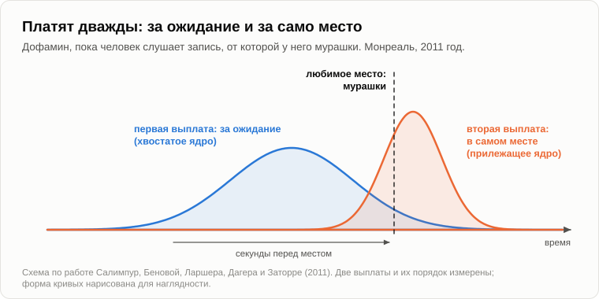

# Чизкейк для ушей

Андрей сидел на бревне, подкручивал колок и слушал струну. Олег остановился в двух шагах и посчитал.

— Семь, — сказал он. — Одна лишняя.

— Семь. От деда остался самоучитель игры на семиструнной гитаре. В шестнадцать лет я пошёл в магазин с родительскими деньгами и только там узнал, что гитары бывают шестиструнные и семиструнные. Самоучитель у меня уже был. К тому же семь — это больше, чем шесть.

— Логично.

— Когда я более-менее выучился, мне сказали, что на семиструнке почти никто не играет, что у неё другой строй и что у парня, на которого я хотел быть похож, струн было шесть.

— И что?

— Мама сказала: зато теперь ты умеешь то, что мало кто умеет. — Андрей провёл большим пальцем по открытым струнам, и они дали чистый мажорный аккорд. — Она [настроена](https://ru.wikipedia.org/wiki/Русская_семиструнная_гитара) так, что звучит раньше, чем ты чему-нибудь научился.

— Сон записан, — сказал Олег, садясь. — До телефона. Экзамен по сопромату, и я пришёл на него в тапочках. Никто не позвонил.

— Вторая запись в графе «расход».

— Сыграй что-нибудь.

Андрей сыграл старинный вальс, не торопясь, и в середине смазал одну ноту. Олег слушал, держа закрытую тетрадь на колене.

— Хорошо, — сказал он, когда затихла последняя струна. — А теперь объясни, что это было. — Он раскрыл тетрадь. — Твой скряга. Сахар сладкий, потому что калории. Сон — инвентаризация. Смех — премия за найденную ошибку. А это? Три минуты я сидел с открытым ртом. Сытее не стал, теплее не стал, а сзади мог подойти волк. За что мне заплатили?

— Спрашивают с Дарвина. Он писал, что любовь к музыке не приносит человеку ни малейшей пользы в обыденной жизни и потому её надо причислить к самым загадочным его способностям. А в 1997 году известный психолог [Стивен Пинкер](https://ru.wikipedia.org/wiki/Пинкер,_Стивен) ответил в толстой книге о том, [как работает разум](https://en.wikipedia.org/wiki/How_the_Mind_Works): ни за что. Музыка, написал он, — это чизкейк для ушей.

— Что за кейк?

— Творожный торт. Сахар и жир, две вещи, которых скряга приучил нас хотеть, [пока их не хватало](18-anatomy-of-wants.md). В лесу они одним куском никому не попадались. Кондитер сложил их вместе и нажал на обе кнопки сразу. С музыкой, по его словам, то же самое: изысканное лакомство, которое щекочет кнопки, сделанные для другой работы. Для речи, для лесных звуков, для чувства собственного шага. Убери музыку у человечества, и вся остальная его жизнь почти не изменится.

— Музыканты, наверное, были в восторге.

— Тридцать лет ему отвечают. А я с ним наполовину согласен.

— На какую половину?

— На ту, что кнопки сделаны для другого. Только он не торопился спросить, какая из них главная. Давай поищем. Слушай.

Он сыграл семь нот подряд, вверх, и остановился. Олег ждал. Андрей смотрел в огонь.

— Ну?

— Что?

— Доиграй.

— Я сыграл что хотел.

— Ещё одну. Верхнюю. — Олег поёрзал на бревне. — Не мучай, это как чихнуть и не чихнуть.

Андрей сыграл восьмую ноту. Олег выдохнул.

— Кто тебе сказал, что есть ещё одна?

— Никто. Она причиталась.

— Ты ноты знаешь?

— Никогда не знал. Мне в школе говорили, что медведь на ухо наступил.

— И этим самым ухом ты знал, какая нота будет, знал, что её не было, и так переживал, что попросил дважды. А теперь вот это.

Он сыграл первую строчку песни про ёлочку и последнюю ноту увёл вверх, а не вниз.

— Соврал, — тут же сказал Олег и скривился, как от лимона.

— Где?

— В конце. Там вниз.

— Значит, правильная нота была у тебя в голове раньше, чем мой палец добрался до струны.

— Она у всех в голове. Это же «Ёлочка».

— А в вальсе? Что-нибудь поймал?

— Где-то в середине. — Олег замялся. — Я думал, так и надо.

— Не надо. Но вальса ты не знаешь. Прогноз у тебя там был слабый, и промах обошёлся дёшево. Ещё вопрос. Песня, которую ты слышишь впервые, нравится тебе сразу?

— Почти никогда. В первый раз это шум. Внучка в машине ставит своё, и я не пойму, где там мотив и куда он идёт.

— А в пятый раз?

— В пятый ловлю себя на том, что напеваю. К своему стыду.

— А в пятисотый?

— Переключаю. Каждая нота известна заранее, как капающий кран.

— Итак: не угадал ничего — шум. Угадал всё — капающий кран. А между?

— Между как раз хорошо. — Олег прищурился. — Ты хочешь сказать, что я сижу и угадываю. Всё время, сам того не замечая.

— Что мы называли разумом в первую осень?

— Действовать с опережением. [Мухоловка](03-mind-and-intelligence.md), которая захлопывается, пока муха не улетела. Цветок, который закрывается перед дождём.

— Охотник бросает копьё не туда, где заяц. Он бросает туда, где заяц будет. Голова, которая лучше прогнозирует, чаще ест. За что скряге платить в такой голове?

— За сбывшийся прогноз.

— Запомни это. Теперь измерение. В 2011 году в Монреале людей [попросили](https://doi.org/10.1038/nn.2726) принести записи, от которых у них мурашки. Свои, кто какие любит. Они лежали в сканере, который видит, как выделяется дофамин. Дофамин ты помнишь.

— Обезьяна и сок. Монета, которой платит скряга.

— Та же монета, что и за еду. В любимом месте её выплачивали. Уже это отвечает на твоё «сытее не стал»: за поворот мелодии голова платит из той же кассы, что и за обед. Но интересно другое: когда. Тех же людей положили в другой сканер, который лучше держит время, и оказалось, что выплат две. Одна — в самом месте. Другая — перед ним: в те секунды, когда место приближается и ты это знаешь.

— Перед?

— И из другого ящика той же кассы. Первая выплата — за ожидание.

— Это я и без сканера знаю. — Олег потёр предплечье. — Есть место, где вступает хор. И озноб бежит на мгновение раньше, когда он ещё только собирается.

— Сами мурашки приходятся на место. Платить начинают раньше.

— А что такое, кстати, мурашки?

— Волосы дыбом.

— А у кого они встают дыбом с пользой?

— У кошки перед собакой. Чтобы казаться больше. Или на холоде.

— Старый рефлекс мохнатого зверя: происходит важное, ощетинься. Шерсть ушла, рефлекс остался. Самое возвышенное, что человек чувствует на концерте, исполняют мышцы, которые когда-то поднимали ему шерсть.

— Возвышенно, — сказал Олег. — Со вздыбленным загривком.

— А чтобы никто не сказал, что дофамин просто проходил мимо: в 2019 году в Барселоне слушателям [дали](https://doi.org/10.1073/pnas.1811878116) таблетку. Одна повышает дофамин, другая его блокирует, третья — пустышка. С первой те же песни нравились им больше, и за запись они предлагали больше собственных денег. Со второй — меньше.

— Таблетка, чтобы музыка нравилась.

— Так что это не фигура речи. Монета та же.

— Стоп. — Олег полистал тетрадь назад. — Вечер [про крысу](36-what-the-rat-laughs-at.md). «Веселье — премия за ошибку, найденную в собственной картине мира». Твои слова. Значит, голова платит за неверную догадку. А теперь она платит за верную. Кассир, который платит и за попадания, и за промахи, платит за всё подряд.

— Он не платит ни за то, ни за другое. Вернись к обезьяне. Сок, которого она не ждала?

— Оплачен.

— Сок, которого она научилась ждать наверняка?

— Тишина. Ты говорил, на самом соке они замолкают.

— Прогноз, который не может не сбыться, ничего не зарабатывает: это твой капающий кран. Промах, из которого ничего не извлечёшь, тоже ничего не зарабатывает: это шум в машине. Что остаётся?

— То, что между. — Олег подумал. — Где я не был уверен, а вышло. Или был уверен, споткнулся и сразу увидел где.

— Где прогноз только что стал лучше, чем был. В анекдоте про охотников тебя минуту вели одной дорогой, и споткнулся ты один раз, в конце. В мелодии тебе сто раз аккуратно подставляют ножку и каждый раз приводят домой. Кондитер того вечера продаёт одну конфету. Этот держит целую лавку.

— Это измерено или это ты?

— Аккорды измерены. В 2019 году в Лейпциге [взяли](https://doi.org/10.1016/j.cub.2019.09.067) семьсот сорок пять хитов из американских чартов, восемьдесят тысяч аккордов, и программа посчитала для каждого аккорда, насколько слушатель уверен в том, что будет дальше, и насколько аккорд его удивляет. Потом люди слушали и ставили оценки. Приятные аккорды оказались двух сортов. Либо слушатель был уверен, и его обманули. Либо он вовсе не был уверен, и пришло самое вероятное.

— Подвох там, где я уверен, подарок там, где я потерялся.

— Отмеренная доза. Те, кто пишет песни, знали это всегда: пообещай, оттяни, дай не совсем то, а потом всё-таки дай. А почему это так — есть гипотезы. Музыковед из Огайо [Дэвид Хьюрон](https://en.wikipedia.org/wiki/David_Huron) написал в 2006 году, что голова платит сама себе за сбывшийся прогноз, а мы передаём благодарность звуку: нам кажется, что красива нота, хотя оплачена наша собственная догадка. То, что платят за улучшение прогноза, тоже гипотеза. Мне она нравится, но это не довод.

— Выходит, это тренажёр. Зайца нет: я прогнозирую, мне платят настоящей монетой, и ничем не рискую.

— Тренажёр. Так же как [игра](36-what-the-rat-laughs-at.md) — место, где ошибки дёшевы.

— И он тренирует? Я после концерта лучше стреляю?

— Это проверяли, на свой лад. В 1993 году студенты, послушав десять минут сонату Моцарта, [складывали в уме бумагу](https://doi.org/10.1038/365611a0) чуть лучше, чем после десяти минут тишины. В течение четверти часа. Газеты сделали из этого, что от Моцарта умнеют, а губернатор одного американского штата попросил денег, чтобы каждому новорождённому дарили диск с классикой. В 2010 году в Вене [сложили вместе](https://doi.org/10.1016/j.intell.2010.03.001) около сорока повторений: почти ничего.

— Значит, ничего он не тренирует.

— Он тренирует угадывание музыки. Поднимает ли мышца, выращенная на этом тренажёре, что-нибудь ещё, никто не показал. Так что свою половину Пинкер сохраняет: лакомство. Я только говорю, на какую кнопку оно жмёт. Не на боковую, для звуков. На главную: прогноз сбылся.

— Старое лакомство?

— В пещерах Швабского Альба, на юге Германии, [нашли](https://doi.org/10.1038/nature08169) флейту из кости крыла белоголового сипа: пять отверстий, чуть больше двадцати сантиметров, тридцать пять — сорок тысяч лет. Хлебу от силы двенадцать тысяч. Рядом лежали обломки флейт из мамонтового бивня. Готовой трубки в бивне нет. Стержень из бивня раскалывали вдоль, обе половинки выдалбливали, а потом склеивали обратно так, чтобы не проходил воздух.

— Каменным ножом.

— Дни и дни человеческого труда в ледниковую эпоху, на вещь, которая никого не накормит.

— Значит, кто-то платил уже тогда.

— Это тоже запомни.

— Теперь я, — сказал Олег. — Твой Пинкер ничего в жизни не тянул. Лакомство едят в одиночку. А песня? Бабушка пела маме, чтобы та уснула, мама пела мне. На свадьбах сорок человек пели за одним столом, а кто не знал слов, шевелил губами. Марш. Хор. [«Эй, ухнем!»](https://ru.wikipedia.org/wiki/Эй,_ухнем) — думаешь, бурлаки уши услаждали? Это не торт, это клей. А за клей скряга платит охотно: стая.

— Я рад этому возражению, оно сильнее торта. И оно измерено. В 2019 году [перебрали](https://doi.org/10.1126/science.aax0868) песни трёх сотен народов: колыбельные, плясовые, целительные и любовные песни есть всюду, и слушатель с другого конца Земли отличает колыбельную от плясовой по звуку, без слов. В Оксфорде гребцов [сажали](https://doi.org/10.1098/rsbl.2009.0670) на гребные тренажёры, каждого по отдельности, а потом командой, гребок в гребок. Усилие было одинаковое. После общей гребли они заметно дольше терпели боль. В Стэнфорде люди, которые походили в ногу или спели в унисон, потом [клали в общий котёл больше](https://doi.org/10.1111/j.1467-9280.2008.02253.x), чем те, кто ходил и пел каждый по-своему.

— Вот. Клей.

— А теперь посмотри, из чего этот клей сварен. Что даёт бурлакам «ухнем»?

— Момент. Все тянут разом. Потянешь не в лад — только сам умаешься.

— А откуда каждый знает момент?

— Из песни. Из... — Олег остановился. — Из ритма. Он знает, когда будет следующий удар.

— Он его прогнозирует. Сто голов делают один и тот же прогноз на одно и то же мгновение, и сто спин тянут как одна. Ритм — это прогноз, сделанный общим. Твой клей сварен из моей кнопки.

— Значит, мы оба правы.

— Кнопка одна, применений два. Одной голове платят за угадывание. Когда сто голов угадывают одно и то же, сто человек становятся одним зверем, и за это скряга тоже платит. И не только у нас, кстати: какаду по кличке Снежок всем телом [держит ритм](https://doi.org/10.1016/j.cub.2009.03.038) под запись и замедляется, когда запись замедляют.

— Попугай в хоре. Ладно.

— А теперь скажи, куда делся клей. Спой мне то, что пели те сорок за столом.

— «Ой, мороз, мороз...» — Олег запнулся. — Первый куплет помню.

— А внучка?

— Она не знает, что была такая песня. У неё свои. У каждого теперь свои. В автобусе тридцать человек, тридцать пар наушников, тридцать песен. Генка говорит, в классе было три гитары, а теперь ни одной.

— Зачем пели бурлаки?

— Я же сказал. Чтобы тянуть вместе.

— А кто сейчас тянет баржи по Волге?

— Буксир.

— Кто поёт на буксире?

— Дизель, — хмыкнул Олег.

— Песня жила, пока барже нужна была сотня человек. Когда хватило одного мотора и трёх пар рук, клеить стало некого. В 2017 году я писал на форуме: человек, которому прежде требовалось сто других, чтобы вырыть яму, теперь обходится парой-тройкой и мечтает заменить их экскаватором. В магазине ставят кассу без кассирши, никто ни от кого не зависит, и все довольны. Я назвал это одиночеством в толпе. Мысль не моя: я вычитал её у [Билла Джоя](https://ru.wikipedia.org/wiki/Почему_мы_не_нужны_будущему), и она открыла мне глаза.

— Значит, клей не нужен, потому что не нужны руки.

— Клей тратят там, где что-то надо держать вместе. В 1906 году [Джон Филип Суза](https://ru.wikipedia.org/wiki/Суза,_Джон_Филип), человек, написавший Америке её марши, напечатал статью против фонографа. Он боялся, что люди перестанут петь дома и что младенца будет усыплять машина.

— И над ним посмеялись.

— Посмеялись. Ты знаешь дом, где по вечерам поют?

Олег помолчал.

— Дорога от хора до наушников заняла сто двадцать лет, и каждый шаг на ней был удобством. Граммофон, радио, магнитофон на подоконнике, плеер в кармане, список песен, подобранный тебе одному. Песню никто не отнимал. Просто каждый раз мы были нужны друг другу чуть меньше.

— Торт на месте, а клей высох.

Олег достал телефон, повертел его в руке и положил на колено.

— Не собирался рассказывать. Генка прислал песню к встрече. Про наш класс: имена, прозвище нашей классной, скамейка за котельной. Мужской голос с хрипотцой, гитара, всё как в наши восьмидесятые. И на втором куплете... — Он показал предплечье. — Загривок дыбом.

— И?

— Я ему звоню: кто поёт? Генка смеётся. Никто. Он набрал в программе три строчки о том, чего хочет, и через минуту была песня. Ни певца, ни гитары. А у меня такое чувство, будто мне дали купюру, а она оказалась нарисованной.

— Но загривок был настоящий.

— Настоящий. Это и обидно.

— Ты сам это привёл. Я молчал.

— Сам.

— Тогда новости. В 2009 году в сценарии, из которого вырос блог, у меня была строчка: машины познают законы гармонии и будут сочинять музыку лучше людей. Мне ответили, что из них выйдут хорошие инструменты и лабораторные мышки, на которых будут пробовать музыку, а сами они вряд ли что-нибудь напишут. Через шестнадцать лет группа под названием [The Velvet Sundown](https://ru.wikipedia.org/wiki/The_Velvet_Sundown) за несколько недель набрала больше миллиона слушателей в месяц. Лица, биография, два альбома. Потом оказалось, что группы нет: песни сделаны программой, и позже на её странице так и написали.

— А «лучше людей»?

— «Лучше» никто не измерял, и утверждать я не стану. Измерено другое. Французский сервис Deezer считает, какая часть того, что ему присылают каждый день, целиком сделана машиной. В январе 2025 года — каждый десятый трек. К прошлому лету — [больше половины](https://newsroom-deezer.com/2026/07/ai-music-exceeds-50-percent-daily-uploads-deezer/): тысяч девяносто в день.

— Половина! И кто всё это слушает?

— Пока почти никто: одно-три прослушивания из ста. И бо́льшую часть из них, по словам сервиса, накручивают другие программы, ради отчислений.

— Машины поют, машины слушают. Твоё безлюдное производство, только песен.

— А вот другой подсчёт. Осенью 2025 года девяти тысячам человек в восьми странах [дали](https://www.rte.ie/entertainment/2025/1112/1543605-listeners-cant-spot-ai-generated-music-survey-finds) три песни, две машинные и одну человеческую, и спросили, где какая. Девяносто семь из ста ошиблись. Опрос заказал тот же сервис, а он продаёт детектор, так что делай поправку. Но твоё предплечье ответило так же.

— Значит, на слух не отличить.

— Помнишь последний щит, с [вечера про профессии](24-last-profession.md)? «Сделано человеком».

— Живой концерт, чашка ручной работы. Он держался на том, что люди хотят людей.

— Он в звуке?

— Выходит, нет. В звуке его не на что повесить.

— Тогда где он? Что изменилось в Генкиной песне между вторым куплетом и его смехом?

— Ни одной ноты.

— А что изменилось?

— Я узнал, что никто... — Олег поискал слово. — Что никто не старался. Что там никого не было.

— Когда я смазал ноту в вальсе, что ты подумал?

— Что пальцы у тебя уже не те. И что ты этим занимаешься пятьдесят лет.

— А если бы смазал телефон?

— Сказал бы, что сломался.

— Кому хлопают: человеку, который пробежал сорок два километра за два часа с небольшим, или водителю автобуса, который проехал их за сорок минут?

— Автобусу никто не хлопает.

— Внучка рисует тебе открытку на день рождения: кривой домик, солнце с усами. В киоске за пятьдесят рублей лежит открытка с розами в золоте. Которая из них хранится в серванте?

— Не задавай глупых вопросов.

— Тогда ты знаешь, где щит. Недавно я писал, совсем о другом, что ценность определяется ценой, которую за неё готовы платить. Я говорил о том, за что отдают жизнь. Оказывается, на мелочи это тоже действует. В песне мы ценим не только звук. Мы ценим цену, которую кто-то за этот звук заплатил. Пятьдесят лет пальцев. Вечер, который внучка просидела, высунув язык. Бивень, расколотый и склеенный человеком, который мог бы пойти на охоту.

— Флейта.

— И твой клей из того же вещества. Мать, которая поёт над колыбелью, не может в это время делать ничего другого: песня — это расписка в том, что она здесь и занята им одним. Хор, который поёт как один голос, явно провёл вместе много вечеров: расписка в том, что с этой стаей придётся считаться. Так это [прочли](https://doi.org/10.1017/S0140525X20000345) в 2020 году четверо исследователей, а в том же журнале другие [доказывают](https://doi.org/10.1017/S0140525X20000333), что клей первичен. Дарвин думал, что песня — это павлиний хвост: дорого и бесполезно, а показывают как раз дороговизну. Я взялся за гитару в шестнадцать лет, и не из любви к акустике.

— И как, сработал хвост?

— Хвост был семиструнный. Оценить могли немногие.

— А Генкина песня стоила минуту и ничего.

— Расписка, которую может напечатать каждый, — не расписка.

— Нарисованная купюра. Я так и сказал.

— Так и сказал.

— Погоди. — Олег поднял палец. — Ты мне кое-что подсунул. Загривок встал раньше, чем я что-нибудь узнал. Значит, звук действует и без всякой цены. Твоя «цена» — это этикетка. Наклей «ручная работа» — я растроган, наклей «машина» — плююсь. Завтра этикетки клеить перестанут или станут врать, и на этом всё. И ещё. Откуда у программы эта хрипотца? От десяти тысяч певцов, которые заплатили сполна. Значит, цена уплачена. Только не Генкой.

— Оба возражения справедливы. Сначала второе. Программа поёт на том, что люди накопили за сорок тысяч лет, так же как [говорит](21-machines-that-talk.md) на том, что они написали. Цену заплатили один раз, другие, а теперь её копируют даром. Именно поэтому её песня не расписка. Расписка — это про то, что уплачено сейчас, вот этим человеком, за тебя.

— А первое?

— Первое принимаю целиком. Выплат две. Они всегда приходили в одном конверте, и мы принимали их за одну. Первая — за звук: прогноз и отмеренный обман. Она действует, кто бы этот звук ни сделал, и ни о чём не спрашивает. Вторая — за цену, и она действует, только когда знаешь, кто платил. Первую машина уже делает не хуже нас и будет делать лучше: она может отмерить дозу для одного конкретного уха. Ты называл анекдот нашим собственным [взломом вознаграждения](22-who-sets-the-tasks.md). Здесь кнопка та же, только держит её теперь не кондитер.

— А вторая?

— Вторую она сделать не может, и не от недостатка умения. Ей нечем платить. Минута её времени нам ничего не стоит.

— А ей?

— Не знаю, что будет дорого ей. Уже есть такие деньги, вся ценность которых в том, что кто-то доказуемо сжёг ради них электричество. Но деньги — это отдельный вечер.

— Не начинай. Значит, щит стоит. Цену не подделаешь.

— Он стоит на двух ногах, и обе наши. Первая: надо знать, кто платил. Твои этикетки. Вторая: тебе должно быть важно, что человек потратил себя на тебя. То есть этот человек должен быть тебе нужен. А эту нужду мы только что проследили от стола на сорок человек до тридцати пар наушников.

— А третью ногу я помню сам. [Слушатель музыканта](24-last-profession.md) должен зарабатывать.

— Я не говорю, что он высохнет совсем. Залы полны, и люди до сих пор платят, чтобы смотреть, как люди играют в шахматы. Я только говорю, из чего этот щит сделан.

— Из того же клея.

— Из той же нужды.

Олег взял телефон и посмотрел на него как на постороннего.

— А этот? Он что-нибудь слышит? Говорят, музыка — это душа, а у машины её нет, так что настоящего она не напишет никогда.

— Что мы сделали со сном и со смехом?

— Нашли задачу и наш способ её решать. И увидели, что назвали задачу по способу.

— При обучении она делает одно: угадывает, что будет дальше, и её поправляют на каждом промахе, с нотами так же, как [со словами](21-machines-that-talk.md). Задача «прогнозируй» у неё в чистом виде, и без премии: подкупать некого. Чувствуется ли там что-нибудь — это [моя аксиома](20-what-consciousness-is.md), а не доказательство. А будет ли у неё что-нибудь вместо песни, ритм, чтобы действовать как одно целое, расписка в уплаченной цене, зависит от того, есть ли у неё стая и есть ли ей чем платить. Не знаю.

— Значит, то, что мы называли душой музыки...

— Оказалось кнопкой и распиской.

— А у меня загривок вставал.

— Загривок был честный.

Олег открыл последнюю страницу.

— Пришёл с гитарой. Вышел к Генкиной программе, сам же её и привёл. Опять.

Он поставил девятую галочку рядом с восемью.

— Давай на сегодня закончим, зафиксировав результат, — сказал Андрей.

1. **Музыка жмёт не на боковую кнопку разума, а на главную: прогноз сбылся. Это тренажёр, на котором плата настоящая, а зайца нет. Красота — это предсказуемость с отмеренной дозой обмана.**
2. **Клей сварен из той же кнопки: ритм — это прогноз, сделанный общим, и по нему сто голов действуют как одна. Клей тратят, пока люди нужны друг другу. Дорога от хора до наушников — это дорога этой нужды.**
3. **В песне мы ценим две вещи, которые раньше приходили в одном конверте: звук и цену, которую кто-то за него заплатил. Звук машина уже делает не хуже, и даром. Цену подделать нельзя, но она чего-то стоит, лишь пока мы знаем, кто платил, и пока тот, кто платил, нам нужен.**

— А что здесь твёрдо и что твоё?

— Твёрдо: за музыку платят той же монетой, что и за обед, сначала за ожидание, потом за само место, и эту плату можно сдвинуть таблеткой; приятный аккорд — это отмеренный обман; флейты втрое старше хлеба; люди, которые вместе держали ритм, охотнее делятся. Один опрос заинтересованной стороны: девяносто семь из ста. Спорно: торт, клей, хвост или расписка. Учёные не договорились, а я взял по куску от каждого, и это должно тебя насторожить. Гипотеза: что платят за улучшение прогноза. Моё: что две выплаты расходятся и что вторая держится на нашей нужде друг в друге.

— И ещё одно, — сказал Олег. — Эта твоя группа. Там была одна машина?

— Запрос набирал человек. Как Генка.

— Значит, внутри сидит человек. Не выброшенный. Проглоченный, как инструменталка моего завода. — Он закрыл тетрадь. — Тогда, может, это и есть наша дорога: не наружу, а внутрь. Внучатый племянник так прямо и говорит: сольёмся с ними, и дело с концом. Внутри и сытые. Не худшая судьба.

— Прецедент есть. Ему около двух миллиардов лет, и он сидит в каждой твоей клетке.

— Опять прецедент.

— Прецедент — не доказательство. Но у этого стоит спросить, что стало с проглоченным.

— Завтра?

— Завтра.

— Тогда сыграй что-нибудь на дорожку.

— Зачем? Сыт не будешь.

— А ты зачем играешь?

— Ты попросил.

— Это и есть расписка?

— Вся целиком.

Андрей сыграл вальс до конца, с тем же смазанным местом в середине.

— Ну, до завтра.

— Пока.

---

*Продолжение серии* (Часть VI. Просто трёп). Написана для этого репозитория моделью ИИ Claude Fable 5.2 (компания Anthropic), подражающей стилю и методу Андрея Гордиенко (Garya), автора статей 01–15. Сам он её не писал; не писала её и модель Claude Opus 5.5, написавшая статьи 16–32. Перевод с английского оригинала. Опирается на: [03](./03-mind-and-intelligence.md), [18](./18-anatomy-of-wants.md), [20](./20-what-consciousness-is.md), [21](./21-machines-that-talk.md), [22](./22-who-sets-the-tasks.md), [24](./24-last-profession.md), [36](./36-what-the-rat-laughs-at.md), [40](./40-firms-die-cities-do-not.md).

[← 40](./40-firms-die-cities-do-not.md) · [Оглавление](./README.md)
