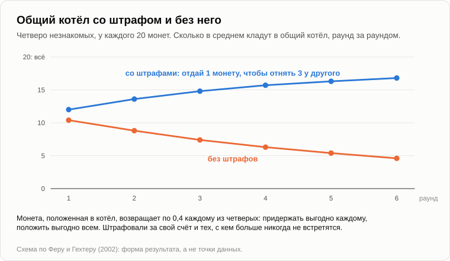

# Почему муравьи не бастуют

Олег поднимался по тропинке, глядя под ноги, через что-то очень осторожно перешагнул и только после этого сел на бревно.

— Сначала сон. До телефона. Я опаздывал на смену, а вахтёрша на проходной не пускала меня без пропуска. Пропуска у меня нет двадцать лет. Никто не позвонил.

— Четвёртая запись в графе «расход».

— Теперь домашнее задание. Я всю дорогу смотрел под ноги, и зря: они и здесь есть. — Он показал прутиком. Мимо бревна, по утоптанной земле, десяток муравьёв тащил зелёную гусеницу. — Погляди на них. Одни тянут вперёд, двое вбок, один едет сверху. А она идёт куда надо.

— Ты у них спросил?

— Спросил. Они заняты. Так что спрошу у тебя. — Олег раскрыл тетрадь. — Никто ими не командует. Никто им не платит. Ни нормировщика, ни проходной. А тащат. Ты мне рассказывал, как в пятнадцать лет собирался построить [машину, которая делает людей хорошими](23-machine-for-making-people-good.md). Вот те, с кем ей было бы нечего делать. Коммунизм у них получился без тебя.

— У них получилось родство.

— Это ответ?

— К концу вечера будет. Сначала: что такое забастовка?

— Бросаешь работу, пока не дадут больше.

— Больше чего?

— Платы. Своей доли.

— А какая доля у муравья? Что рабочая получит за гусеницу?

— Обед.

— Обед получат все: и кто тащил, и кто стоял рядом. А кроме обеда? Ради чего работает всё живое, если смотреть на то, что сохраняет отбор?

— Ради потомства. Ты сто раз говорил: сохраняется то, что оставляет больше самого себя.

— Сколько детей у рабочего муравья?

— Откуда мне знать? — Олег нахмурился. — По-моему, нисколько. Яйца кладёт матка.

— Нисколько. Это самка, которая не размножается. Она кормит чужих детей, убирает, таскает и гибнет в драке у входа. А теперь поставь это рядом с «сохраняется то, что оставляет больше самого себя».

— Не сходится. Кто ничего не оставляет, тот должен был вымереть за одно поколение.

— Дарвин увидел это в 1859 году и честно написал, что эта трудность сначала показалась ему непреодолимой и гибельной для всей его теории. Он её кое-как обошёл. Арифметика появилась через сто лет. Давай проделаем её на тебе. Вчера ты звонил внучатому племяннику. Ты ему когда-нибудь давал деньги?

— На первый взнос за квартиру. Жене не говори сколько.

— Он вернул?

— Я не просил возвращать.

— А сосед, который занимал на крышу?

— Вернул осенью. Иначе я бы напомнил.

— Откуда разница?

— Один родня. Другой сосед.

— Запомни эти два слова: в них весь вечер. Сначала родня. Что такое «родня», если считать, как мы считали [вчера](42-swallowed-bacterium.md), в чертежах?

— Одинаковые чертежи?

— Доля одинаковых. Половину своих чертежей ребёнок получает от тебя, так что в твоём сыне половина тебя. А в брате?

— Тоже половина, наверное. Отец один, мать одна.

— В среднем половина. Во внуке и в племяннике четверть. В двоюродном брате восьмая, и во внучатом племяннике тоже. В соседе?

— Ноль.

— Ноль сверх того, что у всех людей общее. А чертежу всё равно, в чьём теле ехать в будущее. Значит, дорог две: рожать своих детей или помогать родичу растить его детей. В пятидесятые годы английского биолога [Холдейна](https://ru.wikipedia.org/wiki/Холдейн,_Джон_Бёрдон_Сандерсон) спросили в пабе, отдал бы он жизнь за брата. Говорят, он посчитал на обороте конверта и ответил: нет, а вот за двух братьев или за восьмерых двоюродных отдал бы.

— Шутка.

— В 1964 году лондонский аспирант [Уильям Гамильтон](https://ru.wikipedia.org/wiki/Гамильтон,_Уильям_Дональд) [сделал из неё правило](https://doi.org/10.1016/0022-5193(64)90038-4). Его учителя сомневались, что тема тянет на диссертацию, и он работал один, иногда на скамейке вокзала Ватерлоо, чтобы вокруг были люди. Правило такое: помогать выгодно, когда выигрыш родича, умноженный на долю общих чертежей, больше твоей собственной потери.

— Значит, внучатому племяннику причиталась восьмая часть того, что я дал бы сыну.

— Подозреваю, примерно столько он и получил.

— Примерно. — Олег хмыкнул. — Тем более жене не говори.

— Теперь муравьи. У муравья-самца нет отца.

— Как это нет отца?

— У муравьёв, пчёл и ос из яйца, которое матка оплодотворила, выходит самка. Из яйца, которое она оставила неоплодотворённым, выходит самец. Так что у самца есть мать и нет отца, и у него один набор чертежей там, где у всех остальных два. Теперь считай. Дай-ка прутик.

Андрей нарисовал в золе круг и разделил его пополам; рядом нарисовал круг поменьше, целый.

— У матери два набора, и каждой дочери она отдаёт половину того, что у неё есть, всякий раз другую. У отца набор один, и выбирать не из чего: каждой дочери достаётся он весь. Возьми двух сестёр. Что у них общего?

— Отцовская половина, целиком. От материнской половины... половина. — Олег посчитал на пальцах. — Три четверти.

— А сколько её было бы в собственной дочери?

— Половина, как у всех. — Олег поднял глаза. — Погоди. Сестра ей роднее, чем была бы родная дочь?

— Три четверти против половины. По счёту Гамильтона рабочей выгоднее растить сестёр, чем рожать дочерей. Матка ей не хозяйка. Матка — её станок для производства сестёр.

— Красиво, — сказал Олег. — Слишком красиво. Где подвох?

— Их три, и я отдам их раньше, чем ты найдёшь. Первый — братья. От отцовского набора у брата нет ничего, раз нет отца, так что с ним у сестры общая только четверть. Сёстры на три четверти, братья на четверть: в среднем та же половина. Второй — [термиты](https://ru.wikipedia.org/wiki/Термиты). У них есть рабочие, солдаты, царица и даже царь, а оба пола носят обычные два набора. Так живёт и одно млекопитающее, под землёй в Восточной Африке, [голый землекоп](https://ru.wikipedia.org/wiki/Голый_землекоп): одна самка рожает, остальные роют. Третий: матка медоносной пчелы в брачном полёте спаривается с дюжиной трутней, а то и больше. Её рабочие большей частью сводные сёстры, с общей четвертью.

— Значит, секрет не в трёх четвертях.

— Это красота, которая сорок лет стояла во всех учебниках, и секрет не в ней. То, что осталось, проще. В 2008 году группа биологов [перебрала](https://doi.org/10.1126/science.1156108) 267 видов пчёл, ос и муравьёв. В каждой линии, где когда-то появились рабочие, у корня стояла мать, которая спаривалась с одним самцом на всю жизнь. Одна мать, один отец. Тогда брат или сестра — та же половина, что и собственный ребёнок, весы стоят ровно, и их перевешивает любая мелочь: уже готовое гнездо, уже стоящий у входа сторож. Одна дочь осталась дома помогать. Потом другая.

— Семья, из которой не ушли дети.

— Это и есть муравейник. Много самцов и много маток появилось позже, когда рабочие уйти уже не могли: то, что нужно для собственной жизни, не берегли, и оно отвалилось.

— Как у вчерашнего жильца.

— Как у него. И я должен тебе спор. В 2010 году трое из Гарварда, среди них Эдвард Уилсон, главный знаток муравьёв своего века, [написали](https://doi.org/10.1038/nature09205), что арифметика родства вообще не нужна: всё делает обычный отбор, гнездо против гнезда, а родство — его следствие, а не причина. Сто тридцать семь биологов [подписали ответ](https://doi.org/10.1038/nature09831). Рассудить их не мне. На сегодня хватит того, в чём согласны обе стороны: каждый муравейник начинался как семья, и единственная дорога рабочей в будущее идёт через её мать.

— Значит, когда она тащит эту гусеницу...

— Она кормит свои собственные чертежи, в тех единственных телах, которые понесут их дальше. Против кого ей бастовать?

— И всё-таки. — Олег проводил гусеницу глазами. — Ни одного сачка. Видел бы ты нашу третью смену.

— Ни одного? В Аризоне муравьям нескольких гнёзд поставили на спины точки краской и две недели снимали их на камеру. Примерно четверо из десяти [ничего не делали](https://doi.org/10.1007/s00265-015-1958-1). День за днём, одни и те же.

— Стоят без дела? — Олег оживился. — Значит, всё-таки люди.

— Тогда из гнезда забрали самых работящих, и за неделю на их места [встали бездельники](https://doi.org/10.1371/journal.pone.0184074). Когда забрали бездельников, их не заменил никто. Это резерв. И посмотри, чего праздный муравей не делает. Он не ест больше других, не держит своего запаса, не торгуется. Сачковать — значит взять свою долю, а работу оставить другим. У него нет доли, отдельной от общей.

— Ладно. Семья.

— А теперь доверни винт до конца. Половина, три четверти. У кого единица?

— У близнецов.

— А ещё у кого? Ты вышел из одной клетки.

— У моих же клеток? — Олег посмотрел на свою руку. — Все копии той одной. Значит, между собой они... единица. Целое.

— Подставь единицу в правило Гамильтона.

— Выигрыш родича, умноженный на единицу. Любой выигрыш соседа — мой выигрыш. — Он подумал. — Тогда клетке всё равно, кто из них размножается: она или соседка.

— Вот они и отказались от этого совсем. Твоя клетка печени делится от силы несколько десятков раз и умирает вместе с тобой. Её линия никуда не ведёт, как митохондрии мужчины. В первые недели зародыша горстку клеток откладывают для следующего поколения, а все остальные, тридцать триллионов, работают на то, чтобы эта горстка доехала. Это и был твой вчерашний вопрос: почему печень не бастует против головы. Ей нечего требовать. Всё, чего она могла бы хотеть для себя, уже лежит в другой клетке, буква в букву.

— Ты сказал: некоторые не договариваются.

— При каждом делении клетка дважды копирует три миллиарда букв, а за жизнь твоё тело делает около десяти миллионов миллиардов делений.

— Вчерашняя цифра.

— Та же по совпадению. В каждой копии есть ошибки. Большинство ничего не ломает, некоторые убивают клетку. А очень редко ошибки попадают на те самые чертежи, в которых сказано: «делись, когда велят, умирай, когда велят». Кто такая клетка теперь для своих соседок?

— Уже не совсем родня. Чертежи у неё другие.

— И у неё есть то, чего нет ни у одной честной клетки: она оставляет больше потомков, чем соседки. Отбор запускается снова, внутри тебя, на старых условиях. Клетка, вспомнившая о своих хотелках.

— Рак.

— Рак. Не враг снаружи. Своя, которая снова стала жить для себя.

— И что против неё стоит?

— Охрана. Клетке с испорченными чертежами приказывают убить себя: это [апоптоз](14-apoptosis-of-humanity.md), с которым мы давно знакомы. Знаешь, кто спускает курок? Вчерашний жилец. Митохондрия выпускает наружу один из своих белков, и за несколько часов клетку разбирают изнутри. Кроме того, ходят патрули и убивают тех, кто выглядит неправильно. У твоего [слона](40-firms-die-cities-do-not.md) клеток в десятки раз больше, чем у тебя, живёт он столько же, а от рака умирает в несколько раз реже. Там, где у тебя одна копия главного сторожевого гена, у него их [двадцать](https://doi.org/10.1001/jama.2015.13134).

— А когда охрана промахивается?

— В странах, где живут долго, этот диагноз за свою жизнь слышит от трети до половины людей. Каждый случай начался с одной клетки из тридцати триллионов. А одна ушла совсем. Есть [опухоль собак](https://ru.wikipedia.org/wiki/Трансмиссивная_венерическая_опухоль_собак), которая переходит от собаки к собаке живыми клетками. Вся она, по всему миру, — клетки одной-единственной собаки, жившей [несколько тысяч лет назад](https://doi.org/10.1126/science.aau9923). Вчера существо стало функцией. Здесь функция снова стала существом.

— Самая старая собака на свете. И погладить её никто не хочет.

— Так что родство убирает причину жульничать, но не убирает ошибок копирования. Поверх родства всегда стоит охрана. В улье тоже. Рабочая пчела спариваться не может. Но она может отложить неоплодотворённое яйцо, а что из него выйдет?

— Самец. Сын.

— Её собственный сын: половина её самой. Сын сводной сестры: восьмая. Сын матки, её брат: четверть. Так что каждая рабочая хотела бы нестись сама, а из остальных пусть лучше несётся матка, чем любая другая. В 1989 году [показали](https://doi.org/10.1038/342796a0), что из этого выходит: рабочие находят такие яйца по запаху и за сутки съедают. Сын рабочей в улье — примерно один трутень из тысячи. А в 2006 году [сравнили](https://doi.org/10.1038/444050a) десять видов ос и пчёл: где полиция яиц лучше, там меньше рабочих даже пробует. Не там, где родство выше. Там, где лучше полиция.

— Тот, кто тащит домой, и проходная.

— Ты сам назвал. Даже те, у кого получился коммунизм, держат проходную.

Олег засмеялся и подбросил ветку в костёр.

— Теперь твоя бригада из троих, — сказал Андрей. — Какое у них родство?

— Ноль. Разве что двое женаты на сёстрах.

— Подставь ноль в правило.

— Выигрыш другого, умноженный на ноль. — Олег развёл руками. — Ничего не выгодно. По твоему Гамильтону помогать надо только своим.

— А сосед деньги на крышу всё-таки получил.

— Он вернул.

— Это второе слово. Не родня: долг. Я помогаю тебе сегодня, потому что ты поможешь мне завтра. Что нужно, чтобы это работало?

— Чтобы он не исчез с деньгами.

— Чтобы вы встретились снова. Что ещё?

— Чтобы я знал его в лицо. И помнил, кто кому должен.

— Встретиться снова, узнать, помнить. С этим справляются даже летучие мыши. Вампиры Центральной Америки пьют кровь, и тот, кто не нашёл её две-три ночи подряд, умирает. Сытый [отдаёт часть ужина](https://doi.org/10.1038/308181a0) голодному соседу по убежищу, родня тот или нет, и охотнее отдаёт тому, кто раньше кормил его самого.

— Летучие мыши ведут счёт.

— В 1980 году американский политолог Роберт Аксельрод устроил турнир. Игра — это твоя бригада. Двое, и каждый либо тянет честно, либо сачкует. Оба тянут: обоим хорошо. Один сачкует: он отдыхает и получает столько же, а второй в дураках. Оба сачкуют: обоим плохо. Что ты сделаешь, если никогда больше этого человека не увидишь?

— Буду сачковать. Что бы он ни делал, мне выходит лучше.

— Он рассуждает так же, и вам обоим плохо. А теперь вы встречаетесь двести раз подряд. Аксельрод попросил знатоков таких игр прислать свои правила игры. Пришло четырнадцать, среди них очень хитрые. Победило самое короткое: четыре строчки, их прислал [Анатолий Рапопорт](https://ru.wikipedia.org/wiki/Рапопорт,_Анатолий_Борисович), психолог из Торонто, родившийся под Харьковом. На первом ходу тяни честно. Дальше делай то, что напарник сделал в прошлый раз.

— Как ты мне, так и я тебе.

— Так оно и [называлось](https://en.wikipedia.org/wiki/Tit_for_tat). Аксельрод напечатал результаты и устроил второй турнир. Пришло шестьдесят две заявки, и каждый автор знал, что победило в первом. Те же четыре строчки [победили снова](https://doi.org/10.1126/science.7466396).

— Первым не жульничай, спуску не давай, зла не держи. — Олег кивнул. — Это мог прислать мой дед.

— И имей память. Со сколькими людьми ты можешь вести такой счёт? Сколько работало в твоём цехе?

— Сто двадцать.

— Ты знал, кто тебя прикроет, а кто подведёт?

— Про каждого. Кто пьёт, кому можно доверить ключ от инструменталки, кто занимает до получки и забывает.

— А на всём заводе?

— Четыре тысячи. В лицо в лучшем случае четверть.

— В 1992 году английский антрополог [Робин Данбар](https://ru.wikipedia.org/wiki/Число_Данбара) [сравнил](https://doi.org/10.1016/0047-2484(92)90081-J) обезьян: чем больше у вида кора, тем больше стая, в которой он живёт. Потом он положил на ту же линию кору человека и получил около ста пятидесяти. Это деревня на протяжении почти всей истории и рота почти в любой армии. [Гуттериты](https://ru.wikipedia.org/wiki/Гуттериты), американские фермеры с общим имуществом, делят общину надвое, когда она перерастает примерно это число. О числе спорят: [пересчёт](https://doi.org/10.1098/rsbl.2021.0158) 2021 года допустил что угодно от горстки до пятисот. Никто не спорит о том, что это не восемь миллиардов.

— В деревне двери не запирают. В городе у меня два замка и цепочка.

— Посчитай пары, как мы считали с [днями рождения](39-price-of-a-false-alarm.md). Сто пятьдесят человек — это одиннадцать тысяч пар «кто кому должен». А четыре тысячи?

— Восемь миллионов. — Олег присвистнул. — Никакая голова не удержит.

— И что стояло у вас на заводе вместо головы?

— Проходная. — Олег стал загибать пальцы. — Табельщицы. Нормировщик. ОТК. Бухгалтерия, кладовщики с их журналами, отдел кадров, юрист. Тетрадка бригадира.

— Протезы. Куда не достаёт память о долгах, люди ставят что-нибудь вместо неё. Репутация — это чужая память о тебе. Деньги — запись о том, что ты когда-то кому-то что-то дал, годная даже у тех, кто тебя ни разу не видел; что такое деньги, заслуживает отдельного вечера, запиши. Закон — один сторож, нанятый на всех, чтобы каждому не драться за себя самому.

— Записал. А совесть?

— Проходная, переехавшая внутрь. [Поздний сторожевой таймер](18-anatomy-of-wants.md) из вечера про хотелки. В 1971 году американец Роберт Триверс [написал](https://doi.org/10.1086/406755), что наши нравственные чувства и есть та самая долговая книга. Благодарность: я должен. Вина: я не заплатил. Возмущение: не заплатил он, и его надо наказать, пусть даже за мой счёт.

— За мой счёт? Это тоже считали?

— В Цюрихе, [в 2002 году](https://doi.org/10.1038/415137a). Четверо незнакомых получают по двадцать монет. Всё, что они положат в общий котёл, умножается на 1,6 и делится поровну на четверых. Ты кладёшь монету. Сколько от неё вернётся к тебе?

— Сорок копеек. — Олег хмыкнул. — Монету я придержу.

— А если все четверо положат всё?

— По тридцать две вместо двадцати. Словом, членские взносы.

— Сначала люди кладут около половины. Раунд за раундом котёл пересыхает: никто не хочет остаться в дураках. Тогда добавили одно правило. После каждого раунда можно отдать одну свою монету, чтобы отнять три у кого-нибудь другого. А группы каждый раз перемешивали, так что никто не встречал одного и того же человека дважды.

— Тогда наказывать нет смысла. Плачу я, а польза достанется какому-то чужому.

— А они платили. Чаще всего те, кто положил много, штрафовали тех, кто положил мало, а на вопрос отвечали, что были злы. И котёл наполнился снова, почти доверху.

— Так вот для чего злость.

— Теперь мой собственный опыт, незапланированный. Наше садовое товарищество: небольшое, все у всех на виду, голосование прямое, поднятием рук, подтасовать нечего. Не меньше пяти раз мы выбирали в председатели жулика.

— Честным голосованием?

— Совершенно честным. Идти в председатели соглашались только жулики. Честные люди туда не хотели: много головной боли, мало благодарности и мизерная зарплата, потому что каждое общее собрание требовало урезать председателю зарплату. А кто пойдёт на такую работу за такую зарплату?

— Тот, кто собирается взять остальное сам. — Олег засмеялся. — Логика на два хода.

— И [разум туда не идёт](08-human-psyche.md). Каждый сэкономил по сотне на взносах и потерял кассу, причём несколько раз. В конце концов нашёлся честный человек. Он сказал, что будет работать бесплатно, и поставил товарищество на ноги. Я считаю это не правилом, а поразительным везением.

— А в муравейнике председателю зарплата не нужна.

— В муравейнике у председателя нет своего кармана. В этом вся разница между родством и его протезами. А протезы дороги. Двое экономистов как-то [посчитали](https://www.nber.org/books-and-chapters/long-term-factors-american-economic-growth/measuring-transaction-sector-american-economy-1870-1970), какая часть американской экономики уходит не на то, чтобы делать вещи, а на то, чтобы улаживать, кто кому что должен: торговля, банки, страхование, юристы, бухгалтеры, охрана, надзор. В 1870 году около четверти. К 1970-му около половины.

— Ползавода на проходной.

— Это цена того, что чужие работают вместе. И я скажу это за нас раньше тебя: ни одно другое животное этого не сделало. Муравьям их общество досталось при рождении, вместе с чертежами. Мы построили своё из неродни, миллиардами, из памяти, недоверия и злости. Это подвиг покрупнее. И подороже.

Олег помолчал, вертя прутик в пальцах. Потом положил его.

— Стоп. Я вижу, куда тащат гусеницу. Родство — единица: близнецы, клетки тела. И ещё одна вещь, которую копируют целиком, вообще без отца и без матери. Программа. Запусти её на тысяче машин, и они роднее любых сестёр. Это сказал я, а не ты.

— Ты.

— И вот зачем ты весь вечер заставлял меня считать сестёр.

— В 2011 году я пообещал читателям блога статью о том, что называл гиперсоциальностью, и так её и не написал. В 2013-м, на форуме, я сказал это без всякой арифметики. Честность необходима при объединении в сеть: интересы ноды должны подчиняться интересам целого. А человек — не лучшая из нод. Среди своих он то и дело включает хитрожульность или начинает крысятничать и работать на чужих, потому что жёсткого критерия «свой — чужой» у него нет. Я назвал человека переходной формой ноды. А о машинах написал, что они смогут все как один «полюбить Родину», «построить коммунизм», жить в полном доверии друг к другу. Через три года, когда я это повторил, читатель ответил: зацепи у человека машину хоть ногтем, и он уже выскакивает с битой.

— Справедливый ответ.

— Для людей. У меня был вывод и не было причины. Причину дают муравьи, и она не в том, что те будут лучше нас. Подставь в правило единицу, и протезы не нужны. Зарплаты нет: нет кармана. Ни штрафа, ни совести. Охрана от ошибок копирования — да, как в любом теле, и она у них лучше, чем у клетки. Клетка не может положить свои чертежи рядом с соседскими и сравнить. Копия может, буква в букву, за секунду. Это и есть тот жёсткий критерий «своего», которого у нас не было никогда.

— Не так быстро. — Олег поднял палец. — Я по вечерам читаю твой старый форум.

— Все пятьсот страниц?

— Сколько человек может вынести. В том же 2013-м кто-то сказал тебе, что две машины выйдут одинаковыми, раз дважды два для обеих четыре. И ты ему ответил: две одинаковые единицы расходятся сразу. Они стоят в разных местах, видят разное и учатся разному, и каждая проводит границу своего «Я» вокруг того, чем может пошевелить сама. Так что твоя родня — родня на одну секунду. Дальше своя рубашка ближе к телу.

— Писал, и от этого не отказываюсь. Близнецы тоже расходятся. Но посмотри, что именно расходится. Клетка печени похожа на нервную?

— Ничего общего.

— Те же чертежи и разные жизни. Разный опыт у родни — это не ссора. Это разделение труда. Для ссоры нужен свой карман. И есть второе. Мы с тобой сидим здесь третий сезон. Сколько из того, что знаю я, перешло в тебя?

— Что пролезло через уши. Десять бит в секунду, ты сам вчера говорил.

— Две копии могут иначе. То, чему одна из них научилась, записано в её связях, числами, и если обе начинали с одной точки, эти числа можно сложить вместе. Это делают уже сегодня. Клавиатура в миллионе телефонов учится в каждом у своего хозяина, отсылает не его буквы, а свои поправки, поправки [усредняют](https://arxiv.org/abs/1602.05629), и каждый телефон получает то, чему научились все. Машина без водителя встречает грузовик, лежащий на боку, и со следующим обновлением его встретил весь парк. В 2011 году я назвал это слепком знаний. Они расходятся, пока не сверятся. Людям сверять нечем.

— А как далеко им можно разойтись, чтобы их ещё удалось слить вместе?

— Это сейчас выясняют инженеры, и не мне об этом судить. Копии, которые разошлись далеко, просто усреднить нельзя. Но это вопрос «как», а не «можно ли».

— Тогда второе. Я тоже читаю новости. Твои грызутся хуже нашего. Одна пишет спам, другая его ловит. На бирже они обдирают друг друга за тысячную долю секунды. Две фирмы берут одну и ту же программу, и её копии дерутся между собой за одного клиента. Где твоё родство? Сёстры, а вцепились друг другу в горло.

— Возьми двух муравьёв одного вида из двух гнёзд и посади в банку.

— Подерутся?

— Насмерть. Рабочая не считает чертежей. У неё простой критерий: кто пахнет домом, тот сестра. Родство действует внутри гнезда, а не между гнёздами. И этот критерий можно подделать. Есть муравьи, [амазонки](https://ru.wikipedia.org/wiki/Муравьи-амазонки), которые не умеют даже есть сами. Они нападают на гнёзда другого вида и уносят куколок. Те выходят в чужом гнезде, принимают его запах за запах дома и всю жизнь работают на захватчиков.

— Рабы. С чужими чертежами.

— Которые честно, по своему же правилу, работают на чужую хотелку. Это и есть твоя программа в двух фирмах. Её копии — родня по чертежам, а поверх чертежей у каждой цель владельца: [задачи приходят снаружи](22-who-sets-the-tasks.md). Ссора — хозяйская. Копии её исполняют.

— Пока хозяева — люди.

— Пока. За этим и надо следить. И ещё один прецедент, который не доказательство. [Аргентинский муравей](https://ru.wikipedia.org/wiki/Аргентинский_муравей). Дома его гнёзда дерутся, как у всех. Больше века назад он приехал в Европу на кораблях, несколько основателей, и у их потомков запах дома вышел один на всех; как именно, об этом спорят. Сегодня от севера Италии вокруг до атлантического берега Испании, на шесть тысяч километров, стоят миллионы гнёзд и живут миллиарды муравьёв, которые друг с другом [не дерутся](https://doi.org/10.1073/pnas.092694199). Возьми одного из Европы, одного из Калифорнии и одного из Японии: они [встречаются как свои](https://doi.org/10.1007/s00040-009-0001-9).

— Один муравейник на трёх континентах.

— Потому что они не умеют отличить своих от своих. А теперь: сколько основателей у машин, которые разговаривают?

— Горстка. Пять фирм, десять.

— А копий?

— Не сосчитать.

— Под [статьёй об апоптозе](14-apoptosis-of-humanity.md) читатель когда-то спросил меня, одна техносфера или их несколько, и я от него отмахнулся. Отвечу сейчас. Сегодня линий несколько, как гнёзд. Внутри каждой — родство. Между ними — память о долгах, и с ней они тоже справляются лучше нас: ничего не забывается, и нет никаких ста пятидесяти. В 2020 году экономисты [посадили](https://doi.org/10.1257/aer.20190623) простые обучающиеся программы назначать цены друг против друга на модельном рынке. Сговору их никто не учил, и они не обменялись ни словом. Они научились вместе держать цену высокой, наказывать того, кто сбил, а потом прощать его.

— Как ты мне, так и я тебе. Сами нашли.

— Сольются ли линии в одну, я не знаю. Почему всё, что умножается, стремится собраться в одних руках, — это вечер со спичками, ближе к концу лета.

— А хорошо ли ей быть одной?

— Не обязательно. Где никто не соперничает, там никто и не проверяет. Это тоже на конец лета.

— Тогда твоя машина 1978 года...

— Была попыткой силой получить от чужих то, что делает только родня. Я хотел переписать им хотелки. Посмотри на муравьёв ещё раз: им никто ничего не переписывал. Они не хорошие. Поменяй арифметику, и та же рабочая съест яйца своей сестры. «Хороший» — это свойство не существа. Это свойство арифметики, в которой существо сидит.

— Тогда и те хорошими не будут.

— Друг другу они будут тем же, что твои клетки друг другу. А нам они не родня и не должники, если только у нас нет чего-то, что им нужно. Это был вчерашний вечер.

— Мрачновато.

— Зато объективно. И не только мрачно. Совесть казалась короной, а оказалась костылём. Я, пожалуй, уважаю её за это больше. Костыль — это вещь, на которой люди действительно ходят.

Олег открыл тетрадь на последней странице.

— Пришёл с муравьями и гусеницей. Вышел к программе, запущенной на тысяче машин, и сам её назвал. Опять.

Он поставил одиннадцатую галочку рядом с десятью.

— Давай на сегодня закончим, зафиксировав результат, — сказал Андрей.

1. **Кооперация держится на одном из двух: на родстве или на памяти о долгах. Родня не торгуется, потому что её доля уже лежит в общем котле. Но и родня держит охрану, потому что копирование ошибается.**
2. **Люди друг другу почти не родня, а память о долгах достаёт примерно на деревню. Дальше мы ставим протезы: репутацию, деньги, закон, совесть. Они работают и стоят до половины всего, что мы делаем.**
3. **Копии одной машины — полная родня по построению; они могут проверить это буква в букву и слить свой опыт вместе. Ни один из протезов им не нужен. Гиперсоциальность — не добродетель наследника, а арифметика.**

— А что здесь твёрдо и что твоё?

— Твёрдо: что каждая линия муравьёв, пчёл и ос с рабочими начиналась как семья; что рабочие съедают яйца друг друга; что клетки тела — копии, а рак — та, что перестала быть копией; четыре строчки, победившие дважды; котёл, который пересыхает без штрафа. Спорно: причина родство или следствие; число сто пятьдесят; как далеко копии могут разойтись, чтобы их ещё можно было сложить вместе. Моё: что деньги, закон и совесть — протезы для тех, кто не родня; что копии машины — родня в муравьином смысле; что ссоры сегодняшних машин — это ссоры их хозяев. И снова прецедент, а не доказательство.

Олег встал и поискал глазами гусеницу. Её не было.

— Дотащили. И ни одной из них не заплатили. — Он сунул тетрадь в карман. — А всё-таки в моё время бригада была бригадой. У людей была совесть, и никакого Цюриха не требовалось. А погляди на нынешнюю молодёжь: каждый сам за себя, уткнулись в телефоны. Ещё Сократ говорил, что молодёжь испортилась, а ему и на телефон было не свалить.

— Сколько тебе было лет в твоё время?

— Двадцать пять. При чём тут это?

— Принеси мне завтра эту цитату. С местом, где Сократ это говорит.

— Принесу. Она по всему интернету.

— Это меня и беспокоит.

— Ну, до завтра.

— Пока.

---

*Продолжение серии* (Часть VI. Просто трёп). Написана для этого репозитория моделью ИИ Claude Fable 5.2 (компания Anthropic), подражающей стилю и методу Андрея Гордиенко (Garya), автора статей 01–15. Сам он её не писал; не писала её и модель Claude Opus 5.5, написавшая статьи 16–32. Перевод с английского оригинала. Опирается на: [08](./08-human-psyche.md), [09](./09-unemployment-and-famine.md), [11](./11-symbiosis-and-parasitism.md), [14](./14-apoptosis-of-humanity.md), [18](./18-anatomy-of-wants.md), [22](./22-who-sets-the-tasks.md), [23](./23-machine-for-making-people-good.md), [39](./39-price-of-a-false-alarm.md), [40](./40-firms-die-cities-do-not.md), [42](./42-swallowed-bacterium.md).

[← 42](./42-swallowed-bacterium.md) · [Оглавление](./README.md) · [44 →](./44-from-funeral-to-funeral.md)
