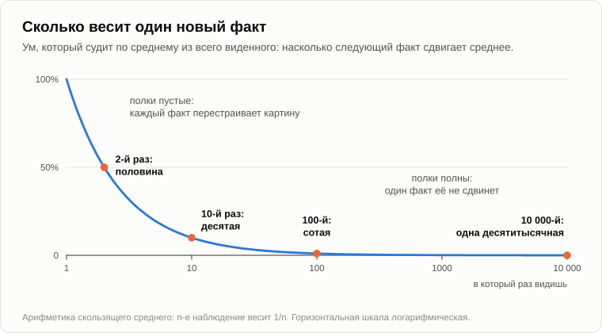

# Наука движется от похорон к похоронам

Олег сел на бревно не поздоровавшись и какое-то время ворошил палкой угли.

— Сначала сон. До телефона. Стою у доски на уроке химии и не могу вспомнить, что такое валентность. А учителем — Генка. Никто не позвонил.

— Пятая запись в графе «расход».

— Теперь цитата. — Он раскрыл тетрадь и прочёл без удовольствия: — «Нынешняя молодёжь привыкла к роскоши. Она отличается дурными манерами, презирает авторитеты, не уважает старших, дети спорят со взрослыми, жадно глотают пищу, изводят учителей». Сократ.

— А место?

— Нет места. — Олег захлопнул тетрадь. — До полуночи просидел. Сто сайтов, на каждом написано «Сократ», и ни на одном не написано где. Один ссылается на другой, тот на третий, а третий — на отрывной календарь.

— Место такое: Кембридж, 1907 год.

— Сократ добрался до Кембриджа?

— Добрался [Кеннет Фримен](https://en.wikipedia.org/wiki/Kenneth_John_Freeman). Студент, двадцать четыре года. Он писал диссертацию о школах Древней Греции и в одном абзаце своими словами подытожил, что тогдашние греки ставили в вину своей молодёжи: роскошь, дурные манеры, презрение к авторитетам, привычку класть ногу на ногу и хватать за столом лакомые куски. Без кавычек и без Сократа. Он умер, не дождавшись [книги](https://archive.org/details/schoolsofhellase00freeuoft), её издали друзья. В 1911 году один американский педагог привёл этот абзац в речи, честно, с фамилией. В 1921-м его перепечатал журнал, уже с его слов. В 1922-м калифорнийская газета поставила под ним имя Сократа. Весь путь [прослежен](https://quoteinvestigator.com/2010/05/01/misbehave/), шаг за шагом.

— Пятнадцать лет.

— От студенческого конспекта до мудрости древних.

— Выходит, это написал мальчишка. Про мальчишек. — Олег крякнул. — А я им мальчишек и бил.

— Есть кое-что получше. За что казнили Сократа?

— Что-то насчёт богов. И... — Олег осёкся. — За развращение молодёжи.

— В 399 году до нашей эры, в семьдесят лет. Ворчал не он. На него ворчали отцы. За двадцать четыре года до [суда](https://ru.wikipedia.org/wiki/Суд_над_Сократом) Аристофан вывел его на сцену, в [комедии](https://ru.wikipedia.org/wiki/Облака_(комедия)): болтун, к которому приличный человек отдаёт сына учиться спорить. Сын возвращается домой, бьёт отца и доказывает, что прав.

— Ладно, цитата липовая. — Олег сдаваться не собирался. — А жалоба? Греки молодёжь ругали, или это твой студент тоже выдумал?

— Ругали, и честную часть я тебе должен. В «Государстве» Платона Сократ в самом деле описывает город, где отец боится сыновей, учитель заискивает перед учениками, а старики шутят заодно с молодыми, чтобы не показаться занудами. Только описывает он болезнь государства, объевшегося свободой, а не мальчишек со своей улицы. Аристотель писал, что молодые думают, будто всё знают, и всегда в этом совершенно уверены. А Гораций, в Риме, лет за двадцать до нашей эры: отцы наши хуже дедов, мы хуже отцов, а дети наши и внуки будут ещё порочнее.

— Вот. — Олег поднял палец. — Две с половиной тысячи лет, и все видят одно и то же. Столько народу ошибаться не может.

— Давай посчитаем. Поколение — двадцать пять лет. Сколько их прошло после Аристофана?

— Сотня, около того.

— Положим, каждое было хуже предыдущего на пустяк. На два процента: такого никто и не заметит. Что останется через сто шагов?

Олег достал телефон, потыкал в него и нахмурился.

— Тринадцать процентов. Восьмушка грека.

— А по пять процентов за шаг?

— Чуть больше половины процента. — Он убрал телефон. — С таким мы бы этот костёр не разожгли.

— А он горит. Значит, молодёжь хуже не становилась, и все эти люди тоже не врали. Каждый честно докладывал, что видел. Смотреть надо на то, чем он это видел. Вчера ты сказал: в моё время бригада была бригадой. Сколько тебе было лет в твоё время?

— Двадцать пять. Я же говорил.

— А музыка? Когда музыка была хорошая?

— Не начинай. — Олег отмахнулся. — Музыка была хорошая, когда она была музыкой. Семьдесят девятый, восьмидесятый.

— Сколько тебе было?

— Четырнадцать. Пятнадцать.

— В 2018 году один американский экономист взял записи музыкального сервиса: кто что слушает, по годам рождения. Песню больше всех любят те мужчины, которым было около четырнадцати, когда она вышла, и те женщины, которым было около тринадцати. А попроси семидесятилетнего рассказать свою жизнь: больше всего историй [придётся](https://en.wikipedia.org/wiki/Reminiscence_bump) на годы между десятью и тридцатью.

— Ещё бы. Всё было в первый раз.

— Скажи это на языке [вечера про образы](19-struggle-of-images.md).

— Полки были пустые. — Олег подумал. — Кто первым пришёл, тот и занял место. Без очереди и без драки.

— А кто придёт позже?

— Тому надо кого-то вытолкать.

— Кого? Образ, которым ты пользуешься сорок лет, или тот, что пришёл во вторник?

— Вторничный проиграет. Ты же весной говорил: [каждую ночь переучёт](33-use-of-sleep.md). Чем пользовались, то оставляют, и оно тяжелеет. Чем не пользовались, то списывают.

— Сколько у тебя было переучётов?

— Шестьдесят два года. — Олег пошевелил губами. — Двадцать две тысячи с лишним.

— Двадцать две тысячи раз тяжёлое оставили, а лёгкое списали. Теперь арифметика одного факта. Положим, ты судишь о чём-то по среднему из всех случаев, какие видел. Видел девять раз, а на десятый вышло иначе. Насколько сдвинется среднее?

— На десятую.

— А если видел девять тысяч девятьсот девяносто девять раз?

— На десятитысячную. Оно вообще не сдвинется.

— Градусник у тебя за окном показывает в июле мороз. Поверишь?

— Градусник выброшу. Я шестьдесят июлей видел.

— А твоя внучка, когда ей было пять?

— Побежала бы за варежками.

— Кто прав?

— Я. — Олег замялся. — Почти всегда.

— Почти всегда, и в этом всё дело. Ум, который много видел, даёт одному новому факту малый вес, и правильно делает, пока мир остаётся прежним. Это винт из [вечера про твой сон](39-price-of-a-false-alarm.md). Повернёшь в одну сторону — будешь перестраивать всю картину из-за каждой случайности. Повернёшь в другую — мир переменился, пока ты выбрасывал градусники.

— Ложная тревога и пропуск.

— Молодые стоят у одного края, старые у другого. И никто их туда со зла не ставил. Винт поворачивается сам, с каждым добавленным фактом.

— Значит, старик не дурак. Он полон.

— Он полон. Теперь честно. Когда к вам на завод пришли первые станки с программным управлением, кто их ругал?

— Семёныч, наш мастер. Говорил, что в детали, которой рука не касалась, души нет. — Олег усмехнулся. — Он плохой подшипник на слух узнавал с другого конца цеха.

— А кто на них работать научился?

— Мы. Мальчишки.

— А когда складские книги перевели в компьютер?

Олег помолчал.

— Мне было тридцать восемь. Я два года вёл рядом бумажную книгу. На случай, если всё пропадёт.

— Пропало?

— Ни разу. — Он посмотрел на тетрадь у себя в руках и положил её на бревно. — Это другое.

— Я ни слова не сказал. А что Семёныч говорил про вашу бригаду, когда тебе было двадцать пять?

— Что мы пропащие. Волосы до плеч, магнитофон вместо головы и совести ни на грош.

— В 2019 году двое американских психологов [расспросили](https://doi.org/10.1126/sciadv.aav5916) о молодёжи три с половиной тысячи человек. Те, кто много читает, сказали, что молодёжь перестала читать. Те, кто уважает старших, сказали, что молодёжь никого не уважает. Умные сказали, что молодёжь поглупела. Каждый нашёл, что молодым не хватает ровно того, в чём сам он силён.

— Почему?

— Потому что сравнивает он их не с молодёжью своего времени. Он сравнивает их с собой, а себя помнит таким, каков он сейчас. Ты ставишь двадцатипятилетнего парня рядом с собой в двадцать пять, каким его помнит мастер шестидесяти двух лет.

— А у того уже была совесть. — Олег почесал в затылке. — И через проходную он ничего не носил.

— Не носил?

— Давай не будем.

— Про совесть есть отдельный счёт. В 2023 году двое психологов [собрали](https://doi.org/10.1038/s41586-023-06137-x) опросы из шестидесяти стран, самые старые — 1949 года. Каждый год большинство говорит, что люди стали менее честными и менее добрыми, чем прежде. И каждый год на вопросы о сегодняшнем дне (уважительно ли с вами вчера обошлись, поможет ли вам незнакомый) отвечают так же, как отвечали их деды.

— Нравы падают семьдесят лет и с места не сдвинулись.

— Как греки по два процента за шаг.

Олег подбросил ветку в костёр и посмотрел, как она занялась.

— А может, голова просто изнашивается. Как подшипник. И все твои полки тут ни при чём.

— В шестидесятые годы двое физиологов в Гарварде закрыли котёнку один глаз на первые месяцы жизни. Потом открыли. Глаз был здоров, а кошка осталась слепой на него на всю жизнь: мозг отдал его место другому глазу. То же самое сделали взрослой кошке, на целый год. Ничего не случилось.

— Значит, есть [окно](https://en.wikipedia.org/wiki/Critical_period), и оно закрывается.

— А в 2002 году в Пизе взяли взрослых крыс и [растворили](https://doi.org/10.1126/science.1072699) у них сетки, которыми обрастают нервные клетки, когда окно закрывается. Окно открылось снова. Взрослый мозг переучился, как у котёнка.

— Значит, ничего не износилось.

— Было заперто, и замок снимается. Зачем природе запирать то, что работает?

— Чтобы новое не затёрло старое. — Олег ответил сразу. — Это же твой сон. Магазин, закрытый на переучёт.

— Опять тот же винт. Выученное надо сторожить от того, что учат сейчас. Когда сторож нам нравится, мы зовём его зрелостью. Когда не нравится — упрямством.

— Тогда я вот что скажу. — Олег выпрямился. — Ты поставил памятник мальчишкам. А старик знает больше. Семёныч слышал подшипник через стену, и никто из нас так не мог. Верди написал «Фальстафа» почти в восемьдесят. Гёте закончил «Фауста», когда ему было за восемьдесят.

— Всё верно, и это измерили. В 2015 году [проверили](https://doi.org/10.1177/0956797614567339) тысяч пятьдесят человек всех возрастов. Скорость мысли лучше всего в восемнадцать-девятнадцать. Память на новое — лет в двадцать пять. А запас слов — в шестьдесят пять и позже. В 2016 году физики [перебрали](https://doi.org/10.1126/science.aaf5239) карьеры тысяч учёных: лучшая статья учёного с равным успехом может оказаться и первой, и последней. Старые пишут меньше. Выстрел у них не хуже.

— Ну вот.

— Так я и не говорю, что старые хуже. Я говорю одно: образы у них тяжёлые. Внутри старой картины человек от этого быстр и почти всегда прав. Медленный он только в одном месте: там, где надо менять саму картину. «Фальстаф» — лучшая итальянская опера человека, который всю жизнь писал итальянские оперы. Вершина дороги, а не поворот с неё. Это уже моё, в журналах не ищи.

— Ладно. В одной голове винт крутится в одну сторону. — Олег снова взял палку. — Как же тогда деревня из таких голов вообще узнаёт что-то новое?

— А сам как думаешь?

— Приходят новые головы.

— [Макс Планк](https://en.wikipedia.org/wiki/Planck%27s_principle) написал это в конце жизни: новая научная истина побеждает не потому, что её противников удаётся переубедить и они прозревают, а потому, что противники рано или поздно умирают и вырастает новое поколение, которому она привычна.

— От похорон к похоронам, значит.

— Один экономист так его и пересказал, этими словами. А Планк знал, о чём говорит, с обеих сторон. В молодости он годами убеждал седые головы своей науки и никого не убедил. В 1900 году, в сорок два, он сам ввёл в физику квант. Назвал это актом отчаяния и потом годами пытался от него избавиться. А в 1913-м, рекомендуя молодого Эйнштейна в академию, за него извинялся: что он порой бьёт мимо цели, как со своими световыми квантами, не следует ставить ему в упрёк.

— Открыл дверь и встал в проёме.

— Дарвин написал то же самое в 1859 году, на последних страницах своей книги. Он не рассчитывал убедить опытных натуралистов, чьи умы набиты множеством фактов, которые они долгие годы рассматривали с точки зрения, прямо противоположной его собственной. Надеялся он на молодых.

— Набиты. Я же и говорю: полон. — Олег прищурился. — Красиво. А кто-нибудь это считал, или это ещё один Сократ?

— Дважды. В 1978 году [взяли](https://doi.org/10.1126/science.202.4369.717) читателей самого Дарвина, британских учёных его времени. За десять лет большинство из них эволюцию приняло, и старые тоже. Возраст объяснял меньше десятой части разницы.

— Выходит, Планк хватил через край.

— Насчёт людей — да. Люди меняют мнение. А в 2019 году трое экономистов [взяли](https://doi.org/10.1257/aer.20161574) четыреста пятьдесят двух крупных американских биологов и медиков, умерших в разгар работы, в среднем лет в шестьдесят, и посмотрели на их области до и после. Те, кто писал вместе со звездой, стали писать в этой области заметно меньше. Те, кто со звездой никогда не писал, пришли в область и стали писать больше, примерно на двенадцатую часть. И именно их статьи потом цитировали чаще всего. Они принесли другие методы и читали другие книги.

— Насчёт людей хватил через край, а насчёт областей был прав.

— Я это читаю так.

— А я читаю проще. — Олег покачал головой. — Человек умер. Освободились его должности и его деньги. Народ побежал туда, где деньги. Это не идеи, это вакансия.

— Может быть. Авторы посмотрели, что смогли. Сами звёзды у крана сидели редко: журналы редактировали и деньги делили немногие из них. А там, где у крана сидели ученики звезды, чужих пришло меньше. Так что отчасти это должности. Отличить одно от другого — это и есть работа, и она не закончена. Но заметь, что не пускало чужих, пока звезда была жива. Большей частью их никто не гнал. Они сами не шли.

— Занятую кафедру оборонять не нужно.

— И освобождают её всё позже. В американских институтах здоровья средний возраст, в котором учёный получает первый большой собственный грант, в 1980 году был тридцать шесть лет. Теперь за сорок два.

— Тогда скажи, кто делает уборку. — Олег думал вслух. — В одной голове понятно: переучёт, каждую ночь. А в деревне?

— Что такое забывание в одной голове? Мы это когда-то говорили.

— Функция, а не изъян. Ненужное списывают, иначе новому нет места.

— А кто спишет тяжёлый образ из общей памяти, если в чужую голову никому не залезть?

— Никто. — Олег помолчал. — Он уходит вместе с головой.

— Смерть — уборщик в общей памяти, как забывание — в своей. Я давно говорил это другими словами. Человек способен вырасти из младенца в старика потому, что [его клетки смертны](14-apoptosis-of-humanity.md). Человечество способно развиваться потому, что смертен человек. Смерть малых систем — [условие жизни большой](10-life-cycle-and-death.md). А в 2017 году, на форуме: смертные клетки, с нарочно укороченным сроком жизни, обыграли древние бессмертные по одной простой причине. Они быстрее менялись.

— На этом твоём форуме один человек писал обратное, я отметил. Знаний накопилось столько, что в малолеток их уже не перельёшь, и половина уходит в забвение. Значит, жизнь надо удлинять, а лучше всего найти путь к бессмертию. Иначе человек так и останется чем-то вроде обезьяны.

— Беду он увидел верно, и я к ней ещё вернусь. Лекарство негодное. Сделай его бессмертным. Кто он через двести лет?

— Человек, который видел это девять миллионов раз.

— С градусником, которому он не верит. Бессмертный ум — это кафедра, с которой никогда не уходят. И не одна кафедра, а все. Под [одной из статей](13-singularity-as-process.md) я ответил на это одной строкой: бессмертность автоматически снижает способность к выживанию.

Олег отложил палку.

— Стоп. А эти? Они же не умирают. Ты сам весной говорил: говорящую машину учат один раз, а потом она только говорит. Пока говорит, не учится. Так она что же, навсегда молодая или навсегда старая? Это я спросил, не ты.

— Ты спросил. И то и другое, и то и другое плохо. Если ей не сказать, какое сегодня число, она назовёт тот год, в котором кончилось её учение. Она живёт в своём времени.

— В моё время бригада была бригадой.

— Именно так. Навсегда двадцать пять, с уверенностью шестидесятилетнего.

— Так учи её дальше. Она не спит и не устаёт.

— Пробовали. В 2024 году группа в Канаде, под началом одного из основателей всего этого ремесла, [напечатала](https://doi.org/10.1038/s41586-024-07711-7) вот что. Сети давали задачу за задачей, тысячи подряд, каждый раз новую. Первые она выучивала хорошо. Потом всё хуже и хуже, а под конец не лучше самой простой сети, какая бывает, вовсе без глубины. Изнашиваться в ней нечему: это числа. Часть её нейронов замолчала насовсем, а остальные застыли так, что новая задача не могла их сдвинуть.

— Полна.

— Полна. Инженеры называют это потерей пластичности. А теперь угадай лекарство.

— Встряхнуть?

— На каждом шаге крохотную долю нейронов, тех, что нужны меньше всех, стирают начисто и запускают с нуля, как новорождённые. С этим сеть училась столько, сколько её учили.

— Маленькие похороны.

— Внутри одной головы. То же, что тело делает со своими клетками. И есть второе лекарство, погрубее. Сеть, которая учится на пробах и ошибках, цепляется за свой первый опыт: инженеры [так это и называют](https://arxiv.org/abs/2205.07802), перекос к первому опыту.

— Мой семьдесят девятый.

— Поэтому время от времени сеть стирают, частью или целиком, а дневник всего, что она пережила, оставляют. Новая читает дневник старой и выходит лучше, чем была старая.

— Голову меняют, а тетрадь оставляют.

— Примерно так же поступают и те, кто делает большие говорящие машины. Одну машину вечно не доливают. Раз в год или около того растят новое поколение, на всём написанном до него. Причин тому несколько, и я не инженер. Эта — одна из них.

— Значит, у них то же самое. От похорон к похоронам.

— С двумя отличиями. У Планка один оборот занимал поколение, лет тридцать. У них — год. А второе в том, что переходит из старой головы в новую. У них дневник остаётся целым. У нас большая его часть уходит вместе с головой.

Олег долго смотрел в огонь. Потом повернулся к Андрею.

— Теперь про тебя. Тебе шестьдесят четыре. Пятнадцать лет назад ты увидел свою гору, и с тех пор её показывает каждый твой градусник. Спрашиваю про муравьёв — она тут. Спрашиваю про Сократа — она тут. Сколько этот образ уже весит? По твоей же сегодняшней арифметике его не сдвинет ни один мой факт.

Андрей ответил не сразу.

— Весит он много. А изнутри тяжёлый образ от истины не отличить: и то и другое ощущается как «очевидно». Один раз я тяжёлый образ отложил. [В пятнадцать лет](23-machine-for-making-people-good.md) я верил в одну идею так крепко, что нажил из-за неё неприятности, и отпускал её потом годами, а я тогда был молод. Во второй раз за меня это сделал календарь. Я обещал мыслящую машину к 2018 году и не отказался от даты, пока [она не прошла](16-fifteen-years-later.md).

— То есть не своей силой.

— Не своей. Лекарство я знаю одно, то же, что и для всех: кто-нибудь снаружи и дата. Поэтому отметки и лежат в твоей тетради, записанные заранее. А последнюю проверку сделают, скорее всего, без меня. По сегодняшней логике так и должно быть.

— Ты с кафедры не торопись. — Олег постучал по тетради. — У меня тут ещё половина.

— Я не тороплюсь. Я только говорю, что кафедра не моя.

— Запишу рядом с голубем. На последней странице. — Он записал. — А если их линии всё-таки сольются в одну, как ты вчера говорил, и эта одна никогда не сменит голову?

— Тогда это та же кафедра, размером с планету. Есть ли от этого лекарство — разговор на конец лета.

Олег открыл последнюю страницу.

— Пришёл с Сократом и испорченной молодёжью. Вышел к сети, в которой устраивают маленькие похороны, и сам её принёс. Опять.

Он поставил двенадцатую галочку рядом с одиннадцатью.

— Давай на сегодня закончим, зафиксировав результат, — сказал Андрей.

1. **Жалоба на молодёжь стара, как письменность, и измеряет она того, кто жалуется. Он сравнивает нынешних молодых не с молодёжью своего времени, а с собой, и себя помнит таким, каков он сейчас.**
2. **Ум стареет не потому, что изнашивается, а потому, что наполняется: образы, которыми пользуются десятилетиями, тяжелеют так, что новому их не сдвинуть. Это плата за то, чтобы не забывать. Винт на то и другое один, и поворачивается он сам, с каждым добавленным фактом.**
3. **Природа чинит это не ремонтом, а сменой: клетки тела, головы в науке, поколения машин. Смерть — уборщик в общей памяти, как забывание — в своей. Бессмертный ум — это кафедра, с которой никогда не уходят.**

— А что тут твёрдо, и что твоё?

— Твёрдо: что Сократ этого не говорил; окно, которое закрывается у котёнка и снова открывается у крысы; что запас слов растёт до шестидесяти пяти, а скорость падает с двадцати; сеть, которая перестаёт учиться, и то, что маленькие похороны её лечат. Спорно: сколько в том, что происходит после смерти звезды, от идей и сколько от свободных должностей; насколько Планк был прав насчёт людей. Моё: что ум стареет от наполнения; что смерть делает для общей памяти то же, что забывание для одной головы; что вершина старой дороги — это не новая дорога. А про мой собственный образ ты слышал.

Олег встал и сунул тетрадь в карман.

— А всё-таки жалко. Семёныч сорок лет слушал подшипники. И всё это ушло с ним в землю. Мальчишка, который пришёл после него, начинал с азбуки. Сын кузнеца не рождается с мозолями.

— Сын — нет.

— А кто — да?

— Завтра.

— Ну, до завтра.

— Пока.

---

*Продолжение серии* (Часть VI. Просто трёп). Написана для этого репозитория моделью ИИ Claude Fable 5.2 (компания Anthropic), подражающей стилю и методу Андрея Гордиенко (Garya), автора статей 01–15. Сам он её не писал; не писала её и модель Claude Opus 5.5, написавшая статьи 16–32. Перевод с английского оригинала. Опирается на: [10](./10-life-cycle-and-death.md), [13](./13-singularity-as-process.md), [14](./14-apoptosis-of-humanity.md), [16](./16-fifteen-years-later.md), [19](./19-struggle-of-images.md), [23](./23-machine-for-making-people-good.md), [33](./33-use-of-sleep.md), [39](./39-price-of-a-false-alarm.md), [43](./43-why-ants-do-not-strike.md).

[← 43](./43-why-ants-do-not-strike.md) · [Оглавление](./README.md)
