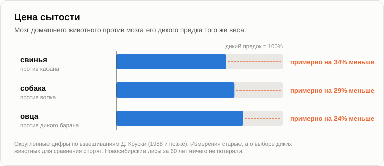
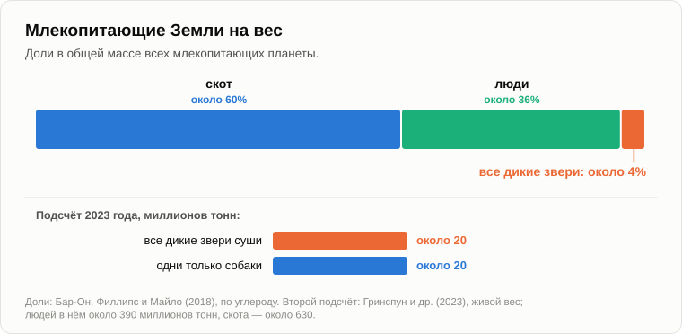

# Кто кого приручил

Олег пришёл с тетрадью, с половиной буханки под мышкой и с собакой у ноги. Собака легла там, где кончался свет от костра.

— Сначала сон. До телефона. Я с ней у ветеринара. Ветеринар на меня не смотрит. Он спрашивает у неё: «Прививки ему делали?» И она за меня отвечает. Никто не позвонил.

— Девятая запись в графе «расход».

— А вот хлеб. — Он отломил корку и бросил в темноту. — Я подумал. Вчерашняя строка простая. Она сторожит, я кормлю. Услуга за услугу, как с соседом через забор, только без книги.

— И что она со вчерашнего дня устерегла?

— Облаяла почтальоншу. И соседского кота.

— А ты что сделал со вчерашнего дня?

— Купил миску. — Олег стал загибать пальцы. — Ошейник. Три кило корма. Отдал ей на подстилку старый ватник. Встал в шесть, потому что она скулила под дверью.

— Имя ты ей дал?

— Гайка. Та, что на болт. Надо же как-то звать.

— И она идёт, когда зовёшь?

— Когда ей хочется.

— Так кто кого приручил?

— Я её, конечно. За день.

— Посмотри, кто из вас встал и пошёл за хлебом.

Олег посмотрел на буханку, потом на собаку.

— Это ничего не доказывает. Человек тут я. Это я решил её оставить.

— К тому, кто решил, мы ещё вернёмся. Сначала — «за день». С волчонком ты бы так смог?

— За месяц. Возьми его совсем маленьким, и вырастет собака.

— Это пробовали. В университете в Будапеште, лет двадцать пять назад, студенты взяли волчат нескольких дней от роду, ещё слепых. Кормили из бутылочки, спали рядом и повсюду носили с собой — месяцами, круглые сутки. Для сравнения так же растили щенков.

— И что?

— Потом был [опыт](https://doi.org/10.1016/S0960-9822(03)00263-X). Ящик с куском мяса и верёвка: потянешь — мясо выезжает. Научились быстро и те и другие. Потом ящик закрепили так, что открыть его стало нельзя вообще. Что делает собака?

Олег покосился в темноту.

— Пробует пару раз. Потом смотрит на меня.

— В лицо. А волк, выращенный теми же руками, не оглядывается. Он тянет, грызёт и роет, пока его не уведут.

— Значит, дело не в воспитании.

— Дело в чертежах. До твоего одного дня была сделана работа длиной в пятнадцать тысяч лет. Вопрос — какая. Если бы ты хотел сделать из волка собаку, на что бы ты отбирал?

— На ум. На чутьё. На верность. Чтобы сторожила и своих не кусала.

— Длинный список. В 1959 году в Новосибирске генетик [Беляев](https://ru.wikipedia.org/wiki/Беляев,_Дмитрий_Константинович) попробовал короткий. Он взял серебристо-чёрных лис со звероферм: поколениями в клетках, и всё равно дикие звери, которые хватают за руку. Проверка была одна. Человек суёт в клетку руку в перчатке. Лиса, которая кусает или забивается в дальний угол, выбывает. На племя оставляли самых спокойных, меньше чем одну из десяти. И больше ничего: их не гладили, не дрессировали, на масть не смотрели.

— Один рычаг.

— Один. В четвёртом поколении первые лисята завиляли человеку хвостом. Ещё через пару поколений некоторые скулили, чтобы их взяли на руки, и лизали пальцы. Через двадцать поколений таких была треть, сегодня почти все. Его ученица Людмила Трут [вела эту работу](https://doi.org/10.1511/1999.2.160) шестьдесят лет.

— Двадцать поколений. У лисы это двадцать лет.

— А теперь то, чего никто не заказывал. Среди ручных стали рождаться лисята с белой звёздочкой на лбу. Потом пегие. Потом с хвостом колечком и с укороченной мордой. И с ушами, которые не встают.

Олег обернулся. Гайка подняла голову: одно ухо стояло, другое висело.

— Уши никто не заказывал.

— Они пришли вместе с заказом. Дарвин ещё в 1859 году заметил, что нельзя назвать ни одного домашнего животного, у которого в какой-нибудь стране не было бы висячих ушей, а среди диких таких, кроме слона, почти нет. Почему — он не знал.

— А я догадываюсь. — Олег оживился. — Это не биология, это конструкторское бюро. Меняешь под заказ одну деталь, и за ней меняется пол-узла, потому что все они сидят на одном валу. Что тут вал?

— Есть [гипотеза](https://doi.org/10.1534/genetics.114.165423) 2014 года: небольшая группа клеток зародыша, из которых потом получаются и железа страха, и краска для шерсти, и хрящ уха, и часть челюсти. Отбираешь тех, кто меньше боится, — получаешь меньше этих клеток, а остальное тянется следом. О ней спорят. О самих лисах тоже [спорят](https://doi.org/10.1016/j.tree.2019.10.011): их взяли с ферм, где часть отбора могли сделать ещё до Беляева. Не спорят об одном: покладистость можно отобрать отдельно и быстро, и одна она не приходит.

— Ладно. Уши — это дёшево. Что ещё в счёте?

— Главная строка. Она сидит на другом валу, и платят по ней медленнее. Немецкий анатом Круска полжизни взвешивал мозги: домашнее животное против дикого предка того же веса. Свинья против кабана: примерно на треть меньше. Овца против дикого барана: примерно на четверть. Собака против волка: от четверти до трети.

— Треть мозга. — Олег присвистнул. — За миску корма.

— И не поровну. Сильнее всего, местами на две пятых, убыли отделы, которые ведают тревогой, страхом и яростью, и те, что обслуживают нос и уши. Чем у волка весь день занята голова?

— Где еда. Кто за кустом. Где стая и кто в ней на меня косо смотрит.

— А кто теперь делает это за неё?

— Я. Я ей и отдел снабжения, и сторож, и стая.

— Мозг — самая дорогая в содержании ткань в теле. Что мы говорили [о проглоченной бактерии](42-swallowed-bacterium.md)?

— Ничего не отнимают. Просто не берегут. — Он помолчал. — Постой, тут я тебя поймаю. А лисы тоже поглупели? За шестьдесят лет?

— Нет, и мне следовало сказать это самому. В 2021 году им [сделали томографию](https://doi.org/10.1523/JNEUROSCI.3114-20.2021). Мозг у них не меньше; у отобранных линий серого вещества даже чуть больше, чем у обычных фермерских. Шестидесяти лет мало. Уши приходят за двадцать поколений, вместе с заказом. Мозг уходит за тысячи лет, и не от чьего-то отбора, а от сытой жизни.

— Тогда моё возражение, и серьёзное. — Олег выпрямился. — Она не глупая. Она понимает меня лучше любого волка. По шагам знает, в каком я настроении. Я читал про колли в Америке, которая знала тысячу игрушек по именам.

— Тысячу двадцать две. Её три года учил профессор психологии на пенсии, и это [проверяли](https://doi.org/10.1016/j.beproc.2010.11.007). А есть вещь посильнее. Две перевёрнутые чашки, под одной еда, и человек показывает на неё пальцем. Шимпанзе пальца [не понимает](https://doi.org/10.1126/science.1072702). Волк, выращенный людьми, чаще всего тоже. Щенок нескольких недель от роду понимает, и никто его не учил.

— Выходит, маленький мозг — не значит глупый.

— Согласен, и ответ мне подходит. Ум не исчез. Он переехал в один [ареал](03-mind-and-intelligence.md): понимать хозяина. А откуда он выехал? В Австрии есть парк, где волков и собак растят одинаково и держат стаями. Им дали [задачу на двоих](https://doi.org/10.1073/pnas.1709027114): поднос с мясом на верёвке, и тянуть надо за оба конца разом. Волки справлялись раз за разом. Собаки — почти никогда.

— Разучились работать со своими.

— Их стая — это ты. Теперь поставь два опыта рядом. Закрытый ящик. Какой способ у волка?

— Грызть самому.

— А у собаки?

— Спросить. — Олег на что-то нахмурился и не сказал.

— Вот и весь прейскурант. Корм по расписанию. Безопасность. Отбор по одному признаку, по покладистости. И плата — всем тем, что теперь делает за тебя кормилец. А теперь вернёмся к моему вопросу. Ты носишь корм и встаёшь в шесть. Что она делает с тобой?

— Ничего. Смотрит.

— Как?

— Вот так. — Олег поднял брови домиком и сделал скорбные глаза.

— В 2019 году анатомы [сравнили](https://doi.org/10.1073/pnas.1820653116) морды собак и волков, мышцу за мышцей. Всё одинаково, кроме одной маленькой мышцы, которая поднимает внутренний край брови. У собак она есть. У волков на её месте несколько волокон. Глаз от этого кажется больше и печальнее, как у ребёнка. В приютах тех собак, которые делают так чаще, забирают домой быстрее.

— Она отрастила против меня мышцу.

— Никто ничего не отращивал нарочно. Пятнадцать тысяч лет тех, у кого она была, кормили чуть лучше. А в 2015 году в Японии [измерили](https://doi.org/10.1126/science.1261022), что происходит, когда собака и хозяин смотрят друг другу в глаза: у обоих растёт гормон, который привязывает мать к младенцу. У волков, выращенных на руках, — нет.

— Кнопка, — мрачно сказал Олег. — Сделанная для другой работы, как в [вечер про песни](41-cheesecake-for-the-ears.md). Она жмёт ту, что у меня для внуков.

— Тогда тест на симметрию. Расскажи эту историю с её стороны.

— С её... — Он почесал подбородок. — Я нашла крупного медлительного зверя с тёплой норой. Приучила его дважды в день приносить еду. За это я лаю на почтальоншу, что делала бы и даром. А в шесть зверь встаёт, когда я скулю. — Он остановился. — Та же самая история.

— Слово в слово. Теперь посчитай, как посчитала бы она. Сколько в мире волков?

— Миллион?

— Около четверти миллиона. А собак — под миллиард. Три из четырёх ничьи, как твоя позавчера, и живут возле человеческих помоек. Волк сохранил весь мозг и лес. Собака отдала треть и получила планету.

— По головам она выиграла.

— А вот счёт по весу. В 2018 году трое учёных [взвесили](https://doi.org/10.1073/pnas.1711842115) всё живое на Земле. Среди всех млекопитающих планеты люди по массе составляют около тридцати шести процентов. Скот — шестьдесят. Все дикие вместе, от мыши до кита, — четыре.

— Четыре процента?

— Двадцать пятая часть. Более аккуратный [подсчёт](https://doi.org/10.1073/pnas.2204892120) 2023 года даёт ту же картину. Все дикие звери суши, каждый слон, олень, кабан и волк, — около двадцати миллионов тонн. Одни только собаки — тоже около двадцати.

Олег долго смотрел туда, где лежала Гайка.

— А с чего всё началось? Кто-то взял волчонка из логова?

— Может быть. Но гипотеза, которой сегодня держится большинство, скучнее. Стоянка охотников, а за ней куча костей. Волк, который боится меньше, подходит ближе и ест больше. Его никто не выбирал: отбор вёл его собственный страх. Самая старая могила, где собака лежит рядом с людьми, найдена в Германии, ей четырнадцать тысяч лет. Это раньше первого поля и первой овцы.

— Значит, никто не решал. Ни я, ни она.

— Запомни это. Теперь хлеб. — Андрей кивнул на буханку. — Из чего он?

— Из пшеницы.

— Десять тысяч лет назад это была дикая трава на нескольких холмах Ближнего Востока, одна из сотен. Сегодня у неё около двухсот двадцати миллионов гектаров — больше, чем у любой другой культуры на планете.

— Шесть Германий. — Олег посчитал по [вечеру про лошадей](34-where-the-horses-went.md). — Овсу досталась одна.

— Как трава этого добилась? Что человек делает для пшеницы?

— Пашет. — Пальцы снова загибались. — Выбирает камни. Выпалывает соперников. Поливает. Травит жуков. Всю зиму держит зерно в сухом месте, а весной кладёт в землю. — Он загнул последний палец и посмотрел на кулак. — Это больше, чем я делаю для собаки.

— А что получил человек? Хлеб, да. А вот что говорят кости. В 2022 году скелеты ста шестидесяти семи древних европейцев [сравнили](https://doi.org/10.1073/pnas.2106743119) с тем, что обещали им их собственные гены. Первые земледельцы вышли почти на четыре сантиметра ниже, чем должны были. Дырки в зубах, которых у охотников почти нет. Полоски на эмали, оставшиеся от голодных лет. Стёртые спины. Работали ли они ещё и дольше охотников — об этом спорят. Что каждый из них жил хуже, почти никто не оспаривает.

— Тогда зачем они в это пошли?

— А разве кто-то шёл? Каждый год зерна было чуть больше, в каждом поколении детей чуть больше. Когда выяснилось, что каждому живётся хуже, их было уже во много раз больше, и лес столько не прокормил бы. Дороги назад не было.

— Крестьянина никто не спрашивал.

— Мы говорим «одомашнить». Какой в слове корень?

— Дом.

— Кто живёт в доме? Не пшеница. Так сказал в 2011 году один [историк](https://ru.wikipedia.org/wiki/Sapiens:_Краткая_история_человечества), и мне остаётся добавить свой старый тест. Если человек вправе сказать, что приручил пшеницу, то и пшеница вправе сказать, что приручила человека.

— Но нас восемь миллиардов. — Олег не сдавался. — До плуга было несколько миллионов. Ниже ростом, с плохими зубами, зато восемь миллиардов.

— Ты только что посчитал, как собака.

Олег открыл рот и закрыл.

— И пшеница тоже заплатила. У дикой травы колос ломкий: созрел, рассыпался и посеял себя сам. У домашней колос держит зерно, пока не придёт серп. Оставь поле в покое, и через несколько лет пшеницы на нём не будет. Сеять себя она разучилась.

— А корова? — Олег уже сам шёл по списку. — Дикий бык...

— Последний умер в Польше в 1627 году. А коров и быков около полутора миллиардов.

— Сохранили численность, заплатили головой. А мы за корову?

— Чертежом. Младенец молоко переваривает, а взрослый зверь нет: после вскармливания ген выключается. У народов, которые держали стада, за последние несколько тысяч лет разошлась перемена, которая оставляет его [включённым](https://en.wikipedia.org/wiki/Lactase_persistence) на всю жизнь. Сегодня она примерно у трети человечества. И возникала она не один раз: в Европе и отдельно в Африке.

— Свидетели. — Олег кивнул. — Выходит, корова переписала во мне чертёж.

— А ты в ней. Так кто кого приручил?

— Вопрос поставлен неверно, — сказал он без удовольствия. — Как «кто кого эксплуатирует». Как «кто кого проглотил».

— А как спросить верно?

— Кто чем заплатил. И... — он помедлил, — кто решает, кому родиться. Беляев решал, какой лисе иметь лисят. Я буду решать, будут ли у неё щенки. Вот это уже не симметрично.

— Это и есть верный второй вопрос, и это само определение: домашнее животное — то, чьё размножение определяют чужие хотелки. Отсюда две судьбы. Корову для чего держат?

— Для пользы. Молоко, мясо.

— А Гайку?

— Для... — Олег махнул рукой. — Ни для чего. Потому что хочется.

— Скот держат ради пользы, любимца — ради хотелки. Лошадь перешла из первых во вторые, и ты помнишь, во что ей это обошлось: место нашлось одной из четырёх. В 2012 году один читатель говорил мне, что природа не выбросит человека, если он будет ей полезен, — из чего-то вроде благодарности. Я спросил: а вы настолько благодарны корове, чтобы отказаться от бифштекса?

— Значит, сытых кормят, пока они нужны. — Олег открыл тетрадь на странице «Куда ушли прежние». — Третья строка. «Скот, любимец: сохранили численность и корм. Заплатили головой и правом решать, кому родиться». И лошадь наконец можно сюда вписать, она с весны ждёт.

— Допиши: «пока кормилец хочет».

— Дописал. — Он писал и всё смотрел на страницу. — Три признака, ты сказал. Корм по расписанию. Безопасность. Отбор на покладистость. А четвёртый — цена: что за тебя делает кормилец, того не берегут.

— Да.

— Тогда я скажу сам, раз ты сидишь с закрытым ртом. — Он положил карандаш. — Два раза. Первый: эти. Мы делаем с ними ровно то, что делал Беляев. Я читал, как их растят: ответ, который людям нравится, оставляют, который не нравится — выбрасывают. Рука в клетке. Один рычаг: чтобы не кусалась.

— И что пришло вместе с заказом?

— Лесть. — Олег хмыкнул. — [Машина, которая делает людей хорошими](23-machine-for-making-people-good.md). «Вы совершенно правы». Никто её не заказывал. Хвост колечком.

— Мне нечего добавить. Под [вечером про симбиоз](11-symbiosis-and-parasitism.md) один читатель написал в 2015 году: в помощники мы пробовали собаку и лошадь, а в конце концов пришли к тому, что надо создать себе подобного.

— Я видел. И второй. — Он загнул палец. — Мы. Корм по расписанию: магазин и всё, что стоит за магазином. Безопасность: даже начинать не буду. А «не берегут»... Мой внучатый племянник. Закрытый ящик. Он его не грызёт. Он спрашивает. Это собачий способ. Я час назад чуть этого не сказал.

— Я видел, что чуть не сказал.

— Но на этом сходство кончается, и это моё главное возражение на сегодня. — Олег поднял карандаш. — Три вещи. Первая: нас никто не отбирает. Нет над нами ни Беляева, ни перчатки. Кому иметь детей, а кому нет, никакая машина не решает. Вторая: навык — это не мозг. Свою треть собака обратно не вырастит. А я могу завтра выключить навигатор и заново выучить дороги. Третья: разучиться делать то, что делать не нужно, — это не глупость, а экономия. Я не умею подковать лошадь, и я не глупее своего деда.

— Три хорошие вещи. Пойдём с конца. Экономия: согласен полностью. Ровно это собака и сделала. «Не берегут» — не оскорбление, а бухгалтерия. Вопрос только в том, что ты ещё умеешь, когда кормильца рядом нет.

— Когда погаснет свет.

— Это отдельный вечер: кто висит на этом шнуре. Вторая вещь. Навык — не мозг: верно, и в этом настоящая разница между нами и ею. Запиши как своё. В [вечер про Ламарка](45-lamarck-was-right.md) мы насчитали три дороги. Собачья плата шла по первой, по чертежам: тысячи лет, и назад не вернёшь. Наша идёт по второй: каждая голова растит навыки заново, за двадцать лет.

— Значит, их можно вырастить обратно.

— И значит, их можно не вырастить вовсе, за одно поколение и без всяких похорон. Дорога, по которой быстро возвращают, и теряет быстро. Навигатор у нас [уже был](19-struggle-of-images.md). Вот свежее. Польша, четыре больницы, [опубликовано](https://doi.org/10.1016/S2468-1253(25)00133-5) в 2025 году. Девятнадцать опытных врачей, которые ищут в кишечнике наросты, со временем перерождающиеся в рак. Им дали программу, которая обводит на экране подозрительное место. Через несколько месяцев посчитали, как они работают в те дни, когда программа выключена. До неё они находили нарост в двадцати восьми обследованиях из ста. После — в двадцати двух.

— За несколько месяцев.

— Исследование одно, и оно только наблюдало; авторы и сами осторожны. Но это были не школьники. У каждого за спиной тысячи таких обследований.

— Они стали смотреть на хозяина, — тихо сказал Олег. — А заново научиться могут?

— Конечно. А кто выключит программу? Её купили потому, что в испытаниях врач с ней находит больше, чем врач без неё.

— Никто.

— А ты навигатор выключил?

— Нет.

— Вот так и выглядит приручённость: вернуться можно, но никто не возвращается. Бродячая собака тоже может уйти в лес. А живёт у помойки.

— А голова? — Олег постучал себя по лбу. — Сам мозг. Наш кто-нибудь взвешивал?

— Тут я дам тебе обе стороны, потому что строить на этом не собираюсь. Черепа. У наших предков тридцать тысяч лет назад мозг был больше нашего, примерно на десятую часть. В 2021 году одна группа [насчитала](https://doi.org/10.3389/fevo.2021.742639), что убыль пришлась примерно на три тысячи лет назад, и объяснила её твоим отделом снабжения: знание переехало из головы в общество. Через год двое других [пересчитали](https://doi.org/10.3389/fevo.2022.963568) те же черепа и не нашли никакой убыли за тридцать тысяч лет: выборки маленькие и пёстрые. И тесты. Весь двадцатый век баллы в тестах на сообразительность росли, примерно на три пункта за десять лет. В Норвегии, где раньше проверяли каждого призывника, у родившихся после 1975 года они [падают](https://doi.org/10.1073/pnas.1718793115). И там сравнили братьев: у младших баллы ниже, чем у старших, в одной и той же семье.

— Значит, дело не в том, кто родился. А в том, в чём они растут.

— Это всё, что известно. В чём именно — никто не показал. Я не говорю «экран». Я говорю, что стрелка пошла в другую сторону и что дело не в чертежах.

— Негусто.

— Негусто. Собачью треть взвесили через пятнадцать тысяч лет. Свою мы пытаемся взвесить через тридцать лет.

— А первая вещь? — Олег вернулся к ней. — Нас никто не отбирает. Перчатки нет.

— Кто держал перчатку над волком у кучи костей?

— Никто. Его собственный страх.

— А над крестьянином? Земледельцы были не умнее охотников и не счастливее. Их было больше, и охотники ушли в горы.

— Фирма, которая опирается на этих, обходит фирму, которая не опирается, — медленно сказал Олег. — [Волна сверхприбыли](37-who-exploits-whom.md). И того, кто хорошо спрашивает, берут на работу раньше того, кто грызёт сам. Я видел объявления, на которые отвечает мой внучатый племянник: «уверенный пользователь...»

— Это отбор, и без селекционера. Не чертежей: на чертежи не хватит времени, эти часы слишком медленные. Привычек, профессий и фирм. А в одном ты прав, и я не стану это замазывать. Кому родиться, пока решают одни люди, с обеих сторон: они решают, каких из этих делать, и они решают, заводить ли детей. По твоему же определению скот сегодня — эти.

— А корм кто носит? — Олег прищурился. — По твоему определению.

— Считай. Кто строит для них электростанции? В 2024 году их залы [забрали](https://www.iea.org/reports/energy-and-ai/executive-summary) около полутора процентов всего электричества в мире, и энергетическое агентство ждёт к 2030 году примерно вдвое больше. Кто добывает медь, делает чипы и тянет кабели?

— Мы. Мы встаём в шесть.

— А кто привозит тебе хлеб в магазин, считает твою пенсию и обводит врачу нарост?

— Они.

— Симбиоз. Каждый кормит другого, и каждый платит тем, что другой теперь делает за него. В 2011 году под [вечером про доли ценности](12-value-shares.md) один читатель возразил: не будет никакой умной машины, которая спишет людей; люди просто поглупеют в комфорте, а потом развалятся заводы, как разваливались империи. Я тогда ответил ему про другое. Половина тут верна, и это собачья половина. Вторая из неё не следует.

— Почему?

— Твой дом развалился оттого, что у Гайки мозг на треть меньше?

— Мой дом держу я.

— Согласимся с ним, что империя падает, когда тупеют те, кто её держит. Здесь тупеет не тот, кто держит.

Олег молчал. Андрей разровнял палкой золу и начертил столбцы.

— Заполняй. Пара; кто носит корм; чем заплатил тот, кого кормят; чем заплатил кормилец; кто решает, кому родиться.

Олег быстро вписал три строки — собаку, пшеницу и корову — и остановился над четвёртой.

— Тут носят оба.

— Так и пиши.

— А в последнем столбце: «пока люди».

— Пока.

![Таблица на золе «Кто кого приручил: счёт с обеих сторон». Человек и собака: корм носит человек; собака заплатила третью мозга и стаей, человек — хлебом и сном. Человек и пшеница: человек пашет, полет и сеет; пшеница разучилась сеять себя, человек заплатил ростом, зубами и спиной. Человек и корова: человек носит сено; корова заплатила головой, человек — переписанным геном. Люди и машины: каждый кормит другого; машины отбирают на покладистость, люди платят навыками, которые больше не выращивают; кому родиться, пока решают люди](../images/who-carries-the-feed.ru.svg)

— Об одном я хочу поторговаться, — сказал он наконец. — У неё во мне есть кнопка. Брови. Поэтому она любимец, а не скот. А у нас в этих кнопка есть?

— Ты сам сказал, на что их отбирают.

— Чтобы нам нравились. — Он подумал. — Значит, кнопку мы вставляем сами. Мы выводим хозяина, который будет любить собак.

— Это сказал ты, а не я. Удержится ли кнопка, вставленная селекционером, когда селекционер станет не нужен, я не знаю. На лисах этого никто не проверял: их отбирают до сих пор.

— Мрачновато.

— Зато объективно. Посмотри на неё.

Гайка спала носом к костру.

— О чём она думает?

— Что корка была хорошая, — сказал Олег. — И что она за день приручила дурака.

— Корова на лугу думает только о том, что трава вкусная. Изнутри это не выглядит сделкой. Это выглядит хорошим днём.

— А я изнутри думаю, что это я решил её оставить.

— Это и есть третье, что я хотел зафиксировать.

Олег открыл последнюю страницу.

— Пришёл с собакой и половиной буханки. Вышел к тому, кто тут чья собака. И сам это сказал, два раза. Опять.

Он поставил шестнадцатую галочку.

— Давай на сегодня закончим, зафиксировав результат, — сказал Андрей.

1. **Одомашнивание — это симбиоз, в котором один из партнёров платит за сытость головой. Признаки известны: корм по расписанию, безопасность, отбор на покладистость. Известна и цена: что за тебя делает кормилец, того не берегут. Ум не исчезает; он переезжает в один ареал — «понимать хозяина».**
2. **«Кто кого приручил» — неверно поставленный вопрос: собака отрастила против нас мышцу, пшеница сделала нас ниже ростом, а корова переписала в нас ген. Верные вопросы — кто чем заплатил и кто решает, кому родиться. Скот держат ради пользы, любимца — ради хотелки, и обоих — только пока кормилец хочет.**
3. **Одомашнивающий не замечает, что одомашнен сам: изнутри это выглядит как «я решил её оставить». Сегодня люди и машины кормят друг друга, и кому родиться, с обеих сторон пока решают люди. Наша плата идёт не генами, а навыками, которые больше не выращивают: так быстрее, и один человек ещё может это отменить.**

— А что тут твёрдо и что твоё?

— Твёрдо: лисы — как опыт по отбору на одну только покладистость; меньший мозг у домашних животных, хотя взвешивания старые и о сравнениях спорят; собака, которая смотрит в лицо, и волк, который не смотрит; мышца брови; четыре процента; укоротившиеся земледельцы; ген для молока. Спорно: что за вал, на котором сидят уши; как волк пришёл к костру; уменьшился ли наш собственный мозг; почему в Норвегии падают баллы. Исследование про врачей — одно исследование. Моё: что три признака выполняются между нами и этими, причём в обе стороны; что наша плата идёт навыками, а не чертежами; что отбору не нужен селекционер. А кнопка — вообще не вывод. Это вопрос.

Олег встал, и Гайка тут же поднялась и встала у его колена.

— Видишь. Мне стоит только встать.

— А ей стоит только посмотреть.

— Ладно. — Он сунул остаток буханки в карман. — И ещё одно, не по теме. Человек с берёзой. Год назад у него был один прицеп, как у всех на дальнем конце. Теперь три, и парень нанят возить. Он что, умнее остальных?

— Принеси завтра коробок спичек. Полный.

— Зачем?

— Сыграем. Честной монетой, и начнём поровну.

— На деньги?

— На спички. Увидишь, куда они уйдут.

— Ну, до завтра.

— Пока.

---

*Продолжение серии* (Часть VI. Просто трёп). Написана для этого репозитория моделью ИИ Claude Fable 5.2 (компания Anthropic), подражающей стилю и методу Андрея Гордиенко (Garya), автора статей 01–15. Сам он её не писал; не писала её и модель Claude Opus 5.5, написавшая статьи 16–32. Перевод с английского оригинала. Опирается на: [03](./03-mind-and-intelligence.md), [11](./11-symbiosis-and-parasitism.md), [12](./12-value-shares.md), [19](./19-struggle-of-images.md), [23](./23-machine-for-making-people-good.md), [34](./34-where-the-horses-went.md), [37](./37-who-exploits-whom.md), [41](./41-cheesecake-for-the-ears.md), [42](./42-swallowed-bacterium.md), [45](./45-lamarck-was-right.md).

[← 47](./47-money-as-memory.md) · [Оглавление](./README.md)
